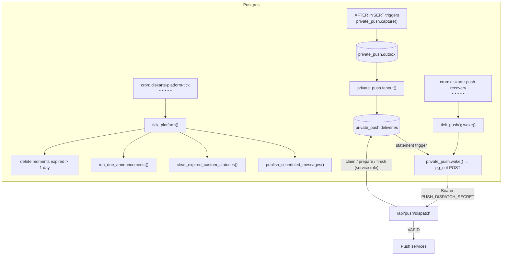

# Background processing

Diskarte has no worker processes or queues outside Postgres. Background work is either:

- **plain SQL run every minute by `pg_cron`** (optional; installed by hand), or
- **a database outbox drained over HTTP** (Web Push only), woken by `pg_net`.

Both are installed by SQL files kept **outside** `supabase/migrations/` because they depend on
hosted-only extensions (`pg_cron`, `pg_net`, Vault) and production secrets. Migrations stay portable
(they run unmodified in PGlite and CI's local Supabase).



## Platform tick

Installed by [`diskarte/docs/sql/enable-platform-jobs.sql`](../../diskarte/docs/sql/enable-platform-jobs.sql):

```sql
create extension if not exists pg_cron;
select cron.schedule('diskarte-platform-tick', '* * * * *', $$select public.tick_platform();$$);
-- Check: select jobname, active from cron.job where jobname = 'diskarte-platform-tick';
-- Undo:  select cron.unschedule('diskarte-platform-tick');
```

`tick_platform()` is `SECURITY DEFINER` and not executable by `anon` or `authenticated`. Its current
definition (in [`20261030010000_recurring_announcements.sql`](../../supabase/migrations/20261030010000_recurring_announcements.sql)) runs, in order:

| Step | Function | Notes |
| --- | --- | --- |
| Scheduled messages | `publish_scheduled_messages()` | Inserts each due row as a normal `messages` row **as its author** (sets `request.jwt.claim.sub` per row) so membership, private channels, read-only, timeouts, slow mode, verification, rules and auto-mod apply exactly as for a live send. Each row runs in its own subtransaction; a failure is stored in `failed_reason` and the row stays for the author to see |
| Custom status expiry | `clear_expired_custom_statuses()` | Idempotent, uses a partial index |
| Recurring announcements | `run_due_announcements()` | Posts each due announcement once (as "Announcement", like a webhook post), records `last_run_at` / `last_error` and computes the next local run in the admin's time zone |
| Moments purge | `delete from moments where expires_at < now() - interval '1 day'` | Rows only; a purged moment's photo stays in Storage until the author deletes their account (known shortcut) |

**Without the cron job** the app degrades gracefully:

- An author's open tab publishes **their own** due scheduled messages
  ([`ScheduledMessages.tsx`](../../diskarte/src/components/chat/ScheduledMessages.tsx) calls
  `publish_scheduled_messages()`, which only publishes the caller's rows when called by a user).
- A signed-in client clears its own expired status
  ([`StatusExpiry.tsx`](../../diskarte/src/components/session/StatusExpiry.tsx)).
- Recurring announcements and the moments purge **do not run**.

## Web Push outbox

Full runbook: [`diskarte/docs/web-push.md`](../../diskarte/docs/web-push.md). The architecture:

1. **Capture (same transaction).** `AFTER INSERT` triggers call `private_push.capture()` on
   `messages`, `message_mentions`, `direct_messages`, `friendships`, `call_rings`, `member_warnings`
   and `account_controls`. `private_push.enqueue()` writes one outbox row per recipient with a stable
   dedupe key. The outbox stores ids and event metadata, **never message bodies**.
2. **Fan-out.** A trigger on the outbox creates one `deliveries` row per active device subscription.
3. **Wake.** A statement-level trigger on `deliveries` calls `private_push.wake()`, which reads the
   dispatcher URL and secret from Supabase Vault (`diskarte_push_url`, `diskarte_push_secret`) and
   issues a `pg_net` POST. `pg_net` sends after commit; wakes are coalesced once per transaction.
4. **Dispatch.** [`POST /api/push/dispatch`](../../diskarte/src/app/api/push/dispatch/route.ts)
   authenticates the bearer secret with a constant-time comparison, then
   [`dispatchPush()`](../../diskarte/src/lib/push-server.ts) uses the service role to:
   - `claim_push_jobs(20)` — `FOR UPDATE SKIP LOCKED` with a random per-attempt lease (2-minute
     expiry), so several dispatchers can run safely;
   - `prepare_push_job(id, lease)` — re-resolves the source row and **rechecks** membership, channel
     grants, verification, blocks, bans, session validity and read state; anything no longer allowed
     returns null and is skipped;
   - apply the recipient's synced preferences in the app (`allowPush()`: push on, quiet hours, DND,
     category, server/channel mutes);
   - send up to 4 at once with a 5 s timeout via `web-push`;
   - `finish_push_job(…)` — sent / retry with exponential backoff + jitter (max 8 attempts, bounded
     `Retry-After`) / failed; vendor 404/410 deletes the dead subscription.
   A full batch calls `wake_push()` to drain the rest immediately.
5. **Recovery.** `diskarte-push-recovery` runs `tick_push()` every minute: re-wakes due or
   lease-expired jobs, creates event reminders (15 minutes before events users marked Interested,
   once per event/start time), and deletes outbox/attempt history older than 7 days. It never makes
   HTTP calls while the queue is idle.

Delivery is **at least once**. Stable event ids, notification tags, worker-side dedupe in IndexedDB
and lease checks suppress ordinary duplicates.

### Turning it off

As the database owner: `update private_push.configuration set enabled = false;` and
`select cron.unschedule('diskarte-push-recovery');`. Claims stop immediately; tables are kept for
inspection. Re-run the reviewed installer to resume.

## Request-time work that looks like background work

| Work | Where it runs |
| --- | --- |
| Device heartbeats (Control Center presence) | Client `SessionGuard` → `heartbeat_device()` |
| Daily visitor count | Client `VisitBeacon` → `record_site_visit()` once per tab session |
| Unread refresh | Client `UnreadsProvider` every 30 s while visible |
| Read-receipt and outbox flush | Client, on reconnect / visibility / backoff timer |
| LiveKit voice-preview invalidation | LiveKit → `/api/livekit/webhook` → Realtime broadcast |
| Welcome messages | `AFTER INSERT` trigger on `members` (a failed post never blocks the join) |
| XP awards | `AFTER INSERT` trigger on `messages` (15 XP, at most once a minute) |

## Observability

- `cron.job_run_details` (Supabase) shows each job's last runs and errors.
- `net._http_response` shows recent `pg_net` responses (status, timeouts).
- Dispatcher logs: one `{"event":"push_batch", …counts}` JSON line per batch and
  `{"event":"push_dispatch_failed","code":"queue_unavailable"}` on failure. No endpoints, keys or
  bodies are logged.
- `scheduled_messages.failed_reason` and `server_announcements.last_error` surface failures
  to users and admins in the UI.
