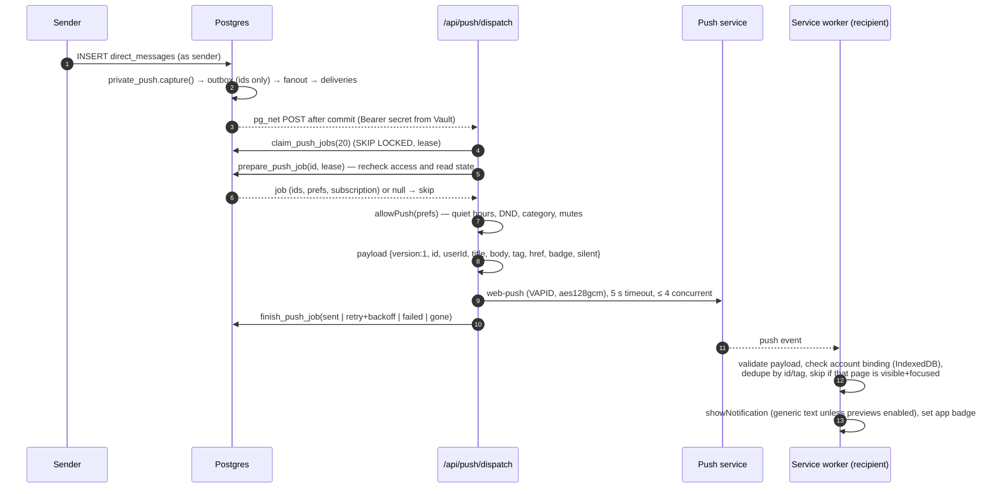

# Notifications, service worker and PWA

## Notification layers

| Layer | Works when | Generated by | Controlled by |
| --- | --- | --- | --- |
| In-app sounds (8-bit cues for message, mention, join/leave, ring) | A Diskarte tab is open | Realtime events in the client ([`lib/sfx.ts`](../../diskarte/src/lib/sfx.ts), Web Audio, no files) | Settings → Sounds (master volume, on/off); quiet hours; Do Not Disturb |
| Unread pills, mention badges, Activity inbox | A tab is open | `my_unreads()` + Realtime | Server/channel mutes |
| Desktop notifications (DMs) | A tab is open, permission granted | [`DmNotifier`](../../diskarte/src/components/shell/DmNotifier.tsx) watching the conversation list | Settings → Notifications → Desktop, DM alerts |
| **Web Push** | No tab needs to be open (installed app on iOS 16.4+) | Database triggers → outbox → `/api/push/dispatch` → service worker | Settings → Notifications → This device, categories, previews, quiet hours |

Per-browser preferences (`NotifyPrefs` in [`lib/notify-prefs.ts`](../../diskarte/src/lib/notify-prefs.ts)):
desktop on/off, DM alerts, per-server level (`mentions` or `nothing`) and mute (with expiry),
quiet hours (default 22:00–08:00 when enabled) and a one-hour pause. When push is enabled these sync
to the account (`account_state`) so the server-side worker applies the same rules.

## Web Push pipeline

**Event categories** (`PUSH_KINDS`): `dm`, `mention`, `reply`, `friend`, `invitation`, `call`,
`event`, `moderation`, `security`. Mentions cover `@username`, moderator `@everyone`/`@here` and
`@{Role name}` (moderators only), deduplicated per message.

**Privacy defaults.** Previews are **off**: the lock-screen text is generic ("Diskarte") unless the
account enables sender/message previews. The outbox never stores message text; each attempt reads the
current source row, so deleted or restricted messages are never pushed.

**Device registration** (`/api/push/subscription`): the endpoint must be an allow-listed vendor
host over HTTPS ([`validPushEndpoint`](../../diskarte/src/lib/push-policy.ts)), the P-256 key is
validated server-side, devices are capped at 10 per account and bound to the current
`auth.sessions` row; sign-out removes this device's registration (or all, for "sign out everywhere"),
clears the worker's account binding and visible notifications. Permission is only ever requested from
the Settings button, never on page load.

Deployment and verification steps: [`diskarte/docs/web-push.md`](../../diskarte/docs/web-push.md).
Current status: implemented and covered by automated tests; **production configuration and
physical-device delivery have not been verified.**

## Service worker

[`public/sw.js`](../../diskarte/public/sw.js) is plain JavaScript, served with
`Cache-Control: no-cache, no-store, must-revalidate` and `Service-Worker-Allowed: /`, registered by
[`PwaProvider`](../../diskarte/src/components/providers/PwaProvider.tsx) with `updateViaCache: "none"`.

| Event | Behaviour |
| --- | --- |
| `install` | Precache `offline.html` and the 192/512 icons into `diskarte-static-v1` |
| `activate` | Delete other `diskarte-static-*` caches, `clients.claim()` |
| `fetch` (navigation) | Network first; on failure serve `/offline.html` |
| `fetch` (static) | Cache first for same-origin `/_next/static/*`, `/icons/*.png`, `/icon.svg` (no query string); keeps at most 150 cached assets plus the precache |
| `fetch` (everything else) | Not intercepted — **authenticated pages, API responses and private media never enter CacheStorage** |
| `message: "SKIP_WAITING"` | Activates a waiting worker when the user chooses to update |
| `push` | Validates, dedupes (IndexedDB, last 100 ids/tags), checks the bound account, shows the notification, updates the app badge |
| `notificationclick` | Opens or focuses a window at a validated same-origin Diskarte path; never auto-joins a call |
| `pushsubscriptionchange` | Defers renewal to the next authenticated page interaction |

**Changing the precache?** Bump `CACHE` (`diskarte-static-vN`) so old caches are removed on activate.

## Installability and updates

[`app/manifest.ts`](../../diskarte/src/app/manifest.ts) declares a standalone app with
`start_url` / `id` `/tambayan`, shortcuts to Messages and Explore, and regular plus maskable icons.

`PwaProvider` exposes `usePwa()`:

- captures `beforeinstallprompt` for an **Install** button (Chromium) and detects standalone mode;
- checks for updates on visibility change and when coming back online; a waiting worker shows
  **Update available** in Settings → Storage & Data. Applying it posts `SKIP_WAITING` and reloads on
  `controllerchange` — finish calls and unsaved edits first;
- **Clear downloaded app files** removes the static caches only; drafts and queued messages (in
  `localStorage`) survive.

## Mobile behaviour

- [`useAppViewport`](../../diskarte/src/hooks/useAppViewport.ts): the shell is `100dvh`; while the iOS
  keyboard is up it sizes to the visual viewport (`data-keyboard`, `--app-height`) so the composer
  stays visible. The root viewport sets `interactive-widget=resizes-content` and `viewport-fit=cover`.
- Safe-area padding, 16 px inputs (no zoom on focus), 44 px touch targets on coarse pointers.
- [`useSwipeDrawer`](../../diskarte/src/hooks/useSwipeDrawer.ts) (edge swipe opens navigation) and
  [`useSwipeReply`](../../diskarte/src/hooks/useSwipeReply.ts) (swipe a message to reply); vertical
  scrolling stays native.
- Theme colour follows the saved colour mode from the first paint (`generateViewport` reads the
  `diskarte-mode` cookie).

## Limitations

- Offline mode is a fallback page plus queued sends; past conversations are not readable offline.
- iOS requires installing to the Home Screen before push can be enabled; Android/desktop support
  depends on the browser. OS focus modes and battery settings can delay or drop pushes.
- Badges count unread conversations/channels, not messages, and can be stale on a device that was
  closed while you read elsewhere.
