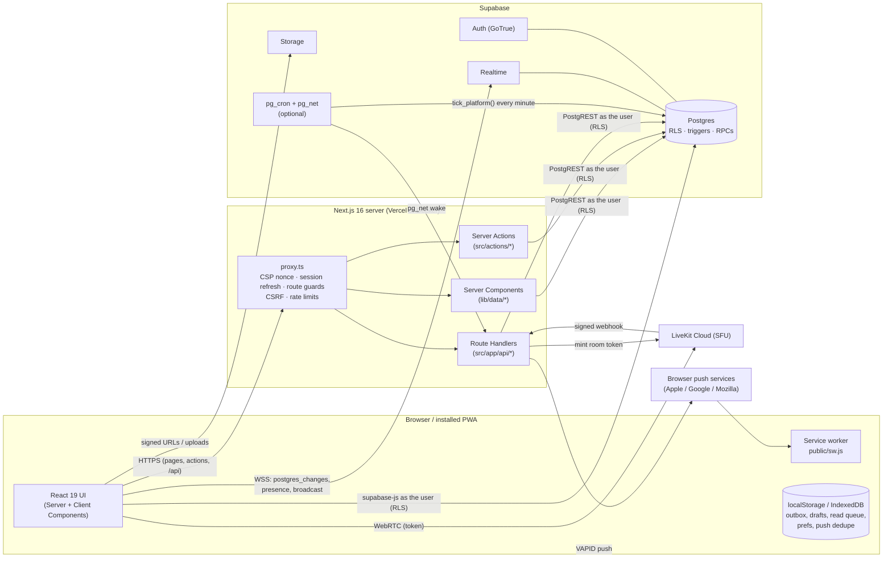
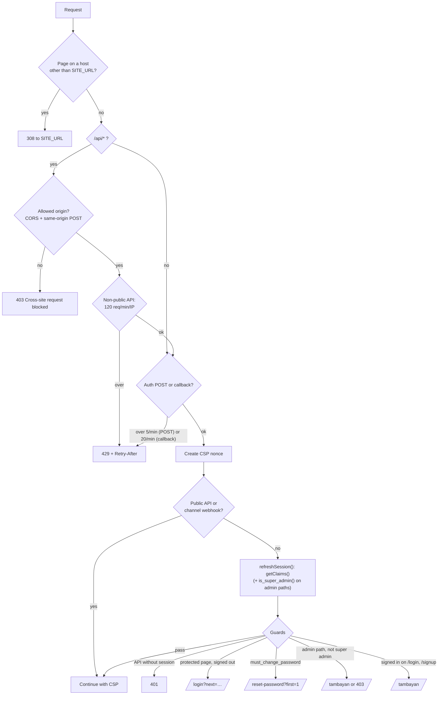
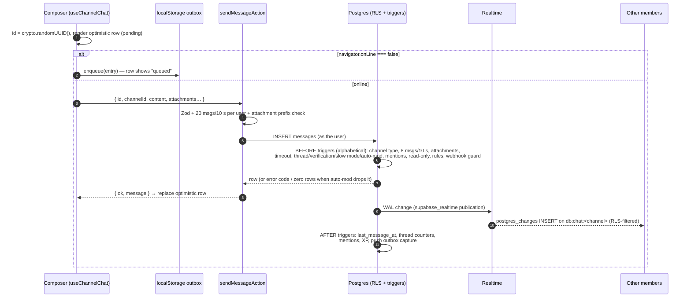
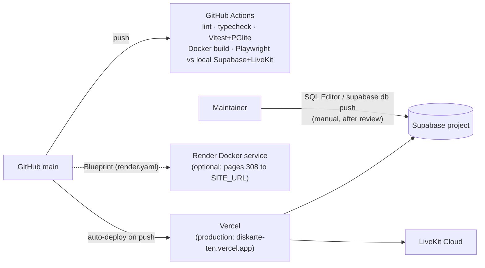

# Architecture overview

Diskarte is one Next.js 16 application backed by three managed services. There is no custom backend
server, message broker or job runner: the database does the authorization, the bookkeeping and the
scheduled work, and the Next.js server handles rendering, a few HTTP endpoints and secrets.



## Technology stack

| Layer | Technology | Where |
| --- | --- | --- |
| Framework | Next.js 16.4 (App Router, Turbopack, `output: "standalone"`), React 19.2 with the React Compiler lint rules | [`diskarte/next.config.ts`](../../diskarte/next.config.ts) |
| Language | TypeScript 5 (strict), Zod 4 for every trust boundary | [`diskarte/src/lib/schemas/`](../../diskarte/src/lib/schemas) |
| Styling | Tailwind CSS 4 (`@theme` tokens), Framer Motion, Lucide icons, Sonner toasts | [`globals.css`](../../diskarte/src/app/globals.css), [`experience.css`](../../diskarte/src/app/experience.css) |
| Data | Supabase Postgres (PostgREST), Auth, Realtime, Storage via `@supabase/ssr` + `supabase-js` | [`src/lib/supabase/`](../../diskarte/src/lib/supabase) |
| Media | LiveKit (`livekit-client`, `@livekit/components-react`, `livekit-server-sdk`) | [`src/components/voice/`](../../diskarte/src/components/voice) |
| Lists | `@tanstack/react-virtual` for message history | [`VirtualMessageList.tsx`](../../diskarte/src/components/chat/VirtualMessageList.tsx) |
| Markdown | `react-markdown` + `remark-gfm` + `rehype-highlight`, raw HTML disabled | [`MessageMarkdown.tsx`](../../diskarte/src/components/chat/MessageMarkdown.tsx) |
| Push | `web-push` (VAPID) + a database outbox | [`src/lib/push-server.ts`](../../diskarte/src/lib/push-server.ts) |
| Analytics | `@vercel/analytics` (page views) + a first-party daily visitor count | [`layout.tsx`](../../diskarte/src/app/layout.tsx), [`VisitBeacon.tsx`](../../diskarte/src/components/VisitBeacon.tsx) |
| Tests | Vitest + Testing Library + jsdom, PGlite (Postgres in WASM) for RLS, Playwright + axe-core | [testing.md](../testing.md) |
| Delivery | GitHub Actions CI, Vercel (production), Docker image for Render or self-hosting | [operations/deployment.md](../operations/deployment.md) |

## Repository layout

```text
.
├── diskarte/                  The app — self-contained (own package-lock.json, Dockerfile)
│   ├── src/
│   │   ├── app/               Routes: landing, (auth), (app)/tambayan/*, settings, api/*, auth/*
│   │   ├── actions/           Server Actions ("use server"), one file per domain
│   │   ├── components/        UI by domain: chat, voice, server, shell, social, profile, admin, ui…
│   │   ├── hooks/             Client hooks: useChannelChat, useDirectChat, useTyping, useSocial…
│   │   ├── lib/               Pure logic + clients: env, security, rate-limit, realtime, outbox,
│   │   │                      read-receipts, push-*, schemas/, supabase/, data/ (server reads)
│   │   └── proxy.ts           The request gate (Next.js 16's replacement for middleware.ts)
│   ├── public/                sw.js, offline.html, icons
│   ├── e2e/                   Playwright specs
│   ├── tests/                 Vitest suites (db/ = PGlite RLS tests), fixtures, mocks
│   ├── scripts/               Brand assets, admin grant, DB readiness check, doc generator
│   └── docs/                  Feature runbooks: web-push.md, voice-preview.md, sql/*.sql installers
├── supabase/
│   ├── migrations/            The whole schema, in filename order
│   └── config.toml            Local `supabase start` settings
├── docs/                      This documentation
├── render.yaml                Render Blueprint (Docker, rootDir: diskarte)
└── docker-compose.yml         Local container + optional LiveKit dev server
```

The app folder is deliberately **not** an npm workspace. Render (and Vercel) build with Root
Directory `diskarte`, so nothing needed at build time may live outside it. The root `package.json`
only forwards scripts (`npm run dev` → `npm run dev --prefix diskarte`) and runs `npm ci` inside the
app on `postinstall`.

## Request lifecycle

Every request except static assets passes through [`src/proxy.ts`](../../diskarte/src/proxy.ts)
(the Next.js 16 name for middleware):



The proxy verifies the JWT signature (`getClaims()`), but pages and actions call `getUser()` /
`requireProfile()` again because a validly signed token can belong to a revoked session. When that
happens they redirect through [`/auth/revoked`](../../diskarte/src/app/auth/revoked/route.ts), which
clears the cookie before `/login` (otherwise `/login` would bounce the user straight back).

## Frontend architecture

**Rendering.** The root layout reads request headers (for the CSP nonce), so every route renders
dynamically. Server Components fetch initial data through `lib/data/*` with React `cache()`
deduplication and the per-request Supabase client, so the first paint of a channel already contains
its latest 50 messages. Client Components take over for anything live.

**The persistent shell.** [`app/(app)/layout.tsx`](../../diskarte/src/app/(app)/layout.tsx) stays
mounted across every in-app navigation and owns the session providers
([`SessionProviders.tsx`](../../diskarte/src/components/shell/SessionProviders.tsx)):

```text
MeProvider                      who I am (profile, verified flag)
└ AccountPreferencesSync        revisioned drafts / preferences in account_state
  └ PresenceProvider            ref-counted server:<id> presence + speaking broadcasts
    └ SocialProvider            one subscription for friendships + DM conversations
      └ CallProvider            the single LiveKit Room (survives navigation)
        └ SettingsDialogProvider, AudioMixerProvider, MediaViewerProvider, IncomingCallsProvider
          + SessionGuard (device heartbeat), StatusExpiry, ClientDiagnostics, PushSession
```

Because the call lives above the routes, moving between Tambayans, DMs and Settings never drops a
voice call. Settings opens as a dialog (not a route change) for the same reason. The `(app)` error
boundary sits below the providers, so a failing page replaces only the page.

**State management.** There is no global store library. State lives in:

| Kind | Mechanism | Examples |
| --- | --- | --- |
| Server data snapshot | Server Component props | channel history, server bundle, conversation bundle |
| Live collections | Hooks owning `useState` + Realtime subscriptions | `useChannelChat`, `useDirectChat`, `useSocial` |
| Cross-cutting session state | React context providers | `MeProvider`, `ServerProvider`, `UnreadsProvider`, `CallProvider` |
| Per-browser preferences | `localStorage` + `useSyncExternalStore` | theme, display prefs, low-data mode, voice prefs, layout widths |
| Per-account synced state | `account_state` rows with revisions | drafts, notification preferences |
| Durable client queues | `localStorage` keyed by account | offline outbox, pending read receipts |

**Code splitting.** LiveKit (~650 KB) loads only when someone joins voice
([`CallProvider.tsx`](../../diskarte/src/components/voice/CallProvider.tsx) imports `./live/*`
lazily); the emoji grid, settings panels, media gallery, command palette and Control Center are
separate chunks loaded on first open.

**Layout.** Desktop uses Discord-style columns (server rail · channel list · main · members) with
resizable, keyboard-operable dividers and an optional floating-panel mode on wide screens
([`WorkspaceProvider.tsx`](../../diskarte/src/components/workspace/WorkspaceProvider.tsx)). Phones
get a tab bar, a swipe drawer and full-screen conversations
([`MobileNavigation.tsx`](../../diskarte/src/components/shell/MobileNavigation.tsx)). See
[design-system.md](../design-system.md).

## Backend architecture

The "backend" is split three ways, each with a clear job:

1. **Postgres is the source of truth for authorization.** Every table has Row Level Security; field
   rules that RLS can't express (who may change a role, pin, edit) are `BEFORE` triggers; multi-row
   operations are `SECURITY DEFINER` RPCs that re-check the caller. The app never uses the service
   role for user-facing reads or writes, so a bug in a Server Action cannot widen access.
2. **Server Actions** ([`src/actions/`](../../diskarte/src/actions)) are thin: validate with Zod,
   apply an in-process rate limit, call Supabase *as the user*, and translate database error codes
   (`SLOWMODE`, `AUTOMOD_BLOCKED`, `RULES_NOT_ACCEPTED`…) into readable messages. Many reads and
   simple writes skip actions entirely and go from the browser straight to PostgREST, where the same
   RLS applies.
3. **Route Handlers** ([`src/app/api/`](../../diskarte/src/app/api)) exist only where a server secret
   or a non-browser caller is involved: LiveKit tokens and webhooks, the push dispatcher and
   subscriptions, incoming channel webhooks, link previews (SSRF-guarded fetches), GIF search, voice
   previews, the admin snapshot and health. See the [API reference](../reference/api.md).

Only three server paths use the service-role key: the LiveKit webhook (to broadcast an
invalidation), the push dispatcher (to claim jobs from the private outbox) and the one-off
`npm run admin:grant` script.

## Data flow: sending a channel message



A network failure re-queues the entry with the **same UUID**; if the first attempt actually landed,
the retry hits a unique violation (`23505`) and the action returns the existing row instead of a
duplicate. Details: [realtime.md](realtime.md).

## Background processing

There are no worker processes. Scheduled work is plain SQL invoked by `pg_cron`, plus a database
outbox drained by an HTTP endpoint:

| Job | Trigger | What it runs |
| --- | --- | --- |
| `diskarte-platform-tick` (every minute, optional) | [`docs/sql/enable-platform-jobs.sql`](../../diskarte/docs/sql/enable-platform-jobs.sql) | `tick_platform()`: publish due scheduled messages, clear expired custom statuses, post due recurring announcements, purge moments expired > 1 day |
| Push wake (per transaction) | trigger → `private_push.wake()` → `pg_net` POST | `/api/push/dispatch` claims ≤ 20 jobs, sends ≤ 4 at once |
| `diskarte-push-recovery` (every minute) | [`docs/sql/enable-web-push.sql`](../../diskarte/docs/sql/enable-web-push.sql) | Re-wakes due/expired-lease jobs, queues event reminders, trims 7-day history |

Without the platform job, scheduled messages are still published by their author's open tab
(`publish_scheduled_messages` from [`ScheduledMessages.tsx`](../../diskarte/src/components/chat/ScheduledMessages.tsx))
and expired statuses are cleared by the owner's tab
([`StatusExpiry.tsx`](../../diskarte/src/components/session/StatusExpiry.tsx)). See
[background-jobs.md](background-jobs.md).

## Deployment shape



Vercel deploys `main` on push **in parallel with CI**, so a red CI run may already be live; watch it
after every push. Migrations are never applied by a deploy. See
[operations/deployment.md](../operations/deployment.md).

## Architectural decisions and trade-offs

The reasoning behind the larger choices is recorded in [decisions.md](decisions.md). In short:

- **Database-enforced authorization** over application checks — one rule set covers Server
  Actions, direct browser queries, Realtime and Storage.
- **Runtime configuration** (`process.env` read per request, never `NEXT_PUBLIC_*` inlining) — one
  Docker image promotes across environments.
- **Private Realtime channels only** — production has "Allow public access" off; every topic is
  authorized by `can_access_realtime_topic()`.
- **Client-generated message ids** — make retries idempotent without a separate dedupe table.
- **Free-tier first** — single-instance in-memory rate limits (Upstash optional), lazy-loaded heavy
  SDKs, a 150 MB Docker image budget.
