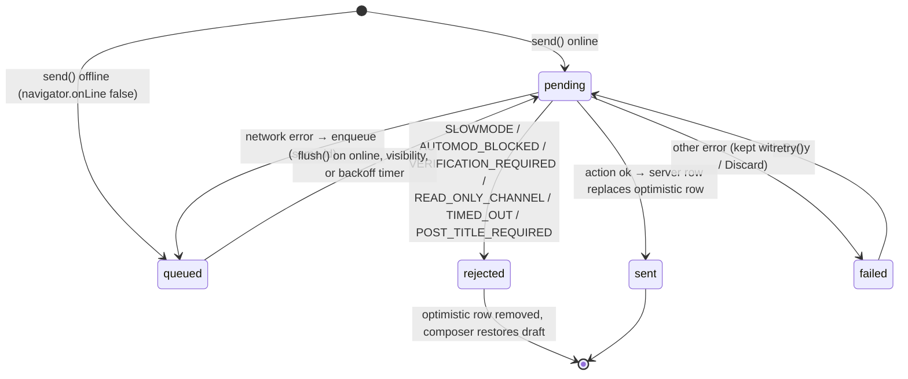
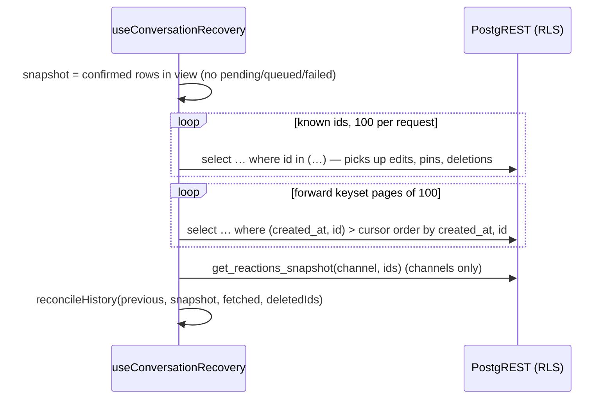

# Realtime and message delivery

Diskarte uses three Supabase Realtime features and one LiveKit feature for live behaviour. Each is
chosen for a reason:

| Need | Mechanism | Persisted? | Authorization |
| --- | --- | --- | --- |
| New/edited/deleted rows (messages, reactions, memberships, friends, events…) | **Postgres Changes** on private `db:*` topics | Yes (the rows) | `can_access_realtime_topic()` for the join, then table RLS per row |
| Who is online / in which voice channel | **Presence** on `server:<id>` | No | `realtime.messages` policies (server members) |
| Typing, "speaking" indicators, voice-preview invalidation | **Broadcast** on `channel:<id>` / `server:<id>` | No | Same policies; clients may not *send* on `db:*` topics |
| In-call soundboard, watch party, games | **LiveKit data channel** | No | The room token (room members only) |

Voice/video media itself is covered in [voice-and-video.md](voice-and-video.md).

## Private channels only

Production has Realtime's **"Allow public access" turned off**, so every channel the app opens must
be private (`{ config: { private: true } }`), and Realtime asks Postgres whether the user may join
by evaluating the policies on `realtime.messages`:

```sql
-- members receive private server/channel broadcasts (SELECT)
can_access_realtime_topic((select realtime.topic()))
-- members send private server/channel broadcasts (INSERT) — never on db:* topics
split_part((select realtime.topic()), ':', 1) <> 'db' and can_access_realtime_topic((select realtime.topic()))
-- plus a restrictive policy: mfa_ok() (sessions that still owe a 2FA code get nothing)
```

`public.can_access_realtime_topic(topic)` (latest version in
[`20261013040000_unreads_mentions.sql`](../../supabase/migrations/20261013040000_unreads_mentions.sql))
maps each topic to a rule:

| Topic | Opened by | Allowed when |
| --- | --- | --- |
| `server:<server>` | `PresenceProvider`, LiveKit webhook (service role) | `is_server_member(server)` |
| `channel:<channel>` | `useTyping` | `can_view_channel(channel)` (membership + private-channel grant) |
| `dm:<conversation>` (broadcast) | — | `is_dm_participant(conversation)` |
| `db:chat:<channel>[:<thread>]`, `db:chat:<channel>:poll-<id>`, `db:chat:<channel>:asset:<kind>` | `useChannelChat`, polls, workspace assets | `can_view_channel(channel)` |
| `db:server:<server>:events` | Events dialog | `is_server_member(server)` |
| `db:lfg:<server>` | LFG board | `is_server_member(server)` |
| `db:dm:<conversation>` | `useDirectChat` | `is_dm_participant(conversation)` |
| `db:memberships:<me>`, `db:friends:<me>`, `db:dms:<me>`, `db:mentions:<me>`, `db:rings:<me>`, `db:account:<me>[…]` | shell providers | the id is the caller's own |
| `db:broadcasts:<HQ>` | sticky broadcast banner | id is Diskarte HQ and the caller is a member |
| `db:admin:<me>` | Control Center | own id and `is_super_admin()` |

Anything else is refused. Because the join check only guards the *topic*, Postgres Changes payloads
are additionally filtered by each table's RLS for the subscribing user: a member who loses access to
a private channel stops receiving its rows even if their old subscription is still open.

> **Why this matters operationally.** CI's local Supabase allows public channels, so a public
> subscription works in tests and silently delivers nothing in production. Always open channels
> through [`subscribeDbChanges()`](../../diskarte/src/lib/realtime.ts) (Postgres Changes) or with
> `private: true`, and add any new topic prefix to `can_access_realtime_topic()` in a migration.

## Subscription lifecycle

[`subscribeDbChanges(supabase, topic, bind, onStatus)`](../../diskarte/src/lib/realtime.ts) wraps two
non-obvious requirements:

1. **Authenticate the socket before joining.** It awaits `supabase.realtime.setAuth()` first.
   realtime-js copies the access token into the join payload at `subscribe()` time; a join without it
   is evaluated as `anon`, and RLS filters out every row.
2. **Never reuse a dying channel.** realtime-js returns the *existing* channel object for a topic
   until its removal round-trip completes. Re-subscribing in that window (switching away from a chat
   and straight back, React Strict Mode's double effects) would reuse a channel that never rejoins.
   `removeChannelSafely()` records each teardown and `whenTopicFree()` makes the next subscriber wait
   for it.

Join status changes are recorded as session-only diagnostics
([`lib/diagnostics.ts`](../../diskarte/src/lib/diagnostics.ts)), visible in **Settings → Advanced →
Connection diagnostics**. They never include message text, ids, tokens or URLs.

## Message lifecycle (channels)

[`useChannelChat`](../../diskarte/src/hooks/useChannelChat.ts) owns a text channel (or one thread):
history, the Realtime subscription, optimistic mutations, pagination, the offline outbox and the
slow-mode cooldown. DMs use the parallel [`useDirectChat`](../../diskarte/src/hooks/useDirectChat.ts).



### Optimistic updates

- **Send** — the client generates the message `id` (`crypto.randomUUID()`) and renders the row
  immediately with `pending: true`. The server's row (with server timestamps and author join)
  replaces it when the action returns. Rows are sorted by `(created_at, id)`.
- **Edit / delete / pin / react** — applied locally first, rolled back if the action fails. Edits roll
  back only if the content hasn't changed again in the meantime.
- **Reactions** carry a per-message epoch so a slow snapshot refresh never overwrites a reaction the
  user just toggled; a message being reacted to is skipped by refreshes until its request settles.

### Idempotency

The message id is the idempotency key. A retried insert whose first attempt already committed fails
with `23505` (unique violation); `sendMessageAction` then selects the existing row (same id, channel
and author) and reports success. No dedupe table or request id header is needed. Realtime `INSERT`
events for an id already in the list replace that row instead of appending, and
[`createOnce()`](../../diskarte/src/lib/once.ts) (bounded, 500 ids) stops replays from playing a
sound twice.

### Offline queue

[`lib/outbox.ts`](../../diskarte/src/lib/outbox.ts) persists unsent messages in `localStorage`:

- Entries are **scoped to the signed-in account** (`userId`) and target (channel/thread or DM);
  sign-out clears this device's queue.
- At most **50 entries**; beyond that `enqueue()` refuses and the row shows as failed instead.
- Only text, reply/thread ids, sticker, title and the paths of *already uploaded* attachments are
  stored — never files or signed URLs.
- Flushing is sequential and stops at the first entry that is still offline, preserving order.
  [`useOutboxRetry`](../../diskarte/src/hooks/useOutboxRetry.ts) retries every 2 s → 30 s
  (exponential) while the chat is open and visible, and immediately on `online` /
  `visibilitychange`, because the `online` event misses short outages.

The 8-bit [`OfflineBanner`](../../diskarte/src/components/chat/OfflineBanner.tsx) shows while offline
or while queued messages wait.

### Rate limits on the send path

| Layer | Limit | Error |
| --- | --- | --- |
| Server Action (per process) | 20 messages / 10 s per user | `RATE_LIMITED` |
| Database trigger | 8 messages / 10 s per user across all channels | `RATE_LIMITED` (SQLSTATE `53400`) |
| Channel slow mode | 1 message per `slowmode_seconds` (moderators exempt) | `SLOWMODE`, `detail` = seconds left |

## Missed-event recovery

Realtime does not replay events missed while disconnected. [`useConversationRecovery`](../../diskarte/src/hooks/useConversationRecovery.ts)
closes the gap whenever the channel **re-joins** (`SUBSCRIBED` after the first join) or the browser
fires `online`:



`reconcileHistory()` only replaces rows that are **unchanged since the fetch began**; anything edited,
deleted or sent live during recovery wins. Deleted ids seen over Realtime are remembered (bounded to
1,000) so recovery can't resurrect them. Results are discarded if the user has switched conversation
(`scope` check) before they arrive. Failures set `recovery.problem`, which the chat header surfaces
with a **Retry sync** control.

`get_reactions_snapshot()` reads reactions in one statement, avoiding offset-pagination races and
PostgREST's row cap ([`20261014040000_reaction_snapshot.sql`](../../supabase/migrations/20261014040000_reaction_snapshot.sql)).

## Unread state and read receipts

**Channels.** `channels.last_message_at` is maintained by a trigger; `channel_reads` stores when each
user last read each channel; `message_mentions` stores who a message mentions (only people who can see
the channel). [`UnreadsProvider`](../../diskarte/src/components/providers/UnreadsProvider.tsx) loads
`my_unreads()` and refreshes it every **30 s** in the background (the open server is live via
Realtime) and when the tab becomes visible.

**Durable receipts.** Marking something read goes through
[`lib/read-receipts.ts`](../../diskarte/src/lib/read-receipts.ts):

1. `queueRead(kind, id, at)` stores "read up to `at`" in `localStorage` (`diskarte:pending-reads`),
   keeping the later of two marks.
2. `flushReads()` sends `mark_channel_read_until(p_channel, p_at)` or
   `mark_dm_read_until(p_conversation_id, p_at)`, one flush at a time. Confirmed receipts leave the
   queue; failures stay for the next try.
3. Because a receipt names a moment, sending it late never marks newer messages read. The server
   caps `p_at` at its own clock.
4. **Mark Unread** calls `forgetRead()` first, so a receipt that hasn't left the device cannot undo
   the user's intent, then `mark_channel_unread`.
5. On databases older than `20261015010000_notification_read_state`, the client falls back to the
   "read now" RPCs (`mark_channel_read`, `mark_dm_read`).

The push worker checks the same read state before delivering, so something read on one device is
not pushed to another later ([`20261015010000_notification_read_state.sql`](../../supabase/migrations/20261015010000_notification_read_state.sql)).

**DM Sent / Seen.** `dm_participants.last_read_at` is readable by fellow participants and published
over the existing `db:dm:<conversation>` topic, so `useDirectChat` shows **Sent** or **Seen** (with
names in group DMs) under the latest message you sent. There is no opt-out yet.

## Presence

[`PresenceProvider`](../../diskarte/src/components/providers/PresenceProvider.tsx) keeps **one
ref-counted presence channel per server** (`server:<id>`), shared by the open server view, the voice
call (even while browsing another server) and voice previews. Each client tracks one payload:

```ts
{ user_id, status, custom_status, custom_status_emoji,
  voice_channel_id, muted, deafened, video, screen, online_at }
```

`flattenPresence()` collapses multiple tabs to one entry per user (newest wins). Speaking indicators
are **Broadcast** events on the same channel, sent on start/stop plus a heartbeat while talking; a
claim lapses after `SPEAKING_TTL_MS` (3.5 s) so a dropped tab can't leave someone "talking".

Separately, [`SessionGuard`](../../diskarte/src/components/session/SessionGuard.tsx) sends
`heartbeat_device()` so the Control Center can show per-device last activity (offline after two
missed minutes).

## Typing indicators

[`useTyping`](../../diskarte/src/hooks/useTyping.ts) broadcasts `typing` at most every **2.5 s** while
the user types and `stop` on send/blur, on the private `channel:<id>` topic. Receivers expire an entry
after **6 s** without a refresh. Nothing is stored.

## Multi-device synchronization

| State | How it syncs |
| --- | --- |
| Messages, reactions, pins, edits | Postgres Changes + recovery on rejoin |
| Read state, unread pills, mentions | `channel_reads` / `dm_participants` via receipts; `my_unreads()` refresh |
| Drafts and notification preferences | `account_state` rows with an integer `revision` ([`useAccountSync`](../../diskarte/src/hooks/useAccountSync.ts)); `save_account_state` rejects stale revisions, and a conflict **never** overwrites local edits — the user chooses which version to keep |
| Profile, status, memberships, friends | Postgres Changes on `db:memberships:*`, `db:friends:*`, `db:dms:*` |
| Theme, display, voice and low-data prefs, layout widths | Per browser only (`localStorage` / cookies) |
| Push devices | Per device (`private_push.subscriptions`, bound to an `auth.sessions` row) |

## Notification generation

In-app notifications (sounds, unread pills, the mention badge, desktop alerts via
[`DmNotifier`](../../diskarte/src/components/shell/DmNotifier.tsx)) come from the Realtime streams
above. Background Web Push is generated **in the database**: `AFTER INSERT` triggers
(`private_push.capture()`) on `messages`, `message_mentions`, `direct_messages`, `friendships`,
`call_rings`, `member_warnings` and `account_controls` write outbox rows in the same transaction as the source row. See [notifications-and-pwa.md](notifications-and-pwa.md).
