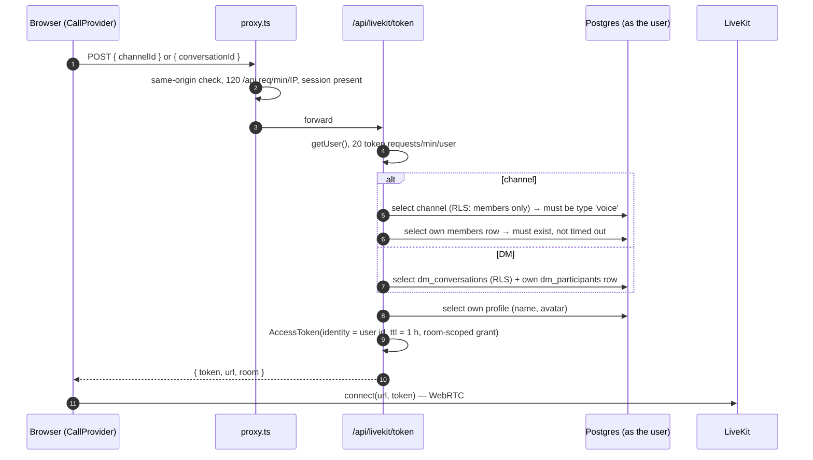
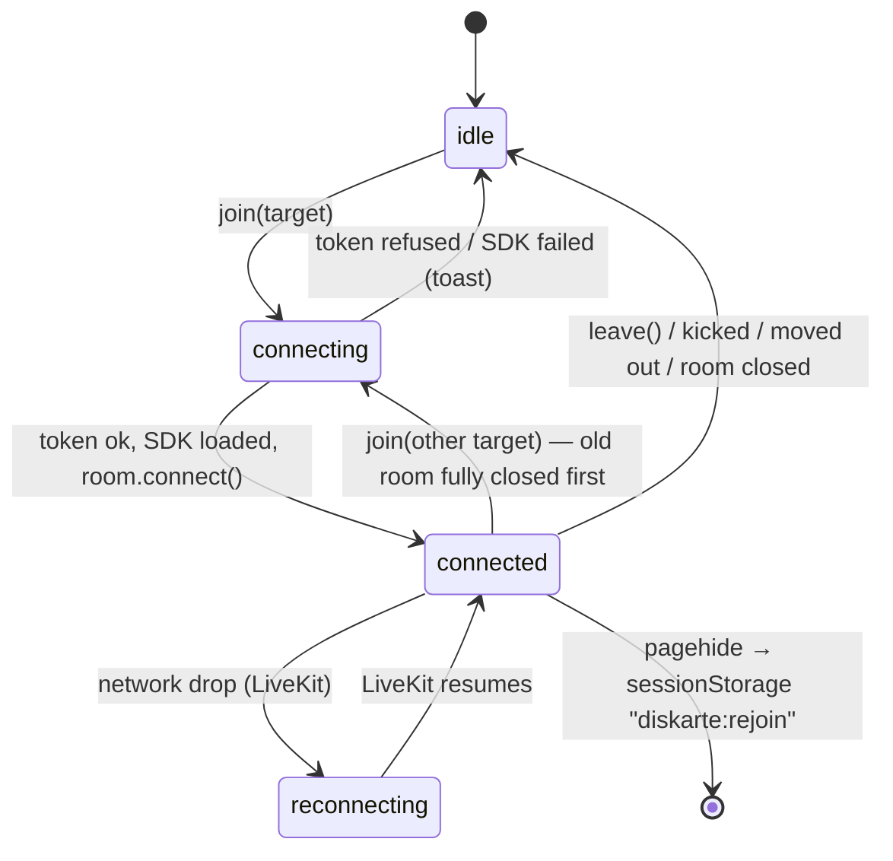

# Voice, video and screen sharing

All media runs through **LiveKit** (an SFU). Diskarte never relays audio or video itself; the Next.js
server only decides *who may join which room* and mints a short-lived token for that one room.

## Rooms and identities

| Room name | Used for | Who may join |
| --- | --- | --- |
| `voice:<channel uuid>` | A Tambayan voice channel | Members of the channel's server who are not timed out (RLS hides channels from non-members; private voice channels need a grant) |
| `dm:<conversation uuid>` | 1:1 and group DM calls | Participants of the conversation |

The participant **identity is the Supabase user id**, so every client maps LiveKit participants back
to profiles. Display name, username and avatar ride in the token metadata as a fallback for people
the client doesn't know yet.

## Token issue

`POST /api/livekit/token` ([route](../../diskarte/src/app/api/livekit/token/route.ts),
[`lib/livekit.ts`](../../diskarte/src/lib/livekit.ts)):

The grant allows join, subscribe, publish and data, **only** from microphone, camera, screen share
and screen-share audio, and forbids `canUpdateOwnMetadata` (so nobody can rename themselves in the
room). Tokens live **one hour**; that only bounds *joining* and reconnecting — LiveKit refreshes
credentials for connected participants, so long calls continue. `LIVEKIT_API_SECRET` exists only on
the server (`lib/livekit.ts` imports `server-only`).

| Response | Meaning |
| --- | --- |
| `200 { token, url, room }` | Join with these |
| `400 Invalid channel` / `Not a voice channel` | Body didn't validate, or the channel isn't voice |
| `401 Not signed in` | No session |
| `403 Not a member of this server` / `You're timed out in this server` / `Not part of this conversation` | Membership check failed |
| `404 Channel not found` / `Conversation not found` | RLS hid it (or it doesn't exist) |
| `429 Too many voice join attempts` | 20/min per user; `Retry-After` set |
| `503 Voice is not configured on this server` | `LIVEKIT_API_KEY` / `LIVEKIT_API_SECRET` missing |

## Call lifecycle in the browser

[`CallProvider`](../../diskarte/src/components/voice/CallProvider.tsx) owns **one** LiveKit `Room` for
the whole signed-in shell, mounted by `app/(app)/layout.tsx`, so a call survives navigation between
servers, DMs and settings.

Key behaviours, all in `CallProvider.tsx`:

- **Lazy SDK.** `livekit-client` and the LiveKit React components (~650 KB) are fetched on the first
  join; components that need LiveKit hooks live under `components/voice/live/`.
- **Pre-warming.** Hovering, focusing or touching a voice channel (with real intent, not a mouse
  sweeping past) loads the SDK and pre-mints a token. A pre-minted token is used for at most
  **2 minutes**; pre-warm fetches are spaced **2 s** apart globally so they cannot exhaust the
  20/min token limit.
- **One room at a time.** Switching rooms shows "connecting" immediately but fully disconnects the
  old room (bounded by a 2.5 s timeout) and drops its voice presence before connecting.
- **Stale attempts are ignored.** Each join has an attempt number; any await that returns after a
  newer join started is discarded.
- **Room options.** `adaptiveStream` and `dynacast` are on. Low-data mode captures 360p camera,
  720p/5 fps screen share and subscribes to low simulcast layers; toggling it mid-call re-requests
  remote video at the matching quality.
- **Devices and processing** come from Settings → Voice & Video
  ([`lib/voice-prefs.ts`](../../diskarte/src/lib/voice-prefs.ts)): input/output device, input profile
  (`isolation`, `studio`, `custom`: noise suppression, echo cancellation, auto gain), and push-to-talk.
  Device changes apply live.
- **Push to talk.** The mic is published (permission asked at join) but stays muted until the key is
  held; typing in a text field never triggers it, and switching windows releases it.
- **Presence mirroring.** Mute/deafen/camera/screen state is written into the server presence payload
  so sidebars show who is in which channel; speaking is a Broadcast heartbeat every 2 s.
- **Per-listener mixing.** Master volume, per-person volume, local mute, "Disable Video" (stop
  downloading a camera) and separate screen-share audio volume are kept in `localStorage`
  (`diskarte:audio-mix`) on this device only.
- **Watch one stream.** [`useScreenWatch`](../../diskarte/src/components/voice/live/useScreenWatch.ts)
  subscribes to one screen share at a time; others stay listed but unsubscribed to save data.

### Call recovery

| Situation | What happens |
| --- | --- |
| Network blip | LiveKit reconnects on its own; diagnostics record `reconnecting` / `recovered` |
| Page reload or a deploy forcing a full reload mid-call | On `pagehide` the tab stores `{ target, muted, deafened, at }` in `sessionStorage["diskarte:rejoin"]`. A load within **30 s** rejoins automatically with the same mute/deafen state |
| Browser blocks autoplay after a rejoin | [`CallAudio`](../../diskarte/src/components/voice/live/CallAudio.tsx) shows a one-click "turn on sound" button |
| Moderator **moves** you | LiveKit moves the participant; the client follows to the new `voice:<id>` room |
| Moderator **server-mutes** you | Your mic publish permission is removed until lifted or you leave |
| Kicked, disconnected, banned | Room closes; the client returns to idle |

Vercel deploys change the deployment id, which turns the next in-app navigation into a full reload;
the rejoin window exists mainly for that. Batch pushes to `main` when people are likely in calls.

## Ringing (incoming calls)

DM calls and "ring to voice" pings use the `call_rings` table
([`20261004000000_call_rings.sql`](../../supabase/migrations/20261004000000_call_rings.sql)). Clients
never write it directly:

- `ring_call(kind, target, callee?, video?)` validates the relationship (DM participants, or fellow
  server members for a voice channel; never across a block), dedupes already-ringing callees and
  rate-limits. Each ring lives **45 seconds**.
- `respond_ring(ring, accept)` lets the callee accept or decline; `cancel_rings(target)` lets the
  caller hang up first. Answering a ring older than 45 s marks it `missed` and refuses it; an
  unanswered ring otherwise simply stays `ringing` and clients ignore it once expired.
- Callees receive rings over `db:rings:<me>`;
  [`IncomingCalls`](../../diskarte/src/components/voice/IncomingCalls.tsx) shows the pop-up. Accepting
  joins the room through the normal token flow.
- A ring also enqueues a Web Push (`call` category) when push is configured. Tapping the
  notification opens the conversation; it never auto-joins.

## Voice moderation

[`moderateVoiceAction`](../../diskarte/src/actions/voice.ts) implements Server Mute / Unmute,
Deafen / Undeafen, Disconnect and Move using LiveKit's server API (`RoomServiceClient`):

1. The caller must outrank the target (`canManageMember`, the same rule as kicking).
2. **Move** only targets a non-private voice channel of the same server (private-channel access is
   per person and can't be checked on their behalf).
3. Mute removes `MICROPHONE` from the participant's allowed sources and mutes the live track; deafen
   sets `canSubscribe: false`.

## Live voice previews

Hovering a server icon (or Right Arrow on it, or long-press → **Voice activity** on touch) shows who
is in each voice channel without joining. `GET /api/voice-preview?serverId=` checks membership,
platform ban, MFA and verification, lists only channels the caller's RLS returns, then asks LiveKit
for participants of those rooms (≤ 30 channels, ≤ 8 avatars each, bounded concurrency). No token is
minted. Full design: [`diskarte/docs/voice-preview.md`](../../diskarte/docs/voice-preview.md).

The **LiveKit webhook** (`POST /api/livekit/webhook`) verifies LiveKit's signed JWT and body digest,
then broadcasts an empty `voice_changed` event on `server:<id>` (using the service role) for join,
leave, track and room-finished events so open previews refresh. It returns `503` on failures so
LiveKit retries.

## In-call extras (LiveKit data channel)

| Feature | Topic / module | Notes |
| --- | --- | --- |
| Soundboard | [`SoundboardPanel`](../../diskarte/src/components/voice/live/SoundboardPanel.tsx), [`lib/soundboard.ts`](../../diskarte/src/lib/soundboard.ts) | 12 built-in synthesized clips + up to 24 uploaded MP3s per server. One clip per sender every 2 s; uploaded clips are cut at 6 s; per-listener mute |
| Activities | [`lib/activity.ts`](../../diskarte/src/lib/activity.ts), `components/voice/live/activities/` | Watch party (privacy-enhanced YouTube embed, drift > ~1.5 s re-seeks), Tic-Tac-Toe, Pinoy Trivia. Whole-state snapshots with a `rev` counter; newer `(rev, author)` wins; joiners request a sync |
| Connection meter | [`ConnectionMeter`](../../diskarte/src/components/voice/ConnectionMeter.tsx), [`lib/call-stats.ts`](../../diskarte/src/lib/call-stats.ts) | Signal bars from LiveKit quality plus measured RTT, packet loss (delta of cumulative counters, worse of local/SFU view) and jitter |

## Configuration

| Setting | Where |
| --- | --- |
| `LIVEKIT_URL` (`wss://…`), `LIVEKIT_API_KEY`, `LIVEKIT_API_SECRET` | App environment ([reference](../reference/environment.md)) |
| Webhook destination `https://<site>/api/livekit/webhook` | LiveKit Cloud project settings (same key/secret) |
| `SUPABASE_SERVICE_ROLE_KEY` | Needed by the webhook only; without it previews refresh on presence and foregrounding but may show stale server-side disconnects |
| CSP `connect-src` | Built automatically from `LIVEKIT_URL` (both `wss://` and `https://` origins) |

Local development: `docker compose --profile livekit up livekit` runs a dev server at
`ws://localhost:7880` with key `devkey` / secret `secret`.

## Limitations

- No recording, transcription, stage/broadcast roles, or end-to-end media encryption.
- Web Push is an invitation alert, not CallKit/ConnectionService telephony; it can't wake a locked
  phone into a ringing UI.
- Physical iOS/Android call behaviour (background audio, Bluetooth routing, battery policies) has not
  been verified on hardware.
- Moving a member into a private voice channel isn't supported.
