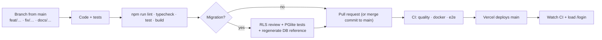

# Contributing

Thanks for helping build Diskarte. This guide covers how the repository is organized, how changes
flow from a branch to production, and the conventions reviewers expect.

## Repository organization

| Path | What lives there | Notes |
| --- | --- | --- |
| `diskarte/` | The Next.js app — **self-contained** (own `package-lock.json`, `Dockerfile`) | Hosts build with Root Directory `diskarte`; nothing it needs at build time may live outside it. Add dependencies from inside this folder |
| `diskarte/src/app/` | Routes (App Router): `(auth)`, `(app)/tambayan/*`, `(app)/settings`, `api/*`, `auth/*` | `(app)/layout.tsx` owns the session providers |
| `diskarte/src/actions/` | Server Actions, one file per domain | Thin: validate, rate-limit, call Supabase as the user, translate errors |
| `diskarte/src/components/<domain>/` | UI by domain (`chat`, `voice`, `server`, `shell`, `social`, `profile`, `admin`, `workspace`, `ui`…) | `ui/` holds shared primitives |
| `diskarte/src/hooks/` | Client hooks for live data and gestures | |
| `diskarte/src/lib/` | Pure logic, clients and schemas | `lib/schemas/` (Zod), `lib/supabase/` (clients + generated types), `lib/data/` (server reads) |
| `diskarte/src/proxy.ts` | Request gate (Next.js 16's middleware) | |
| `diskarte/tests/`, `diskarte/e2e/` | Vitest suites (incl. PGlite DB tests) and Playwright specs | See [testing.md](../testing.md) |
| `diskarte/scripts/` | `grant-admin.mjs`, `check-database.mjs`, brand asset generators, `generate-db-reference.mts` | |
| `diskarte/docs/` | Feature runbooks and hosted-only SQL installers | Linked from these docs |
| `supabase/migrations/` | The database schema | Filename order = apply order |
| `docs/` | This documentation | |

The repository is **not** an npm workspace. From the root, `npm install` runs `npm ci` in the app
and `npm run <script>` forwards to `npm run <script> --prefix diskarte`.

## Before you write code

This project uses **Next.js 16**, which changes APIs and conventions (for example `proxy.ts` instead
of `middleware.ts`, `PageProps<"/route">` / `LayoutProps` helpers generated by `next typegen`). Read
the relevant guide in `diskarte/node_modules/next/dist/docs/` before relying on memory, and heed
deprecation notices.

## Development workflow



1. **Branch** from `main`: `feat/<area>`, `fix/<area>`, `docs/<topic>`, `test/<area>`.
2. **Run checks locally** (inside `diskarte/`):

   ```bash
   npm run lint && npm run typecheck && npm test && npm run build
   ```

3. **Open a pull request** against `main`. CI runs on PRs and on pushes to `main` only — pushing a
   feature branch alone doesn't run it.
4. **Merge** with a merge commit (`merge(<scope>): <summary>`), keeping the branch's commits.
5. **After merging**, Vercel deploys `main` immediately. Watch the CI run and load the production
   `/login` page before pushing anything else (see [deployment.md](../operations/deployment.md#release-procedure)).

Never force-push `main` or rewrite published history.

## Commit messages

Conventional-commit style, imperative mood, lower-case summary, scoped by area:

```text
feat(chat): built-in slash commands
fix(servers): name the channels relationship in the server list query
test(e2e): cover recurring announcement settings
docs(operations): add rollback steps for push
merge(community): slash commands, server rules and recurring announcements
```

Common types: `feat`, `fix`, `perf`, `refactor`, `test`, `docs`, `merge`. Put the *why* in
the body when it isn't obvious. Don't add AI/assistant attribution trailers to commits or PR
descriptions in this repository.

## Pull request expectations

- One topic per PR; describe the user-visible change and how you verified it.
- List any **manual steps**: migrations to apply, SQL installers to run, environment variables to
  set. Add them to `diskarte/CHANGELOG.md` and, if needed, a `diskarte/RELEASE-<date>.md`.
- Include tests for new logic (see [testing.md → Adding tests](../testing.md#adding-tests)).
- Update documentation in the same PR (checklist below).
- Screenshots or short recordings for UI changes, including a phone width and light mode.

## Coding conventions

**TypeScript**

- `strict` is on. Prefer inferred types; use `z.infer` for anything validated.
- Validate every trust boundary with Zod (`lib/schemas/*`): action inputs, route bodies, query
  params, JSON from storage. Never trust a client-provided user id — the server uses the session.
- Import with the `@/` alias (`@/lib/…`, `@/components/…`).
- Server-only modules import `server-only`; secrets are read only in those modules. A test fails if a
  `"use client"` module references a server secret.
- `lib/supabase/database.types.ts` mirrors the schema; update it with new tables/columns/functions.

**React and Next.js**

- Server Components by default; add `"use client"` only where state, effects or browser APIs are
  needed. Anything rendered from the root layout must be **SSR-safe**: create browser clients and
  touch `window` only inside effects.
- Read runtime config through `useSupabase()` / `RuntimeConfigProvider`, never `NEXT_PUBLIC_*`.
- Heavy UI (LiveKit, pickers, settings bodies, admin) loads lazily with a skeleton.
- Realtime: use `subscribeDbChanges()` for Postgres Changes and always `private: true` channels.
- Optimistic updates must roll back on failure and show a specific toast.
- Follow the lint rules from `eslint-config-next` (core web vitals + TypeScript), including the React
  Compiler rules; justify any `eslint-disable` inline.

**Style**

- The codebase is hand-formatted with long lines (~160 columns) and **has no Prettier config — don't
  run Prettier** over files; match the surrounding style.
- Comment the *why*, not the *what*. Exported functions and components get a one-line JSDoc when their
  purpose or constraints aren't obvious from the name.
- Known shortcuts are marked `// shortcut: <the limit>, <when to upgrade>`.

**Components**

- Reuse `components/ui` primitives (Button, Field, Modal, FloatingWindow, Popover, Menu,
  ContextMenu, Tooltip, ConfirmHost, EmptyState) and semantic CSS tokens. See
  [design-system.md](../design-system.md).
- Accessible by construction: real buttons/links, labels for inputs, keyboard support, 44 px touch
  targets, focus management through the shared overlays.
- No emoji in UI chrome — add a glyph to `lib/glyphs.ts`.
- UI copy is English, short and specific; add Filipino strings for navigation/settings to
  `lib/locale.ts` when you add those surfaces.

## Database changes

Read [database-migrations.md](database-migrations.md) before touching `supabase/migrations/`.

## Documentation

Docs live in `docs/` (product and engineering) plus runbooks in `diskarte/docs/`. Update them in the
same PR as the code.

### The Help Center (`/docs`)

The public Help Center is rendered from the same Markdown:

- [`docs/site.json`](../site.json) lists the published pages, their URL slugs, sidebar sections and
  the `reviewed` date. **Only listed pages are published**; every other Markdown file under `docs/`
  must be in its `internal` list (operational runbooks, the generated database reference, templates).
  The repository itself is public, so "internal" means "not on the website or in its search", not
  secret — never write secrets into any doc.
- `npm run docs:site --prefix diskarte` renders the published pages to HTML (headings, anchors,
  highlighted code, method badges, Mermaid containers, rewritten links) into
  `diskarte/src/content/docs-site.json` and builds the search index
  `diskarte/public/docs-assets/search-index.json`. Commit both.
- Links to published pages become `/docs/...`; links to code or internal pages become GitHub links.
  Raw HTML isn't allowed in published pages (the build fails).
- Images live in `diskarte/public/docs-assets/` and are referenced with a relative path from the
  Markdown. `npm run docs:screens --prefix diskarte` recaptures the product screenshots from the
  fixture harness (sample data only) and the production build, then rebuilds the site content.
- In-app help links are defined once in [`src/lib/docs/help.ts`](../../diskarte/src/lib/docs/help.ts).
  If you rename a heading they point at, the docs test tells you.
- When you check a page against the code, update its `reviewed` date in `site.json`.

**Docs checklist for a PR**

- [ ] New/changed feature → its page in `docs/features/` (use the [feature template](templates/feature.md)) and the status table in `docs/features/README.md`
- [ ] User-visible change → the relevant `docs/user-guide/` page
- [ ] New env var → `docs/reference/environment.md` and `diskarte/.env.example`
- [ ] New route handler, action or error code → `docs/reference/api.md`
- [ ] Migration → `npm run docs:db --prefix diskarte` (regenerates `docs/reference/database.md`), plus `docs/database.md` if the model changed
- [ ] Architectural decision → an entry in `docs/architecture/decisions.md` ([ADR template](templates/adr.md))
- [ ] Manual deploy steps → `diskarte/CHANGELOG.md` / `RELEASE-<date>.md` and `docs/operations/deployment.md`
- [ ] Limitation found or removed → `docs/known-limitations.md`
- [ ] New Markdown page → publish it in `docs/site.json` or list it as `internal`; then `npm run docs:site --prefix diskarte`
- [ ] UI the screenshots show changed → `npm run docs:screens --prefix diskarte`

`npm test` includes [`tests/docs/docs.test.ts`](../../diskarte/tests/docs/docs.test.ts), which fails
on broken relative links or anchors in Markdown, a stale database reference or Help Center build, an
unclassified or doubly classified page, an internal page or secret-looking string in the public
bundle, an in-app help link to a missing page or heading, an API route handler missing from (or
invented in) `docs/reference/api.md`, or an environment variable read by the code but missing from
the environment reference. `e2e/docs.spec.ts` checks the site itself in a browser.

**Writing style:** plain, specific, present tense; explain *why* when it isn't obvious; real commands
and paths; mark anything unverified as such. Diagrams use Mermaid (rendered by GitHub) and must
describe the real implementation.

## Troubleshooting your environment

See [troubleshooting → Local development](../operations/troubleshooting.md#local-development).
