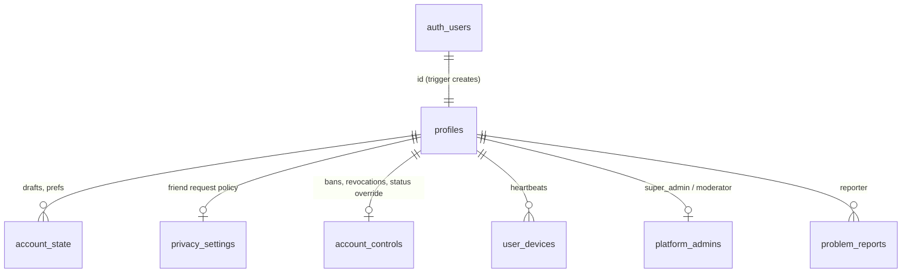
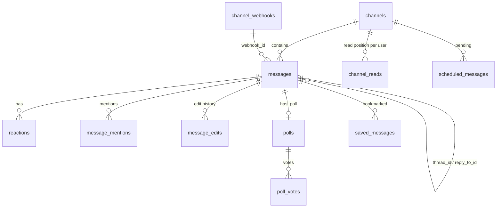
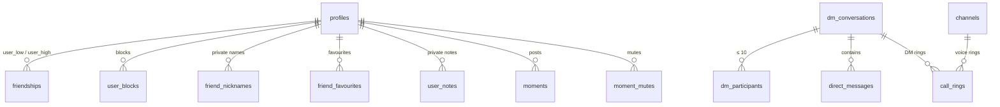
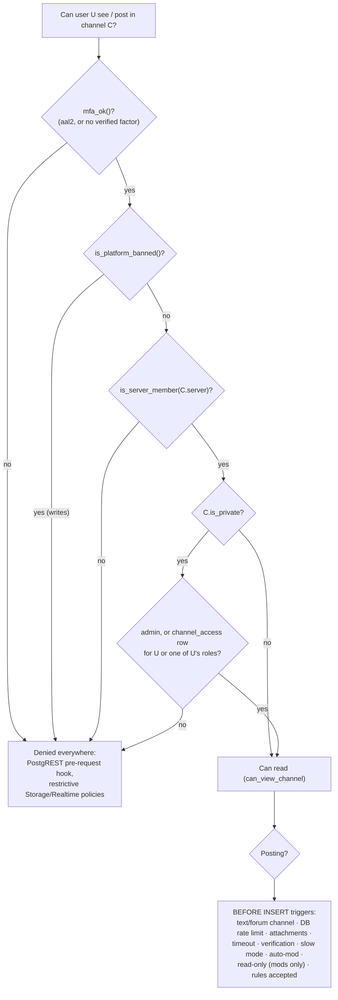
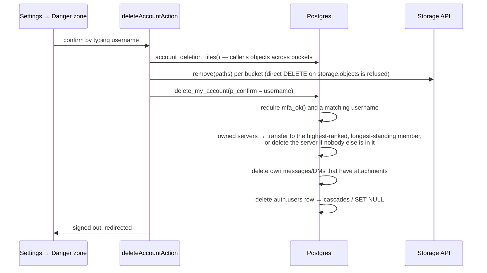

# Database guide

The whole schema lives in [`supabase/migrations/`](../supabase/migrations), applied in filename order.
This page explains how it is organized and why. For every table, column, constraint, index, policy,
trigger and function, see the generated **[database reference](reference/database.md)**.

## Schemas

| Schema | Contents | Reachable through the API? |
| --- | --- | --- |
| `public` | All application tables and RPCs | Yes, as `authenticated` (RLS on every table); `anon` has no table privileges |
| `private_push` | Push subscriptions, outbox, deliveries, attempts, configuration | **No** — only definer functions and the service role |
| `auth`, `storage`, `realtime` | Supabase-managed; Diskarte adds policies on `storage.objects` and `realtime.messages` and rows in `storage.buckets` | Via Supabase Auth / Storage / Realtime |

## Domains and relationships

The 59 tables group into a few domains. Foreign-key diagrams per domain (the full generated map is in
the [reference](reference/database.md#foreign-key-map)):

### Identity and accounts



`profiles` is created by a trigger on `auth.users` insert, from the sign-up metadata (`username`,
`display_name`). `onboarded` gates the app until the profile builder is finished.

### Communities (Tambayans)

```mermaid
erDiagram
  servers ||--o{ members : has
  profiles ||--o{ members : joins
  servers ||--o{ channels : contains
  servers ||--o{ server_roles : defines
  server_roles ||--o{ member_roles : "granted to"
  channels ||--o{ channel_access : "private grants (user or role)"
  servers ||--o{ server_invites : "limited invites"
  servers ||--o{ server_bans : bans
  servers ||--o{ audit_logs : "Bantay-Bayan log"
  servers ||--o{ server_events : schedules
  server_events ||--o{ event_rsvps : interested
  servers ||--o{ server_emojis : "custom emoji"
  servers ||--o{ soundboard_clips : clips
  servers ||--o{ server_badges : "supporter badges"
  servers ||--o{ lfg_beacons : LFG
  lfg_beacons ||--o{ lfg_party_members : party
  servers ||--o{ rules_acceptances : "rules accepted"
  servers ||--o{ server_announcements : recurring
  servers ||--o{ member_xp : levels
  members ||--o{ member_warnings : warned
  channels ||--o{ channel_webhooks : "incoming webhooks"
  channels ||--o{ workspace_documents : "notes, boards, focus"
  channels ||--o{ workspace_assets : "resources, whiteboards"
```



### Messaging



### Social



Friendships store each pair once as `(user_low, user_high)` (ordered ids) with a status of `pending`
or `accepted`; [`classifyFriendships()`](../diskarte/src/lib/social.ts) turns rows into "incoming",
"outgoing" and "accepted" from the viewer's side. Direct conversations have a unique `direct_key`
so a pair can't have two 1:1 DMs.

### Platform

`platform_admins` (role table), `account_controls`, `admin_audit_logs`, `system_broadcasts`,
`system_creators`, `site_visits`, `problem_reports`, `user_devices`, `release_announcements` (one row
per officially announced release; see [release announcements](operations/release-announcements.md)). Diskarte HQ is a system server
(`is_system`, fixed id `d15ca47e-0000-4000-8000-000000000001`) that every profile joins automatically.

## Permission model



**Server ranks** live in `members.role` (`member` < `moderator` < `admin`, the `member_role` enum).
`server_role(server)` returns the caller's rank and `has_server_role(server, min)` compares it. The
server **owner** (`servers.owner_id`) is always an admin and is the only one who can demote admins or
transfer ownership. `members_guard` enforces: only admins change roles; nobody changes their own or
the owner's role; only the owner demotes admins; moderators may only rename members below them.

**Custom roles** (`server_roles`, `member_roles`) are cosmetic colours and labels plus a way to
grant private-channel access to a group; moderation powers still come from the rank.

**Platform roles** (`platform_admins.role`: `super_admin` or `moderator`) are checked by
`is_super_admin()` and mirrored into Diskarte HQ as admin / moderator.

**Common helper functions** (all `SECURITY DEFINER`, `search_path = ''`, stable):

| Function | True when |
| --- | --- |
| `is_server_member(server)` | Caller has a `members` row |
| `has_server_role(server, min)` | Caller's rank ≥ `min` |
| `can_view_channel(channel)` | Member, and the channel is public or the caller has a grant (or is admin) |
| `has_channel_grant(channel, server)` | Admin, or a `channel_access` row for the caller or one of their roles |
| `is_dm_participant(conversation)` | Caller is in `dm_participants` |
| `are_friends(a, b)` | Accepted friendship |
| `is_platform_banned(user?)` | `account_controls.banned_until` in the future |
| `is_verified_user()` | Confirmed email or phone |
| `mfa_ok()` | Session is `aal2`, or the account has no verified factor |
| `is_super_admin()` | `platform_admins.role = 'super_admin'` for the caller |

## Data integrity guarantees

- **Server-assigned fields.** Insert triggers overwrite `author_id` with `auth.uid()`, `created_at`
  with `now()`, and clear pin/edit fields, so clients can't backdate or impersonate.
- **Immutable relationships.** Guards refuse moving members, messages, events or channels between
  servers after creation (`MEMBER_IMMUTABLE_FIELD` and similar).
- **Attachments** must be objects in the `attachments` bucket under
  `<server>/<channel>/<uploader>/<uuid>.<ext>`, of an allow-listed MIME type and ≤ 10 MB — checked by
  the message trigger, the bucket configuration and the upload policy.
- **Counters** (`thread_reply_count`, `rsvp_count`, `last_message_at`) are maintained by triggers;
  event capacity updates serialize on the event row so RSVPs can't overbook.
- **Revisions.** `workspace_documents`, `workspace_assets` and `account_state` carry an integer
  `revision`; saves with a stale revision fail instead of overwriting.
- **Rate limits in the database**: 8 messages / 10 s per user; reports 5 / hour; push registration and
  tests per minute; webhooks 30 / minute per webhook.
- **Auto-mod drops instead of raising** so its audit entry commits (`return null` from the trigger;
  the API sees zero rows inserted).

## Realtime publication

30 tables are in `supabase_realtime` (listed in the [reference](reference/database.md#realtime-publication)).
Adding a table to the publication is a migration (`alter publication supabase_realtime add table …`);
subscribers also need a topic rule in `can_access_realtime_topic()` (see
[realtime.md](architecture/realtime.md)).

## Storage buckets

| Bucket | Public | Limit | Object path | Who writes / reads |
| --- | --- | --- | --- | --- |
| `attachments` | no | 10 MB; images, MP3/MP4, voice (WebM/Ogg/MP4 audio) | `<server>/<channel>/<uploader>/<uuid>.<ext>` or `dm/<conversation>/<uploader>/<uuid>.<ext>` | Members of the server upload to their own folder and read; DM participants for `dm/…`; uploader or moderators delete. Served as short-lived **signed URLs** |
| `avatars` | yes | 5 MB images | `<user>/(avatar\|banner)-<uuid>.<ext>`, `servers/<server>/…` | Owner (or server admin for `servers/`) writes and lists; anyone loads images by public URL, but nobody else can list the bucket |
| `emoji` | yes | 256 KB PNG/GIF/WebP | `<server>/<uuid>.<ext>` | Server admins write |
| `soundboard` | no | 1 MB MP3 | `<server>/<uuid>.mp3` | Admins write, members read |
| `moments` | no | 5 MB images | `<user>/…` | Author writes/deletes; readable while the viewer can see the moment |

A restrictive policy (`mfa_ok()`) applies to all Storage access.

## Retention

| Data | Retention |
| --- | --- |
| Moments | Hidden after 24 h; rows purged 1 day later by `tick_platform()` (photos remain until account deletion) |
| Push outbox and attempts | 7 days (`tick_push()`), subscriptions until removed or the vendor reports 404/410 |
| Call rings | 45 s of relevance; rows are kept |
| Everything else (messages, audit logs, site visits, reports) | Kept until deleted by a user, moderator or account deletion; no automatic expiry |

## Account deletion and export



Other messages authored by a deleted account keep their content with `author_id` set to null (shown
as a deleted user); private data (DMs participation, friendships, notes, devices, push subscriptions, XP,
moments, scheduled messages) cascades. `export_my_data()` returns one JSON document of everything the
account wrote or set; later migrations (`…_account_export_sync`, `…_account_data_coverage`) wrap the
base function rather than rewriting it. Exact coverage is tested in
[`tests/db/account-data-coverage.test.ts`](../diskarte/tests/db/account-data-coverage.test.ts).

## Writing migrations

See [contributing/database-migrations.md](contributing/database-migrations.md) for naming, the RLS
review checklist and how to test with PGlite. Then regenerate the reference:

```bash
npm run docs:db --prefix diskarte
```
