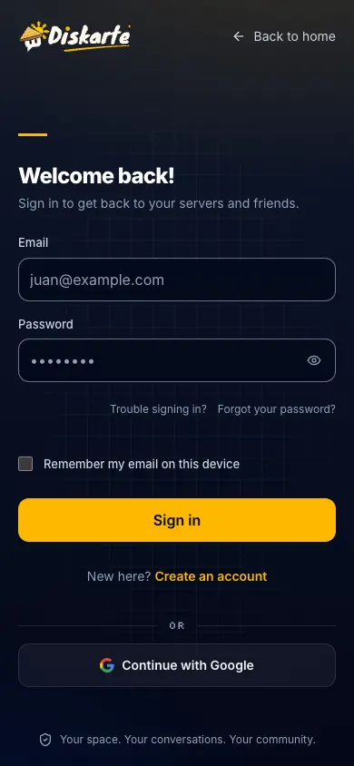

# Sign-in and account recovery

Fixes for passwords, two-factor codes, expired links and sign-in errors.

## I forgot my password

1. On the sign-in page choose **Forgot your password?**.
2. Enter your email. For privacy, Diskarte always says it sent a link, whether or not that email has an
   account.
3. Open the link in the email (check Spam) and choose a new password: at least 10 characters with an
   uppercase letter, a lowercase letter, a number and a symbol.

## "Too many requests"

You tried to sign in several times in a minute. Wait a minute and try again.

## The confirmation or reset link doesn't work

Links work once and expire. Request a new one. If you opened it on a different device or browser,
that's fine — but use the newest link.

## I'm asked for a code after my password

You turned on **two-factor sign-in**. Open your authenticator app and enter the 6-digit code for
Diskarte. If you lost access to your authenticator, contact the people who run your Diskarte server;
they can remove two-factor from your account after confirming it's you.

## "Your session ended"

You were signed out — for example after "sign out everywhere", a password change elsewhere, or an
account action by an administrator. Sign in again.

## I'm sent to "New password" every time I sign in

Your account was created with a temporary password. Choose your own password once and you'll go
straight in afterwards.

## Sign-up says registrations are paused

This Diskarte server only accepts invited members at the moment.

## Google or GitHub sign-in fails

Try again, or sign in with email and password if you set one. If the button is missing, that sign-in
method isn't enabled on this server.

## Keep your account safe

Use a unique password, turn on two-factor sign-in, and use **Settings → Devices & Sessions → sign
out everywhere** after using a shared computer.
