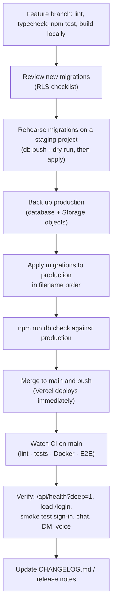

# Deployment and operations

Diskarte needs three things: the Next.js app (Vercel, or the Docker image on Render or any container
host), a Supabase project and a LiveKit project. All three have free tiers that are enough for small
communities.

| Environment | App | Database | Media | Notes |
| --- | --- | --- | --- | --- |
| Local | `npm run dev` (or `docker compose up`) | Hosted dev project, or `npx supabase start` (Docker) | LiveKit Cloud or `docker compose --profile livekit up livekit` | [Quick start](../getting-started/quick-start.md) |
| CI | Standalone build | `supabase start` in the runner (migrations applied) | `livekit-server --dev` container | Throwaway; no secrets |
| Production | **Vercel** (`https://diskarte-ten.vercel.app`), deploys `main` on push | Supabase (hosted) | LiveKit Cloud | Migrations applied by hand |
| Alternative | Render Docker web service ([`render.yaml`](../../render.yaml)) | same | same | Pages on a non-`SITE_URL` host 308-redirect to `SITE_URL` |

There is no separate staging environment in the repository; use a second Supabase project (and a
Vercel preview deployment pointed at it) to rehearse migrations.

## 1. Supabase

1. Create a project. Pick the region closest to your users (Singapore for the Philippines) **and**
   put your app's serverless functions next to it — every request makes several database round trips.
2. Apply the schema — every file in [`supabase/migrations/`](../../supabase/migrations) in filename
   order, either:
   - **CLI** from the repository root: `npx supabase link --project-ref <ref>` then
     `npx supabase db push --dry-run` (review) and `npx supabase db push`; or
   - **SQL Editor**: run each file in order. Keep a note of what you applied; the SQL Editor doesn't
     record migration history.
3. **Auth → URL configuration**: Site URL = your `SITE_URL`; add `<SITE_URL>/auth/callback` (and
   `http://localhost:3000/auth/callback` for development) to redirect URLs.
4. **Auth → Providers → Email**: confirm email on; minimum password length 10 with lowercase,
   uppercase, digits and symbols.
5. **OAuth (optional)**: create GitHub/Google/Discord OAuth apps whose only redirect URI is
   `https://<ref>.supabase.co/auth/v1/callback`; list the enabled ones in `AUTH_OAUTH_PROVIDERS`.
6. **Realtime → Settings**: turn **off** "Allow public access".
7. *(Optional)* Confirm-signup email template using the token-hash flow:
   `{{ .SiteURL }}/auth/confirm?token_hash={{ .TokenHash }}&type=email&next=/onboarding`.
8. *(Optional, recommended)* Platform jobs: run
   [`diskarte/docs/sql/enable-platform-jobs.sql`](../../diskarte/docs/sql/enable-platform-jobs.sql)
   as the database owner (scheduled messages while the author is away, status expiry, recurring
   announcements, moments purge).
9. *(Optional)* Web Push: follow [`diskarte/docs/web-push.md`](../../diskarte/docs/web-push.md)
   (Vault secrets, then [`enable-web-push.sql`](../../diskarte/docs/sql/enable-web-push.sql)).
10. Copy the project URL → `SUPABASE_URL` and the anon/publishable key → `SUPABASE_ANON_KEY`.

## 2. LiveKit Cloud

1. Create a project; copy its `wss://…` URL → `LIVEKIT_URL`.
2. Settings → Keys → create a key → `LIVEKIT_API_KEY`, `LIVEKIT_API_SECRET`.
3. *(Optional)* Webhooks → `https://<site>/api/livekit/webhook` signed with the same key, and set
   `SUPABASE_SERVICE_ROLE_KEY` on the app, so voice previews update when someone disconnects
   unexpectedly.

## 3a. Vercel (production)

1. Import the repository; **Root Directory `diskarte`**, framework Next.js, default build
   (`npm ci`, `npm run build`).
2. Environment variables (Production): the five required ones, `SITE_URL=https://<project>.vercel.app`
   (the stable domain, not a preview URL), `AUTH_OAUTH_PROVIDERS`, and
   `UPSTASH_REDIS_REST_URL` / `UPSTASH_REDIS_REST_TOKEN` (serverless instances don't share memory, so
   auth rate limits are otherwise per instance). Optional: push, GIPHY, service role. Full list:
   [environment reference](../reference/environment.md).
3. Settings → Functions → region next to the Supabase project.
4. If deployment protection covers the production domain, make sure `/api/livekit/webhook` and
   `/api/push/dispatch` remain reachable by their external callers.
5. Add the Vercel URL to Supabase's Site URL / redirect list.

Changing environment variables requires a redeploy.

## 3b. Render or any Docker host

The [`Dockerfile`](../../diskarte/Dockerfile) builds a Next.js standalone server on `node:22-alpine`
and runs it on plain Alpine with the system `nodejs` package and English ICU (all time zones; the
build fails if `Asia/Manila` formatting breaks), as uid 1001, with a `HEALTHCHECK` on `/api/health`.
CI fails the build if the image reaches 150 MB.

```bash
cd diskarte
docker build -t diskarte .
docker run --rm -p 3000:3000 --env-file .env.local diskarte
```

Render: **New → Blueprint** reads [`render.yaml`](../../render.yaml) (Docker, free plan, Singapore,
`rootDir: diskarte`, health check `/api/health`, `NODE_OPTIONS=--max-old-space-size=384`,
`SIGNUP_MODE=invite`). Fill in the prompted Supabase/LiveKit values. Free Render services sleep after
~15 idle minutes (30–60 s cold start); an external pinger on `/api/health` keeps them warm.

[`docker-compose.yml`](../../docker-compose.yml) runs the image read-only with `no-new-privileges`
and an optional local LiveKit (`--profile livekit`).

## 4. First super admin

Sign up in the app, then from `diskarte/`:

```bash
SUPABASE_URL=… SUPABASE_SERVICE_ROLE_KEY=… npm run admin:grant -- you@example.com
```

Reload: the shield on the server rail opens the Control Center. Further roles are managed there.
To close registrations set `SIGNUP_MODE=invite` **and** turn off "Allow new users to sign up" in
Supabase (otherwise OAuth can still create accounts).

## Release procedure



Rules that come from real incidents:

- **Migrations first, then code.** Features must tolerate a missing migration (hidden UI or an
  "unavailable" state), but applying first avoids that window. Deploying never applies SQL.
- **Watch CI after every push to `main`.** Vercel deploys in parallel with CI, so a red run may
  already be live. On 2026-10-13 a client component in the root layout touched `window` during
  render and every page returned 500 for ~25 minutes while CI was red. After each push:
  `curl -fsS -o /dev/null -w '%{http_code}\n' https://diskarte-ten.vercel.app/login` should print
  `200`.
- **Batch pushes when people are in calls.** Each deploy makes the next in-app navigation a full
  reload, which drops calls (the 30-second rejoin softens this).
- Anything rendered in the root layout must be SSR-safe; a local check is `npm run build && node
  .next/standalone/server.js` and curling a few pages.

### Pending-migration checklist

Release notes list the migrations each release needs (for example
[`RELEASE-2026-10-29.md`](../../diskarte/RELEASE-2026-10-29.md)). `npm run db:check --prefix diskarte`
probes a project with the public key for the objects newer features need (exit 0 present, 2 missing,
1 inconclusive). It does not prove policies or live delivery.

## Health checks and verification

| Check | Command | Healthy |
| --- | --- | --- |
| Liveness | `curl -s $SITE_URL/api/health` | `"status":"ok"` (always 200 while serving) |
| Readiness | `curl -s -w '%{http_code}' $SITE_URL/api/health?deep=1` | 200 with `"supabase":"ok"`; 503 when degraded |
| Database objects | `npm run db:check --prefix diskarte` | all `present` |
| Platform job | `select jobname, active from cron.job;` | `diskarte-platform-tick` active |
| Push | see [web-push.md diagnostics](../../diskarte/docs/web-push.md#diagnostics-and-recovery) | deliveries leaving `pending` |
| Pages | load `/login`, sign in, open a channel, send a message, start a two-person call | no errors |
| Help Center | load `/docs`, search for "install", open `/docs/developers/architecture` (diagrams render) | 200, results, SVG diagrams |

## Logging and monitoring

- **Server logs** (Vercel/Render): request errors are emitted as JSON records with the route
  *template*, method and error class only — no URLs, query strings, headers or messages
  ([`lib/server-observability.ts`](../../diskarte/src/lib/server-observability.ts)). The push
  dispatcher logs `push_batch` counts.
- **Client diagnostics**: Settings → Advanced → Connection diagnostics shows a bounded, session-only
  log of Realtime/call/message events. Nothing is sent to a third party.
- **Usage**: Vercel Analytics (page views) and the Control Center's Traffic tab (unique browsers per
  Manila day, from `site_visits`).
- **Supabase**: dashboard logs, `cron.job_run_details`, `net._http_response`, advisors.
- There is no alerting or uptime monitoring configured in the repository. An external uptime check
  on `/api/health?deep=1` is the cheapest addition.

## Backup and restore

- Use Supabase's backups or a logical dump that includes roles, schema, data **and** the custom
  Auth/Storage/Realtime policies and triggers Diskarte adds.
- Database backups contain Storage *metadata* only. Back up the bytes of `attachments`, `avatars`,
  `emoji`, `soundboard` and `moments` separately.
- Restore into an isolated project first. Check user and membership counts, messages, attachments,
  RPC signatures, private Realtime authorization and RLS with a member and a non-member account.
  Re-enable the Realtime publication, Auth redirect URLs and providers, cron jobs and (if used) Vault
  secrets, and keep push **disabled** until subscriptions and secrets are reviewed.
- Treat backups as private user data: restricted access, encryption, defined retention, never in git.
- A backup is not verified until a restore drill succeeds. **No production restore drill has been
  recorded.**

## Rollback

| Situation | Action |
| --- | --- |
| App regression | Redeploy the previous deployment (Vercel: promote the previous production deployment; Render: redeploy the previous commit). Leave the database as is — older code ignores additive columns |
| Bad migration | Write a **forward** fix migration, test it against a restored copy, apply it. Don't drop tables or reset migration history. Keep stricter policies (rolling back the event visibility policy would reintroduce a private-channel leak) |
| Push misbehaving | `update private_push.configuration set enabled = false;` and `select cron.unschedule('diskarte-push-recovery');` before rolling back code |
| Platform job misbehaving | `select cron.unschedule('diskarte-platform-tick');` |
| Data loss | Restore from backup only for confirmed loss, accounting for writes since the backup |

## Incident response

1. **Confirm and scope**: `/api/health?deep=1`, a page load, Vercel/Render deployment status,
   Supabase status, CI status of the latest `main` commit.
2. **Mitigate**: roll back the app if the latest deploy is the cause; disable push/cron jobs if they
   are; turn on `SIGNUP_MODE=invite` for abuse waves; use the Control Center to revoke sessions or ban
   accounts; rotate any leaked secret (LiveKit key, service role key, webhook token, push secret).
3. **Communicate**: a sticky broadcast from the Control Center reaches every open canvas.
4. **Fix forward**: patch on a branch, run the full local checks, push, watch CI and verify.
5. **Record**: add an entry to the changelog/release notes and, if it changed how you work, a
   rule in this runbook.

## Release management

- `main` is the integration branch and is always deployable; feature branches are merged with a merge
  commit (`merge(scope): …`).
- User-facing changes go in [`diskarte/CHANGELOG.md`](../../diskarte/CHANGELOG.md) under a dated
  heading; releases that need manual steps get a `diskarte/RELEASE-<date>.md` with the migrations,
  optional SQL and what was verified.
- There are no version tags; `/api/health` reports `APP_VERSION` if you set one.
