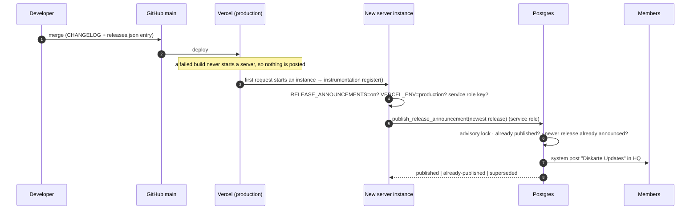

# Release announcements

Every meaningful release gets an official **Diskarte Updates** post in Diskarte HQ `#announcements`,
published automatically once the production deployment is live, plus a What's New card on Home.
Nothing is generated: the post is a fixed format filled from developer-written notes.



## Writing release notes

1. Add user-facing changes to [`diskarte/CHANGELOG.md`](../../diskarte/CHANGELOG.md) as usual.
2. For a release users should hear about, add an entry at the **top** of
   [`diskarte/src/content/releases.json`](../../diskarte/src/content/releases.json):

   ```json
   {
     "id": "2026-11-07-smoother-start",
     "date": "2026-11-07",
     "title": "A smoother start and dependable notifications",
     "summary": "One or two friendly sentences: what changed for people.",
     "highlights": [{ "title": "Feature", "text": "What it does for you.", "href": "/docs/..." }],
     "fixes": ["Plain-language description of a fix people would notice."],
     "links": [{ "label": "Help Center", "href": "/docs" }],
     "requires": ["servers.join_questions"]
   }
   ```

   - `id` is `<date>-<short-name>`; entries are newest first.
   - Links are Help Center paths (`/docs/...`) or full `https://` URLs; the docs test fails on a
     missing page or heading.
   - Skip internal-only changes (refactors, tests, docs fixes) — no entry, no post.
   - `requires` (optional) lists one `table.column` per migration the release depends on. Production
     posts only once every one of them exists; until then the result is `waiting-for-database` and
     the next instance start checks again. Apply the migrations, then redeploy (or wait for a cold
     start) and the post goes out.
3. Merge and deploy as normal. The post appears when the first production instance starts.
4. Check HQ `#announcements` (or Control Center → Broadcast → Release announcements).

The post format is fixed by `formatReleasePost()` in
[`src/lib/releases.ts`](../../diskarte/src/lib/releases.ts): title, date, a summary callout,
"What's new" and "Fixed" lists, and links.

## Turning it on (once per environment)

1. Apply [`20261107000000_release_announcements.sql`](../../supabase/migrations/20261107000000_release_announcements.sql).
2. On the **Production** environment only: `RELEASE_ANNOUNCEMENTS=on` and
   `SUPABASE_SERVICE_ROLE_KEY` (already needed for push and the LiveKit webhook). Redeploy.
3. Preview deployments (`VERCEL_ENV=preview`), local runs and forks never post unless they set the
   flag themselves.

## Guarantees

| Situation | Behaviour |
| --- | --- |
| Many instances start at once | `pg_advisory_xact_lock` serializes them; one posts, the rest get `already-published` |
| Restarts and later cold starts | `already-published` — one cheap RPC per instance start, not awaited |
| Rollback to an older deployment | `superseded`: an older release is never announced after a newer one |
| Failed build / failed deploy | No server starts, so nothing is posted |
| Release migrations not applied yet | `waiting-for-database` (logs name the missing `table.column`); nothing is posted or recorded until they exist |
| Database error, missing channel | Nothing is recorded (the post and record are one transaction); the next instance retries. Logs show `{"event":"release_announcement","result":"failed"}` |
| Someone tries to impersonate it | Only the service role can call the publisher; members can't post in read-only `#announcements`, and a webhook name never sticks to a member's post. The **Official** badge appears only on Diskarte Updates posts in Diskarte HQ |
| Notifications | It's a normal channel post with no mentions: an unread pill in HQ, no push, and HQ mutes apply |

## Correcting or withdrawing a post

Control Center → **Broadcast** → **Release announcements** (super admins):

- **Publish now** — retry a release that hasn't been posted.
- **Withdraw** — deletes the post and keeps the record, so it won't be posted again automatically.
- **Republish** — deletes the post and the record, then posts the current `releases.json` text. To fix
  a typo: correct the notes, deploy, then Republish.

All three are logged in the Control Center audit log (`release.withdraw`, `release.reset`).

## What's New on Home

Home shows the newest release this browser hasn't acknowledged, with up to three highlights and links
to the full post and the changelog. A first visit records the current release silently (new members
don't need a changelog). Dismissing it, or opening the full update, marks everything up to the newest
release as seen on this browser.
