# Database reference

> **Generated file — do not edit by hand.** Rebuild with `npm run docs:db --prefix diskarte` after changing
> `supabase/migrations/`. The Vitest suite fails when this file is stale. Descriptions come from the SQL
> comment directly above each `create table` / `create function`, so document objects there.

Built by applying all 58 migrations to PGlite with the Supabase stand-ins in
`diskarte/tests/db/supabase-shim.sql`. Supabase-managed schemas (`auth`, `storage`, `realtime`) are only
shown where Diskarte adds policies or rows. Table grants reflect Supabase's default privileges (mirrored by
the shim) minus the migrations' revokes; RLS policies, not grants, decide which rows a role sees.
For the narrative overview see [database.md](../database.md).

**63 tables · 118 RLS policies · 213 functions · 69 triggers · 31 Realtime tables · 5 Storage buckets**

## Contents

- [Tables](#tables)
- [Enums](#enums)
- [Functions](#functions)
- [Realtime publication](#realtime-publication)
- [Storage buckets and policies](#storage-buckets-and-policies)
- [Realtime channel authorization](#realtime-channel-authorization)
- [Foreign-key map](#foreign-key-map)
- [Migration history](#migration-history)

## Tables

| Table | RLS | Realtime | Description |
| --- | --- | --- | --- |
| [`private_push.attempts`](#private-push-attempts) | on |  |  |
| [`private_push.configuration`](#private-push-configuration) | **off** |  |  |
| [`private_push.deliveries`](#private-push-deliveries) | on |  |  |
| [`private_push.outbox`](#private-push-outbox) | on |  |  |
| [`private_push.subscriptions`](#private-push-subscriptions) | on |  |  |
| [`public.account_controls`](#public-account-controls) | on | yes | Account controls: bans, revoked sessions, status overrides |
| [`public.account_state`](#public-account-state) | on | yes | Private, versioned preferences and text drafts. No device identifiers or attachment URLs. |
| [`public.admin_audit_logs`](#public-admin-audit-logs) | on | yes | Audit log |
| [`public.audit_logs`](#public-audit-logs) | on |  | Audit log ("Bantay-Bayan" admin panel) |
| [`public.call_rings`](#public-call-rings) | on | yes | Ringing: incoming call pop-ups for DM calls and "ring to voice" pings. A ring is one caller → one callee invitation that lives for 45 seconds. Clients never … |
| [`public.channel_access`](#public-channel-access) | on |  |  |
| [`public.channel_reads`](#public-channel-reads) | on |  |  |
| [`public.channel_webhooks`](#public-channel-webhooks) | on |  |  |
| [`public.channels`](#public-channels) | on | yes | channels |
| [`public.direct_messages`](#public-direct-messages) | on | yes |  |
| [`public.dm_conversations`](#public-dm-conversations) | on | yes | Direct messages and group DMs |
| [`public.dm_participants`](#public-dm-participants) | on | yes |  |
| [`public.event_rsvps`](#public-event-rsvps) | on | yes |  |
| [`public.forum_post_state`](#public-forum-post-state) | on |  |  |
| [`public.forum_votes`](#public-forum-votes) | on |  |  |
| [`public.friend_favourites`](#public-friend-favourites) | on |  |  |
| [`public.friend_nicknames`](#public-friend-nicknames) | on |  |  |
| [`public.friendships`](#public-friendships) | on | yes | Friends and blocks |
| [`public.join_requests`](#public-join-requests) | on | yes |  |
| [`public.lfg_beacons`](#public-lfg-beacons) | on | yes | LFG beacons |
| [`public.lfg_party_members`](#public-lfg-party-members) | on | yes |  |
| [`public.member_roles`](#public-member-roles) | on | yes |  |
| [`public.member_warnings`](#public-member-warnings) | on | yes | Warnings |
| [`public.member_xp`](#public-member-xp) | on |  |  |
| [`public.members`](#public-members) | on | yes | members (server membership + RBAC role) |
| [`public.message_edits`](#public-message-edits) | on |  |  |
| [`public.message_mentions`](#public-message-mentions) | on | yes |  |
| [`public.messages`](#public-messages) | on | yes | messages |
| [`public.moment_mutes`](#public-moment-mutes) | on |  | Muting hides someone's moments from you without unfriending them. |
| [`public.moments`](#public-moments) | on |  |  |
| [`public.platform_admins`](#public-platform-admins) | on |  | Platform admins |
| [`public.poll_votes`](#public-poll-votes) | on | yes |  |
| [`public.polls`](#public-polls) | on | yes |  |
| [`public.privacy_settings`](#public-privacy-settings) | on |  |  |
| [`public.problem_reports`](#public-problem-reports) | on |  |  |
| [`public.profiles`](#public-profiles) | on |  | profiles |
| [`public.reactions`](#public-reactions) | on | yes | reactions |
| [`public.release_announcements`](#public-release-announcements) | on |  | One row per announced release. Readable by everyone signed in (the What's New status); written only by the definer functions below. |
| [`public.rules_acceptances`](#public-rules-acceptances) | on |  |  |
| [`public.saved_messages`](#public-saved-messages) | on |  |  |
| [`public.scheduled_messages`](#public-scheduled-messages) | on |  |  |
| [`public.server_announcements`](#public-server-announcements) | on |  |  |
| [`public.server_badges`](#public-server-badges) | on | yes | Server support: badges (Server Booster, Lodi Supporter, GCash Contributor) |
| [`public.server_bans`](#public-server-bans) | on |  | Bans |
| [`public.server_emojis`](#public-server-emojis) | on | yes |  |
| [`public.server_events`](#public-server-events) | on | yes |  |
| [`public.server_invites`](#public-server-invites) | on |  |  |
| [`public.server_roles`](#public-server-roles) | on | yes |  |
| [`public.servers`](#public-servers) | on | yes | servers ("Tambayan") |
| [`public.site_visits`](#public-site-visits) | on |  |  |
| [`public.soundboard_clips`](#public-soundboard-clips) | on | yes | Soundboard (uploaded clips; the 8-bit meme sounds are built into the client) |
| [`public.system_broadcasts`](#public-system-broadcasts) | on | yes | System broadcasts |
| [`public.system_creators`](#public-system-creators) | on |  | The creators: the only people who post in HQ's #announcements (they are HQ's admins). Managed from the SQL Editor only — clients can neither read nor change … |
| [`public.user_blocks`](#public-user-blocks) | on |  |  |
| [`public.user_devices`](#public-user-devices) | on | yes | Device heartbeats (presence inspector) |
| [`public.user_notes`](#public-user-notes) | on |  |  |
| [`public.workspace_assets`](#public-workspace-assets) | on | yes | Separate additive assets keep older workspace clients compatible with notes/boards/focus. |
| [`public.workspace_documents`](#public-workspace-documents) | on | yes |  |

### `private_push.attempts`

RLS **enabled** · created in `20261015000000_web_push`

Grants: none to `anon` / `authenticated` (reachable only through functions)

| Column | Type | Null | Default |
| --- | --- | --- | --- |
| `id` | `bigint` |  | identity |
| `delivery_id` | `uuid` |  |  |
| `attempted_at` | `timestamp with time zone` |  | `now()` |
| `status` | `integer` | yes |  |
| `code` | `text` |  |  |

| Constraint | Kind | Definition |
| --- | --- | --- |
| `attempts_code_check` | check | `CHECK ((length(code) <= 40))` |
| `attempts_delivery_id_fkey` | foreign key | `FOREIGN KEY (delivery_id) REFERENCES private_push.deliveries(id) ON DELETE CASCADE` |
| `attempts_pkey` | primary key | `PRIMARY KEY (id)` |

No policies: with RLS on, direct table access returns nothing; only SECURITY DEFINER functions read or write it.

### `private_push.configuration`

RLS **disabled** · created in `20261015000000_web_push`

Grants: none to `anon` / `authenticated` (reachable only through functions)

| Column | Type | Null | Default |
| --- | --- | --- | --- |
| `singleton` | `boolean` |  | `true` |
| `enabled` | `boolean` |  | `false` |

| Constraint | Kind | Definition |
| --- | --- | --- |
| `configuration_singleton_check` | check | `CHECK (singleton)` |
| `configuration_pkey` | primary key | `PRIMARY KEY (singleton)` |

### `private_push.deliveries`

RLS **enabled** · created in `20261015000000_web_push`

Grants: none to `anon` / `authenticated` (reachable only through functions)

| Column | Type | Null | Default |
| --- | --- | --- | --- |
| `id` | `uuid` |  | `gen_random_uuid()` |
| `event_id` | `uuid` |  |  |
| `subscription_id` | `uuid` | yes |  |
| `status` | `text` |  | `'pending'::text` |
| `attempts` | `integer` |  | `0` |
| `next_attempt_at` | `timestamp with time zone` |  | `now()` |
| `lease` | `uuid` | yes |  |
| `lease_until` | `timestamp with time zone` | yes |  |
| `last_status` | `integer` | yes |  |
| `last_code` | `text` | yes |  |

| Constraint | Kind | Definition |
| --- | --- | --- |
| `deliveries_last_code_check` | check | `CHECK ((length(last_code) <= 40))` |
| `deliveries_status_check` | check | `CHECK ((status = ANY (ARRAY['pending'::text, 'sending'::text, 'sent'::text, 'skipped'::text, 'failed'::text])))` |
| `deliveries_event_id_fkey` | foreign key | `FOREIGN KEY (event_id) REFERENCES private_push.outbox(id) ON DELETE CASCADE` |
| `deliveries_subscription_id_fkey` | foreign key | `FOREIGN KEY (subscription_id) REFERENCES private_push.subscriptions(id) ON DELETE SET NULL` |
| `deliveries_pkey` | primary key | `PRIMARY KEY (id)` |
| `deliveries_event_id_subscription_id_key` | unique | `UNIQUE (event_id, subscription_id)` |

Indexes:

- `CREATE INDEX push_deliveries_due ON private_push.deliveries (next_attempt_at) WHERE (status = ANY (ARRAY['pending'::text, 'sending'::text]))`

No policies: with RLS on, direct table access returns nothing; only SECURITY DEFINER functions read or write it.

### `private_push.outbox`

RLS **enabled** · created in `20261015000000_web_push`

Grants: none to `anon` / `authenticated` (reachable only through functions)

| Column | Type | Null | Default |
| --- | --- | --- | --- |
| `id` | `uuid` |  | `gen_random_uuid()` |
| `user_id` | `uuid` |  |  |
| `actor_id` | `uuid` | yes |  |
| `kind` | `text` |  |  |
| `source_id` | `uuid` |  |  |
| `dedupe_key` | `text` |  |  |
| `created_at` | `timestamp with time zone` |  | `now()` |
| `expires_at` | `timestamp with time zone` |  |  |

| Constraint | Kind | Definition |
| --- | --- | --- |
| `outbox_dedupe_key_check` | check | `CHECK ((length(dedupe_key) <= 200))` |
| `outbox_kind_check` | check | `CHECK ((kind = ANY (ARRAY['dm'::text, 'mention'::text, 'reply'::text, 'friend'::text, 'invitation'::text, 'call'::text, 'event'::text, 'moderation'::text, 'security'::text, 'test'::text])))` |
| `outbox_actor_id_fkey` | foreign key | `FOREIGN KEY (actor_id) REFERENCES profiles(id) ON DELETE CASCADE` |
| `outbox_user_id_fkey` | foreign key | `FOREIGN KEY (user_id) REFERENCES profiles(id) ON DELETE CASCADE` |
| `outbox_pkey` | primary key | `PRIMARY KEY (id)` |
| `outbox_user_id_dedupe_key_key` | unique | `UNIQUE (user_id, dedupe_key)` |

Indexes:

- `CREATE INDEX push_outbox_user_time ON private_push.outbox (user_id, created_at DESC)`

No policies: with RLS on, direct table access returns nothing; only SECURITY DEFINER functions read or write it.

Triggers:

- `push_outbox_fanout AFTER INSERT ON private_push.outbox FOR EACH ROW EXECUTE FUNCTION private_push.fanout()`

### `private_push.subscriptions`

RLS **enabled** · created in `20261015000000_web_push`

Grants: none to `anon` / `authenticated` (reachable only through functions)

| Column | Type | Null | Default |
| --- | --- | --- | --- |
| `id` | `uuid` |  | `gen_random_uuid()` |
| `user_id` | `uuid` |  |  |
| `session_id` | `uuid` |  |  |
| `device_id` | `uuid` |  |  |
| `endpoint` | `text` |  |  |
| `p256dh` | `text` |  |  |
| `auth_key` | `text` |  |  |
| `label` | `text` |  |  |
| `created_at` | `timestamp with time zone` |  | `now()` |
| `updated_at` | `timestamp with time zone` |  | `now()` |
| `last_delivered_at` | `timestamp with time zone` | yes |  |

| Constraint | Kind | Definition |
| --- | --- | --- |
| `subscriptions_endpoint_check` | check | `CHECK (((length(endpoint) >= 30) AND (length(endpoint) <= 2048)))` |
| `subscriptions_label_check` | check | `CHECK (((length(label) >= 1) AND (length(label) <= 80)))` |
| `subscriptions_session_id_fkey` | foreign key | `FOREIGN KEY (session_id) REFERENCES auth.sessions(id) ON DELETE CASCADE` |
| `subscriptions_user_id_fkey` | foreign key | `FOREIGN KEY (user_id) REFERENCES profiles(id) ON DELETE CASCADE` |
| `subscriptions_pkey` | primary key | `PRIMARY KEY (id)` |
| `subscriptions_endpoint_key` | unique | `UNIQUE (endpoint)` |
| `subscriptions_user_id_device_id_key` | unique | `UNIQUE (user_id, device_id)` |

Indexes:

- `CREATE INDEX push_subscriptions_session ON private_push.subscriptions (session_id)`
- `CREATE INDEX push_subscriptions_user ON private_push.subscriptions (user_id)`

No policies: with RLS on, direct table access returns nothing; only SECURITY DEFINER functions read or write it.

### `public.account_controls`

Account controls: bans, revoked sessions, status overrides

RLS **enabled** · in the `supabase_realtime` publication · created in `20261006000000_admin_control_center`

Grants: `authenticated` SELECT

| Column | Type | Null | Default |
| --- | --- | --- | --- |
| `user_id` | `uuid` |  |  |
| `banned_until` | `timestamp with time zone` | yes |  |
| `ban_reason` | `text` | yes |  |
| `banned_by` | `uuid` | yes |  |
| `sessions_revoked_at` | `timestamp with time zone` | yes |  |
| `status_override` | `jsonb` | yes |  |
| `status_override_at` | `timestamp with time zone` | yes |  |
| `updated_at` | `timestamp with time zone` |  | `now()` |

| Constraint | Kind | Definition |
| --- | --- | --- |
| `account_controls_ban_reason_check` | check | `CHECK (((ban_reason IS NULL) OR (char_length(ban_reason) <= 300)))` |
| `account_controls_status_override_check` | check | `CHECK (((status_override IS NULL) OR (jsonb_typeof(status_override) = 'object'::text)))` |
| `account_controls_banned_by_fkey` | foreign key | `FOREIGN KEY (banned_by) REFERENCES auth.users(id) ON DELETE SET NULL` |
| `account_controls_user_id_fkey` | foreign key | `FOREIGN KEY (user_id) REFERENCES auth.users(id) ON DELETE CASCADE` |
| `account_controls_pkey` | primary key | `PRIMARY KEY (user_id)` |

| Policy | Command | Roles | Using | With check |
| --- | --- | --- | --- | --- |
| people see their own account controls; super admins see all | SELECT | authenticated | `((user_id = ( SELECT auth.uid() AS uid)) OR is_super_admin())` |  |

Triggers:

- `push_account AFTER INSERT OR UPDATE ON public.account_controls FOR EACH ROW EXECUTE FUNCTION private_push.capture()`

### `public.account_state`

Private, versioned preferences and text drafts. No device identifiers or attachment URLs.

RLS **enabled** · in the `supabase_realtime` publication · created in `20261014020000_account_state`

Grants: `authenticated` SELECT

| Column | Type | Null | Default |
| --- | --- | --- | --- |
| `user_id` | `uuid` |  |  |
| `key` | `text` |  |  |
| `value` | `jsonb` |  |  |
| `revision` | `integer` |  | `1` |
| `updated_at` | `timestamp with time zone` |  | `now()` |

| Constraint | Kind | Definition |
| --- | --- | --- |
| `account_state_key_check` | check | `CHECK ((length(key) <= 120))` |
| `account_state_revision_check` | check | `CHECK ((revision > 0))` |
| `account_state_value_check` | check | `CHECK ((octet_length((value)::text) <= 24000))` |
| `account_state_user_id_fkey` | foreign key | `FOREIGN KEY (user_id) REFERENCES profiles(id) ON DELETE CASCADE` |
| `account_state_pkey` | primary key | `PRIMARY KEY (user_id, key)` |

| Policy | Command | Roles | Using | With check |
| --- | --- | --- | --- | --- |
| account state is private | SELECT | authenticated | `((user_id = ( SELECT auth.uid() AS uid)) AND mfa_ok() AND (NOT is_platform_banned()))` |  |

### `public.admin_audit_logs`

Audit log

RLS **enabled** · in the `supabase_realtime` publication · created in `20261006000000_admin_control_center`

Grants: `authenticated` SELECT

| Column | Type | Null | Default |
| --- | --- | --- | --- |
| `id` | `uuid` |  | `gen_random_uuid()` |
| `actor_id` | `uuid` | yes |  |
| `action` | `text` |  |  |
| `target_user_id` | `uuid` | yes |  |
| `details` | `jsonb` |  | `'{}'::jsonb` |
| `created_at` | `timestamp with time zone` |  | `now()` |

| Constraint | Kind | Definition |
| --- | --- | --- |
| `admin_audit_logs_action_check` | check | `CHECK (((action ~ '^[a-z_]+\.[a-z_]+$'::text) AND (char_length(action) <= 64)))` |
| `admin_audit_logs_details_check` | check | `CHECK ((jsonb_typeof(details) = 'object'::text))` |
| `admin_audit_logs_actor_id_fkey` | foreign key | `FOREIGN KEY (actor_id) REFERENCES auth.users(id) ON DELETE SET NULL` |
| `admin_audit_logs_target_user_id_fkey` | foreign key | `FOREIGN KEY (target_user_id) REFERENCES auth.users(id) ON DELETE SET NULL` |
| `admin_audit_logs_pkey` | primary key | `PRIMARY KEY (id)` |

Indexes:

- `CREATE INDEX admin_audit_logs_created_idx ON public.admin_audit_logs (created_at DESC)`
- `CREATE INDEX admin_audit_logs_target_idx ON public.admin_audit_logs (target_user_id, created_at DESC) WHERE (target_user_id IS NOT NULL)`

| Policy | Command | Roles | Using | With check |
| --- | --- | --- | --- | --- |
| super admins read the admin audit log | SELECT | authenticated | `is_super_admin()` |  |

### `public.audit_logs`

Audit log ("Bantay-Bayan" admin panel)

RLS **enabled** · created in `20260927000000_community`

Grants: `authenticated` REFERENCES, SELECT, TRIGGER

| Column | Type | Null | Default |
| --- | --- | --- | --- |
| `id` | `bigint` |  | identity |
| `server_id` | `uuid` |  |  |
| `actor_id` | `uuid` | yes |  |
| `action` | `text` |  |  |
| `target_type` | `text` | yes |  |
| `target_id` | `uuid` | yes |  |
| `metadata` | `jsonb` |  | `'{}'::jsonb` |
| `created_at` | `timestamp with time zone` |  | `now()` |
| `channel_id` | `uuid` | yes |  |
| `channel_private` | `boolean` |  | `false` |

| Constraint | Kind | Definition |
| --- | --- | --- |
| `audit_logs_action_check` | check | `CHECK ((action ~ '^[a-z_]+\.[a-z_]+$'::text))` |
| `audit_logs_metadata_check` | check | `CHECK ((jsonb_typeof(metadata) = 'object'::text))` |
| `audit_logs_target_type_check` | check | `CHECK ((target_type = ANY (ARRAY['member'::text, 'channel'::text, 'message'::text, 'server'::text, 'badge'::text, 'soundboard'::text, 'lfg'::text, 'workspace'::text])))` |
| `audit_logs_actor_id_fkey` | foreign key | `FOREIGN KEY (actor_id) REFERENCES profiles(id) ON DELETE SET NULL` |
| `audit_logs_server_id_fkey` | foreign key | `FOREIGN KEY (server_id) REFERENCES servers(id) ON DELETE CASCADE` |
| `audit_logs_pkey` | primary key | `PRIMARY KEY (id)` |

Indexes:

- `CREATE INDEX audit_logs_server_idx ON public.audit_logs (server_id, created_at DESC, id DESC)`

| Policy | Command | Roles | Using | With check |
| --- | --- | --- | --- | --- |
| moderators read the audit log | SELECT | authenticated | `(has_server_role(server_id, 'moderator'::member_role) AND can_read_audit_channel(server_id, channel_id, channel_private))` |  |

Triggers:

- `audit_logs_tag_channel BEFORE INSERT ON public.audit_logs FOR EACH ROW EXECUTE FUNCTION audit_logs_tag_channel()`

### `public.call_rings`

Ringing: incoming call pop-ups for DM calls and "ring to voice" pings. A ring is one caller → one callee invitation that lives for 45 seconds. Clients never write the table directly: `ring_call` validates the relationship (DM participants, or fellow server members for a voice channel; never across a block) and dedupes/limits, `respond_ring` lets the callee accept or decline, `cancel_rings` lets the caller hang up first. Each user watches their own rings over the private Realtime topic `db:rings:<user>`.

RLS **enabled** · in the `supabase_realtime` publication · created in `20261004000000_call_rings`

Grants: `anon` REFERENCES, SELECT, TRIGGER; `authenticated` REFERENCES, SELECT, TRIGGER

| Column | Type | Null | Default |
| --- | --- | --- | --- |
| `id` | `uuid` |  | `gen_random_uuid()` |
| `kind` | `text` |  |  |
| `caller_id` | `uuid` |  |  |
| `callee_id` | `uuid` |  |  |
| `conversation_id` | `uuid` | yes |  |
| `server_id` | `uuid` | yes |  |
| `channel_id` | `uuid` | yes |  |
| `video` | `boolean` |  | `false` |
| `status` | `text` |  | `'ringing'::text` |
| `created_at` | `timestamp with time zone` |  | `now()` |
| `expires_at` | `timestamp with time zone` |  | `(now() + '00:00:45'::interval)` |
| `responded_at` | `timestamp with time zone` | yes |  |

| Constraint | Kind | Definition |
| --- | --- | --- |
| `call_rings_check` | check | `CHECK ((caller_id <> callee_id))` |
| `call_rings_check1` | check | `CHECK ((((kind = 'dm'::text) AND (conversation_id IS NOT NULL)) OR ((kind = 'voice'::text) AND (server_id IS NOT NULL) AND (channel_id IS NOT NULL))))` |
| `call_rings_kind_check` | check | `CHECK ((kind = ANY (ARRAY['dm'::text, 'voice'::text])))` |
| `call_rings_status_check` | check | `CHECK ((status = ANY (ARRAY['ringing'::text, 'accepted'::text, 'declined'::text, 'missed'::text, 'cancelled'::text])))` |
| `call_rings_callee_id_fkey` | foreign key | `FOREIGN KEY (callee_id) REFERENCES profiles(id) ON DELETE CASCADE` |
| `call_rings_caller_id_fkey` | foreign key | `FOREIGN KEY (caller_id) REFERENCES profiles(id) ON DELETE CASCADE` |
| `call_rings_channel_id_fkey` | foreign key | `FOREIGN KEY (channel_id) REFERENCES channels(id) ON DELETE CASCADE` |
| `call_rings_conversation_id_fkey` | foreign key | `FOREIGN KEY (conversation_id) REFERENCES dm_conversations(id) ON DELETE CASCADE` |
| `call_rings_server_id_fkey` | foreign key | `FOREIGN KEY (server_id) REFERENCES servers(id) ON DELETE CASCADE` |
| `call_rings_pkey` | primary key | `PRIMARY KEY (id)` |

Indexes:

- `CREATE INDEX call_rings_callee_idx ON public.call_rings (callee_id, status, expires_at)`
- `CREATE INDEX call_rings_caller_idx ON public.call_rings (caller_id, created_at)`

| Policy | Command | Roles | Using | With check |
| --- | --- | --- | --- | --- |
| callers and callees see their rings | SELECT | authenticated | `((caller_id = ( SELECT auth.uid() AS uid)) OR (callee_id = ( SELECT auth.uid() AS uid)))` |  |

Triggers:

- `push_call AFTER INSERT ON public.call_rings FOR EACH ROW EXECUTE FUNCTION private_push.capture()`

### `public.channel_access`

RLS **enabled** · created in `20261013020000_roles_private_channels`

Grants: `authenticated` DELETE, INSERT, SELECT

| Column | Type | Null | Default |
| --- | --- | --- | --- |
| `id` | `uuid` |  | `gen_random_uuid()` |
| `channel_id` | `uuid` |  |  |
| `server_id` | `uuid` |  |  |
| `user_id` | `uuid` | yes |  |
| `role_id` | `uuid` | yes |  |
| `created_at` | `timestamp with time zone` |  | `now()` |

| Constraint | Kind | Definition |
| --- | --- | --- |
| `channel_access_check` | check | `CHECK (((user_id IS NULL) <> (role_id IS NULL)))` |
| `channel_access_channel_id_server_id_fkey` | foreign key | `FOREIGN KEY (channel_id, server_id) REFERENCES channels(id, server_id) ON DELETE CASCADE` |
| `channel_access_role_id_server_id_fkey` | foreign key | `FOREIGN KEY (role_id, server_id) REFERENCES server_roles(id, server_id) ON DELETE CASCADE` |
| `channel_access_user_id_fkey` | foreign key | `FOREIGN KEY (user_id) REFERENCES profiles(id) ON DELETE CASCADE` |
| `channel_access_pkey` | primary key | `PRIMARY KEY (id)` |

Indexes:

- `CREATE UNIQUE INDEX channel_access_role_idx ON public.channel_access (channel_id, role_id) WHERE (role_id IS NOT NULL)`
- `CREATE UNIQUE INDEX channel_access_user_idx ON public.channel_access (channel_id, user_id) WHERE (user_id IS NOT NULL)`

| Policy | Command | Roles | Using | With check |
| --- | --- | --- | --- | --- |
| admins see and manage private channel access | ALL | authenticated | `has_server_role(server_id, 'admin'::member_role)` | `has_server_role(server_id, 'admin'::member_role)` |

### `public.channel_reads`

RLS **enabled** · created in `20261013040000_unreads_mentions`

Grants: `authenticated` SELECT

| Column | Type | Null | Default |
| --- | --- | --- | --- |
| `user_id` | `uuid` |  | `auth.uid()` |
| `channel_id` | `uuid` |  |  |
| `last_read_at` | `timestamp with time zone` |  | `now()` |

| Constraint | Kind | Definition |
| --- | --- | --- |
| `channel_reads_channel_id_fkey` | foreign key | `FOREIGN KEY (channel_id) REFERENCES channels(id) ON DELETE CASCADE` |
| `channel_reads_user_id_fkey` | foreign key | `FOREIGN KEY (user_id) REFERENCES profiles(id) ON DELETE CASCADE` |
| `channel_reads_pkey` | primary key | `PRIMARY KEY (user_id, channel_id)` |

| Policy | Command | Roles | Using | With check |
| --- | --- | --- | --- | --- |
| people see their own read points | SELECT | authenticated | `(user_id = ( SELECT auth.uid() AS uid))` |  |

### `public.channel_webhooks`

RLS **enabled** · created in `20261029030000_channel_webhooks`

Grants: `authenticated` DELETE

| Column | Type | Null | Default |
| --- | --- | --- | --- |
| `id` | `uuid` |  | `gen_random_uuid()` |
| `server_id` | `uuid` |  |  |
| `channel_id` | `uuid` |  |  |
| `name` | `text` |  |  |
| `token_hash` | `text` |  |  |
| `created_by` | `uuid` | yes |  |
| `created_at` | `timestamp with time zone` |  | `now()` |
| `last_used_at` | `timestamp with time zone` | yes |  |

| Constraint | Kind | Definition |
| --- | --- | --- |
| `channel_webhooks_name_check` | check | `CHECK (((char_length(btrim(name)) >= 1) AND (char_length(btrim(name)) <= 32)))` |
| `channel_webhooks_channel_id_fkey` | foreign key | `FOREIGN KEY (channel_id) REFERENCES channels(id) ON DELETE CASCADE` |
| `channel_webhooks_created_by_fkey` | foreign key | `FOREIGN KEY (created_by) REFERENCES profiles(id) ON DELETE SET NULL` |
| `channel_webhooks_server_id_fkey` | foreign key | `FOREIGN KEY (server_id) REFERENCES servers(id) ON DELETE CASCADE` |
| `channel_webhooks_pkey` | primary key | `PRIMARY KEY (id)` |

Indexes:

- `CREATE INDEX channel_webhooks_server_idx ON public.channel_webhooks (server_id)`

| Policy | Command | Roles | Using | With check |
| --- | --- | --- | --- | --- |
| admins delete their server's webhooks | DELETE | authenticated | `has_server_role(server_id, 'admin'::member_role)` |  |
| admins see their server's webhooks | SELECT | authenticated | `has_server_role(server_id, 'admin'::member_role)` |  |

### `public.channels`

channels

RLS **enabled** · in the `supabase_realtime` publication · created in `20260926000000_schema`

Grants: `authenticated` DELETE, INSERT, REFERENCES, SELECT, TRIGGER, TRUNCATE, UPDATE

| Column | Type | Null | Default |
| --- | --- | --- | --- |
| `id` | `uuid` |  | `gen_random_uuid()` |
| `server_id` | `uuid` |  |  |
| `name` | `text` |  |  |
| `type` | `channel_type` |  | `'text'::channel_type` |
| `category` | `text` |  | `'Text Channels'::text` |
| `topic` | `text` |  | `''::text` |
| `position` | `integer` |  | `0` |
| `created_at` | `timestamp with time zone` |  | `now()` |
| `slowmode_seconds` | `integer` |  | `0` |
| `requires_verification` | `boolean` |  | `false` |
| `read_only` | `boolean` |  | `false` |
| `is_private` | `boolean` |  | `false` |
| `last_message_at` | `timestamp with time zone` | yes |  |
| `forum_mode` | `text` |  | `'discussion'::text` |
| `forum_tags` | `text[]` |  | `'{}'::text[]` |

| Constraint | Kind | Definition |
| --- | --- | --- |
| `channels_category_check` | check | `CHECK (((char_length(btrim(category)) >= 1) AND (char_length(btrim(category)) <= 32)))` |
| `channels_forum_mode_check` | check | `CHECK ((forum_mode = ANY (ARRAY['discussion'::text, 'suggestions'::text])))` |
| `channels_forum_tags_check` | check | `CHECK (((cardinality(forum_tags) <= 12) AND (array_position(forum_tags, NULL::text) IS NULL)))` |
| `channels_name_format` | check | `CHECK (((((type)::text = ANY (ARRAY['text'::text, 'forum'::text])) AND (name ~ '^[a-z0-9][a-z0-9_-]{0,31}$'::text)) OR (((type)::text = 'voice'::text) AND ((char_length(btrim(name)) >= 1) AND (char_length(btrim(name)) <= 32)))))` |
| `channels_slowmode_seconds_check` | check | `CHECK (((slowmode_seconds >= 0) AND (slowmode_seconds <= 21600)))` |
| `channels_topic_check` | check | `CHECK ((char_length(topic) <= 256))` |
| `channels_server_id_fkey` | foreign key | `FOREIGN KEY (server_id) REFERENCES servers(id) ON DELETE CASCADE` |
| `channels_pkey` | primary key | `PRIMARY KEY (id)` |
| `channels_id_server_key` | unique | `UNIQUE (id, server_id)` |

Indexes:

- `CREATE INDEX channels_server_idx ON public.channels (server_id, "position")`

| Policy | Command | Roles | Using | With check |
| --- | --- | --- | --- | --- |
| members can view channels they may see | SELECT | authenticated | `(is_server_member(server_id) AND ((NOT is_private) OR has_channel_grant(id, server_id)))` |  |
| moderators create channels | INSERT | authenticated |  | `has_server_role(server_id, 'moderator'::member_role)` |
| moderators delete channels | DELETE | authenticated | `has_server_role(server_id, 'moderator'::member_role)` |  |
| moderators update channels | UPDATE | authenticated | `has_server_role(server_id, 'moderator'::member_role)` | `has_server_role(server_id, 'moderator'::member_role)` |

Triggers:

- `channels_audit AFTER INSERT OR DELETE OR UPDATE ON public.channels FOR EACH ROW EXECUTE FUNCTION channels_audit()`
- `channels_guard BEFORE UPDATE ON public.channels FOR EACH ROW EXECUTE FUNCTION channels_guard()`
- `channels_private_guard BEFORE UPDATE ON public.channels FOR EACH ROW EXECUTE FUNCTION channels_private_guard()`
- `channels_private_insert_guard BEFORE INSERT ON public.channels FOR EACH ROW EXECUTE FUNCTION channels_private_insert_guard()`

### `public.direct_messages`

RLS **enabled** · in the `supabase_realtime` publication · created in `20260927000000_community`

Grants: `authenticated` DELETE, INSERT, REFERENCES, SELECT, TRIGGER, TRUNCATE, UPDATE

| Column | Type | Null | Default |
| --- | --- | --- | --- |
| `id` | `uuid` |  | `gen_random_uuid()` |
| `conversation_id` | `uuid` |  |  |
| `author_id` | `uuid` | yes |  |
| `content` | `text` |  | `''::text` |
| `sticker` | `text` | yes |  |
| `reply_to_id` | `uuid` | yes |  |
| `edited_at` | `timestamp with time zone` | yes |  |
| `created_at` | `timestamp with time zone` |  | `now()` |
| `attachments` | `jsonb` |  | `'[]'::jsonb` |
| `invite_server_id` | `uuid` | yes |  |

| Constraint | Kind | Definition |
| --- | --- | --- |
| `direct_messages_attachments_check` | check | `CHECK (((jsonb_typeof(attachments) = 'array'::text) AND (jsonb_array_length(attachments) <= 10)))` |
| `direct_messages_content_check` | check | `CHECK ((char_length(content) <= 4000))` |
| `direct_messages_not_empty` | check | `CHECK (((char_length(btrim(content)) > 0) OR (sticker IS NOT NULL) OR (jsonb_array_length(attachments) > 0)))` |
| `direct_messages_sticker_check` | check | `CHECK (((sticker IS NULL) OR (sticker ~ '^[a-z0-9][a-z0-9_-]{1,39}$'::text)))` |
| `direct_messages_author_id_fkey` | foreign key | `FOREIGN KEY (author_id) REFERENCES profiles(id) ON DELETE SET NULL` |
| `direct_messages_conversation_id_fkey` | foreign key | `FOREIGN KEY (conversation_id) REFERENCES dm_conversations(id) ON DELETE CASCADE` |
| `direct_messages_invite_server_id_fkey` | foreign key | `FOREIGN KEY (invite_server_id) REFERENCES servers(id) ON DELETE SET NULL` |
| `direct_messages_reply_to_id_fkey` | foreign key | `FOREIGN KEY (reply_to_id) REFERENCES direct_messages(id) ON DELETE SET NULL` |
| `direct_messages_pkey` | primary key | `PRIMARY KEY (id)` |

Indexes:

- `CREATE INDEX direct_messages_attachments_idx ON public.direct_messages USING gin (attachments jsonb_path_ops)`
- `CREATE INDEX direct_messages_author_idx ON public.direct_messages (author_id, created_at DESC)`
- `CREATE INDEX direct_messages_conversation_idx ON public.direct_messages (conversation_id, created_at DESC, id DESC)`
- `CREATE INDEX direct_messages_search_idx ON public.direct_messages USING gin (to_tsvector('simple'::regconfig, content))`

| Policy | Command | Roles | Using | With check |
| --- | --- | --- | --- | --- |
| authors delete their messages | DELETE | authenticated | `(author_id = ( SELECT auth.uid() AS uid))` |  |
| authors edit their messages | UPDATE | authenticated | `(author_id = ( SELECT auth.uid() AS uid))` | `(author_id = ( SELECT auth.uid() AS uid))` |
| banned accounts cannot send direct messages *(restrictive)* | INSERT | authenticated |  | `(NOT is_platform_banned())` |
| participants read messages | SELECT | authenticated | `is_dm_participant(conversation_id)` |  |
| participants send messages as themselves | INSERT | authenticated |  | `((author_id = ( SELECT auth.uid() AS uid)) AND is_dm_participant(conversation_id))` |

Triggers:

- `direct_messages_after_insert AFTER INSERT ON public.direct_messages FOR EACH ROW EXECUTE FUNCTION direct_messages_after_insert()`
- `direct_messages_before_insert BEFORE INSERT ON public.direct_messages FOR EACH ROW EXECUTE FUNCTION direct_messages_before_insert()`
- `direct_messages_before_update BEFORE UPDATE ON public.direct_messages FOR EACH ROW EXECUTE FUNCTION direct_messages_before_update()`
- `direct_messages_hangout_guard BEFORE INSERT ON public.direct_messages FOR EACH ROW EXECUTE FUNCTION direct_messages_hangout_guard()`
- `dm_attachment_guard BEFORE INSERT OR UPDATE ON public.direct_messages FOR EACH ROW EXECUTE FUNCTION dm_attachment_guard()`
- `push_dm AFTER INSERT ON public.direct_messages FOR EACH ROW EXECUTE FUNCTION private_push.capture()`
- `push_invite_guard BEFORE INSERT OR UPDATE ON public.direct_messages FOR EACH ROW EXECUTE FUNCTION private_push.guard_invite()`

### `public.dm_conversations`

Direct messages and group DMs

RLS **enabled** · in the `supabase_realtime` publication · created in `20260927000000_community`

Grants: `authenticated` REFERENCES, SELECT, TRIGGER

| Column | Type | Null | Default |
| --- | --- | --- | --- |
| `id` | `uuid` |  | `gen_random_uuid()` |
| `kind` | `text` |  |  |
| `name` | `text` | yes |  |
| `owner_id` | `uuid` | yes |  |
| `direct_key` | `text` | yes |  |
| `created_at` | `timestamp with time zone` |  | `now()` |
| `last_message_at` | `timestamp with time zone` |  | `now()` |
| `hangout_until` | `timestamp with time zone` | yes |  |
| `hangout_topic` | `text` | yes |  |

| Constraint | Kind | Definition |
| --- | --- | --- |
| `dm_conversations_check` | check | `CHECK (((kind = 'direct'::text) = (direct_key IS NOT NULL)))` |
| `dm_conversations_hangout_group` | check | `CHECK (((hangout_until IS NULL) OR (kind = 'group'::text)))` |
| `dm_conversations_hangout_topic_check` | check | `CHECK ((hangout_topic = ANY (ARRAY['hangout'::text, 'gaming'::text, 'study'::text, 'project'::text, 'watch'::text, 'create'::text])))` |
| `dm_conversations_kind_check` | check | `CHECK ((kind = ANY (ARRAY['direct'::text, 'group'::text])))` |
| `dm_conversations_name_check` | check | `CHECK (((name IS NULL) OR ((char_length(btrim(name)) >= 1) AND (char_length(btrim(name)) <= 64))))` |
| `dm_conversations_owner_id_fkey` | foreign key | `FOREIGN KEY (owner_id) REFERENCES profiles(id) ON DELETE SET NULL` |
| `dm_conversations_pkey` | primary key | `PRIMARY KEY (id)` |
| `dm_conversations_direct_key_key` | unique | `UNIQUE (direct_key)` |

Indexes:

- `CREATE INDEX dm_conversations_hangout_until_idx ON public.dm_conversations (hangout_until) WHERE (hangout_until IS NOT NULL)`

| Policy | Command | Roles | Using | With check |
| --- | --- | --- | --- | --- |
| participants see conversations | SELECT | authenticated | `is_dm_participant(id)` |  |

### `public.dm_participants`

RLS **enabled** · in the `supabase_realtime` publication · created in `20260927000000_community`

Grants: `authenticated` REFERENCES, SELECT, TRIGGER

| Column | Type | Null | Default |
| --- | --- | --- | --- |
| `conversation_id` | `uuid` |  |  |
| `user_id` | `uuid` |  |  |
| `joined_at` | `timestamp with time zone` |  | `now()` |
| `last_read_at` | `timestamp with time zone` |  | `now()` |

| Constraint | Kind | Definition |
| --- | --- | --- |
| `dm_participants_conversation_id_fkey` | foreign key | `FOREIGN KEY (conversation_id) REFERENCES dm_conversations(id) ON DELETE CASCADE` |
| `dm_participants_user_id_fkey` | foreign key | `FOREIGN KEY (user_id) REFERENCES profiles(id) ON DELETE CASCADE` |
| `dm_participants_pkey` | primary key | `PRIMARY KEY (conversation_id, user_id)` |

Indexes:

- `CREATE INDEX dm_participants_user_idx ON public.dm_participants (user_id)`

| Policy | Command | Roles | Using | With check |
| --- | --- | --- | --- | --- |
| participants see each other | SELECT | authenticated | `is_dm_participant(conversation_id)` |  |

### `public.event_rsvps`

RLS **enabled** · in the `supabase_realtime` publication · created in `20261013120000_server_events`

Grants: `authenticated` DELETE, INSERT, SELECT

| Column | Type | Null | Default |
| --- | --- | --- | --- |
| `event_id` | `uuid` |  |  |
| `server_id` | `uuid` |  |  |
| `user_id` | `uuid` |  | `auth.uid()` |
| `created_at` | `timestamp with time zone` |  | `now()` |

| Constraint | Kind | Definition |
| --- | --- | --- |
| `event_rsvps_event_id_fkey` | foreign key | `FOREIGN KEY (event_id) REFERENCES server_events(id) ON DELETE CASCADE` |
| `event_rsvps_server_id_fkey` | foreign key | `FOREIGN KEY (server_id) REFERENCES servers(id) ON DELETE CASCADE` |
| `event_rsvps_user_id_fkey` | foreign key | `FOREIGN KEY (user_id) REFERENCES profiles(id) ON DELETE CASCADE` |
| `event_rsvps_pkey` | primary key | `PRIMARY KEY (event_id, user_id)` |

Indexes:

- `CREATE INDEX event_rsvps_server_idx ON public.event_rsvps (server_id)`
- `CREATE INDEX event_rsvps_user_idx ON public.event_rsvps (user_id)`

| Policy | Command | Roles | Using | With check |
| --- | --- | --- | --- | --- |
| members mark themselves interested | INSERT | authenticated |  | `((user_id = ( SELECT auth.uid() AS uid)) AND (EXISTS ( SELECT 1 FROM server_events e WHERE ((e.id = event_rsvps.event_id) AND (e.server_id = event_rsvps.server_id)))) AND is_server_member(server_id))` |
| members see who's interested | SELECT | authenticated | `(EXISTS ( SELECT 1 FROM server_events e WHERE ((e.id = event_rsvps.event_id) AND (e.server_id = event_rsvps.server_id))))` |  |
| members take back interest | DELETE | authenticated | `(user_id = ( SELECT auth.uid() AS uid))` |  |

Triggers:

- `event_rsvp_count AFTER INSERT OR DELETE ON public.event_rsvps FOR EACH ROW EXECUTE FUNCTION update_event_count()`

### `public.forum_post_state`

RLS **enabled** · created in `20261108020000_forum_tags_suggestions`

Grants: `authenticated` SELECT

| Column | Type | Null | Default |
| --- | --- | --- | --- |
| `message_id` | `uuid` |  |  |
| `channel_id` | `uuid` |  |  |
| `tags` | `text[]` |  | `'{}'::text[]` |
| `status` | `text` | yes |  |
| `status_by` | `uuid` | yes |  |
| `updated_at` | `timestamp with time zone` |  | `now()` |

| Constraint | Kind | Definition |
| --- | --- | --- |
| `forum_post_state_status_check` | check | `CHECK ((status = ANY (ARRAY['solved'::text, 'under_consideration'::text, 'planned'::text, 'in_progress'::text, 'completed'::text, 'declined'::text])))` |
| `forum_post_state_tags_check` | check | `CHECK ((cardinality(tags) <= 5))` |
| `forum_post_state_channel_id_fkey` | foreign key | `FOREIGN KEY (channel_id) REFERENCES channels(id) ON DELETE CASCADE` |
| `forum_post_state_message_id_fkey` | foreign key | `FOREIGN KEY (message_id) REFERENCES messages(id) ON DELETE CASCADE` |
| `forum_post_state_status_by_fkey` | foreign key | `FOREIGN KEY (status_by) REFERENCES profiles(id) ON DELETE SET NULL` |
| `forum_post_state_pkey` | primary key | `PRIMARY KEY (message_id)` |

Indexes:

- `CREATE INDEX forum_post_state_channel_idx ON public.forum_post_state (channel_id)`

| Policy | Command | Roles | Using | With check |
| --- | --- | --- | --- | --- |
| channel viewers see post state | SELECT | authenticated | `can_view_channel(channel_id)` |  |

### `public.forum_votes`

RLS **enabled** · created in `20261108020000_forum_tags_suggestions`

Grants: `authenticated` SELECT

| Column | Type | Null | Default |
| --- | --- | --- | --- |
| `message_id` | `uuid` |  |  |
| `channel_id` | `uuid` |  |  |
| `user_id` | `uuid` |  |  |
| `created_at` | `timestamp with time zone` |  | `now()` |

| Constraint | Kind | Definition |
| --- | --- | --- |
| `forum_votes_channel_id_fkey` | foreign key | `FOREIGN KEY (channel_id) REFERENCES channels(id) ON DELETE CASCADE` |
| `forum_votes_message_id_fkey` | foreign key | `FOREIGN KEY (message_id) REFERENCES messages(id) ON DELETE CASCADE` |
| `forum_votes_user_id_fkey` | foreign key | `FOREIGN KEY (user_id) REFERENCES profiles(id) ON DELETE CASCADE` |
| `forum_votes_pkey` | primary key | `PRIMARY KEY (message_id, user_id)` |

Indexes:

- `CREATE INDEX forum_votes_channel_idx ON public.forum_votes (channel_id)`
- `CREATE INDEX forum_votes_user_idx ON public.forum_votes (user_id)`

| Policy | Command | Roles | Using | With check |
| --- | --- | --- | --- | --- |
| channel viewers see votes | SELECT | authenticated | `can_view_channel(channel_id)` |  |

### `public.friend_favourites`

RLS **enabled** · created in `20261029000000_profile_connections`

Grants: `authenticated` DELETE, INSERT, SELECT

| Column | Type | Null | Default |
| --- | --- | --- | --- |
| `owner_id` | `uuid` |  | `auth.uid()` |
| `target_id` | `uuid` |  |  |
| `created_at` | `timestamp with time zone` |  | `now()` |

| Constraint | Kind | Definition |
| --- | --- | --- |
| `friend_favourites_check` | check | `CHECK ((owner_id <> target_id))` |
| `friend_favourites_owner_id_fkey` | foreign key | `FOREIGN KEY (owner_id) REFERENCES profiles(id) ON DELETE CASCADE` |
| `friend_favourites_target_id_fkey` | foreign key | `FOREIGN KEY (target_id) REFERENCES profiles(id) ON DELETE CASCADE` |
| `friend_favourites_pkey` | primary key | `PRIMARY KEY (owner_id, target_id)` |

| Policy | Command | Roles | Using | With check |
| --- | --- | --- | --- | --- |
| people manage their own favourites | ALL | authenticated | `(owner_id = ( SELECT auth.uid() AS uid))` | `(owner_id = ( SELECT auth.uid() AS uid))` |

### `public.friend_nicknames`

RLS **enabled** · created in `20261013010000_friend_nicknames`

Grants: `authenticated` DELETE, INSERT, SELECT, UPDATE

| Column | Type | Null | Default |
| --- | --- | --- | --- |
| `owner_id` | `uuid` |  | `auth.uid()` |
| `target_id` | `uuid` |  |  |
| `nickname` | `text` |  |  |

| Constraint | Kind | Definition |
| --- | --- | --- |
| `friend_nicknames_check` | check | `CHECK ((owner_id <> target_id))` |
| `friend_nicknames_nickname_check` | check | `CHECK (((char_length(btrim(nickname)) >= 1) AND (char_length(btrim(nickname)) <= 32)))` |
| `friend_nicknames_owner_id_fkey` | foreign key | `FOREIGN KEY (owner_id) REFERENCES profiles(id) ON DELETE CASCADE` |
| `friend_nicknames_target_id_fkey` | foreign key | `FOREIGN KEY (target_id) REFERENCES profiles(id) ON DELETE CASCADE` |
| `friend_nicknames_pkey` | primary key | `PRIMARY KEY (owner_id, target_id)` |

| Policy | Command | Roles | Using | With check |
| --- | --- | --- | --- | --- |
| people manage their own nicknames for others | ALL | authenticated | `(owner_id = ( SELECT auth.uid() AS uid))` | `(owner_id = ( SELECT auth.uid() AS uid))` |

### `public.friendships`

Friends and blocks

RLS **enabled** · in the `supabase_realtime` publication · created in `20260927000000_community`

Grants: `authenticated` REFERENCES, SELECT, TRIGGER

| Column | Type | Null | Default |
| --- | --- | --- | --- |
| `user_low` | `uuid` |  |  |
| `user_high` | `uuid` |  |  |
| `requested_by` | `uuid` |  |  |
| `status` | `text` |  | `'pending'::text` |
| `created_at` | `timestamp with time zone` |  | `now()` |
| `accepted_at` | `timestamp with time zone` | yes |  |

| Constraint | Kind | Definition |
| --- | --- | --- |
| `friendships_check` | check | `CHECK ((user_low < user_high))` |
| `friendships_check1` | check | `CHECK (((requested_by = user_low) OR (requested_by = user_high)))` |
| `friendships_status_check` | check | `CHECK ((status = ANY (ARRAY['pending'::text, 'accepted'::text])))` |
| `friendships_requested_by_fkey` | foreign key | `FOREIGN KEY (requested_by) REFERENCES profiles(id) ON DELETE CASCADE` |
| `friendships_user_high_fkey` | foreign key | `FOREIGN KEY (user_high) REFERENCES profiles(id) ON DELETE CASCADE` |
| `friendships_user_low_fkey` | foreign key | `FOREIGN KEY (user_low) REFERENCES profiles(id) ON DELETE CASCADE` |
| `friendships_pkey` | primary key | `PRIMARY KEY (user_low, user_high)` |

Indexes:

- `CREATE INDEX friendships_high_idx ON public.friendships (user_high)`

| Policy | Command | Roles | Using | With check |
| --- | --- | --- | --- | --- |
| users see their friendships | SELECT | authenticated | `((( SELECT auth.uid() AS uid) = user_low) OR (( SELECT auth.uid() AS uid) = user_high))` |  |

Triggers:

- `push_friend AFTER INSERT ON public.friendships FOR EACH ROW EXECUTE FUNCTION private_push.capture()`

### `public.join_requests`

RLS **enabled** · in the `supabase_realtime` publication · created in `20261108010000_membership_screening`

Grants: `authenticated` SELECT

| Column | Type | Null | Default |
| --- | --- | --- | --- |
| `server_id` | `uuid` |  |  |
| `user_id` | `uuid` |  |  |
| `answers` | `jsonb` |  | `'[]'::jsonb` |
| `status` | `text` |  | `'pending'::text` |
| `created_at` | `timestamp with time zone` |  | `now()` |
| `decided_by` | `uuid` | yes |  |
| `decided_at` | `timestamp with time zone` | yes |  |

| Constraint | Kind | Definition |
| --- | --- | --- |
| `join_requests_answers_check` | check | `CHECK (((jsonb_typeof(answers) = 'array'::text) AND (jsonb_array_length(answers) <= 5)))` |
| `join_requests_status_check` | check | `CHECK ((status = ANY (ARRAY['pending'::text, 'approved'::text, 'rejected'::text])))` |
| `join_requests_decided_by_fkey` | foreign key | `FOREIGN KEY (decided_by) REFERENCES profiles(id) ON DELETE SET NULL` |
| `join_requests_server_id_fkey` | foreign key | `FOREIGN KEY (server_id) REFERENCES servers(id) ON DELETE CASCADE` |
| `join_requests_user_id_fkey` | foreign key | `FOREIGN KEY (user_id) REFERENCES profiles(id) ON DELETE CASCADE` |
| `join_requests_pkey` | primary key | `PRIMARY KEY (server_id, user_id)` |

Indexes:

- `CREATE INDEX join_requests_pending_idx ON public.join_requests (server_id, created_at) WHERE (status = 'pending'::text)`
- `CREATE INDEX join_requests_user_idx ON public.join_requests (user_id)`

| Policy | Command | Roles | Using | With check |
| --- | --- | --- | --- | --- |
| applicants and moderators see join requests | SELECT | authenticated | `((user_id = ( SELECT auth.uid() AS uid)) OR has_server_role(server_id, 'moderator'::member_role))` |  |

### `public.lfg_beacons`

LFG beacons

RLS **enabled** · in the `supabase_realtime` publication · created in `20260927000000_community`

Grants: `authenticated` REFERENCES, SELECT, TRIGGER

| Column | Type | Null | Default |
| --- | --- | --- | --- |
| `id` | `uuid` |  | `gen_random_uuid()` |
| `server_id` | `uuid` |  |  |
| `author_id` | `uuid` |  |  |
| `game` | `text` |  |  |
| `description` | `text` |  | `''::text` |
| `party_size` | `integer` |  |  |
| `voice_channel_id` | `uuid` | yes |  |
| `status` | `text` |  | `'open'::text` |
| `expires_at` | `timestamp with time zone` |  |  |
| `created_at` | `timestamp with time zone` |  | `now()` |

| Constraint | Kind | Definition |
| --- | --- | --- |
| `lfg_beacons_description_check` | check | `CHECK ((char_length(description) <= 200))` |
| `lfg_beacons_game_check` | check | `CHECK (((char_length(btrim(game)) >= 1) AND (char_length(btrim(game)) <= 48)))` |
| `lfg_beacons_party_size_check` | check | `CHECK (((party_size >= 2) AND (party_size <= 10)))` |
| `lfg_beacons_status_check` | check | `CHECK ((status = ANY (ARRAY['open'::text, 'full'::text, 'closed'::text])))` |
| `lfg_beacons_author_id_fkey` | foreign key | `FOREIGN KEY (author_id) REFERENCES profiles(id) ON DELETE CASCADE` |
| `lfg_beacons_server_id_fkey` | foreign key | `FOREIGN KEY (server_id) REFERENCES servers(id) ON DELETE CASCADE` |
| `lfg_beacons_voice_channel_id_fkey` | foreign key | `FOREIGN KEY (voice_channel_id) REFERENCES channels(id) ON DELETE SET NULL` |
| `lfg_beacons_pkey` | primary key | `PRIMARY KEY (id)` |

Indexes:

- `CREATE INDEX lfg_beacons_server_idx ON public.lfg_beacons (server_id, created_at DESC)`

| Policy | Command | Roles | Using | With check |
| --- | --- | --- | --- | --- |
| members see beacons | SELECT | authenticated | `is_server_member(server_id)` |  |

### `public.lfg_party_members`

RLS **enabled** · in the `supabase_realtime` publication · created in `20260927000000_community`

Grants: `authenticated` REFERENCES, SELECT, TRIGGER

| Column | Type | Null | Default |
| --- | --- | --- | --- |
| `beacon_id` | `uuid` |  |  |
| `server_id` | `uuid` |  |  |
| `user_id` | `uuid` |  |  |
| `joined_at` | `timestamp with time zone` |  | `now()` |

| Constraint | Kind | Definition |
| --- | --- | --- |
| `lfg_party_members_beacon_id_fkey` | foreign key | `FOREIGN KEY (beacon_id) REFERENCES lfg_beacons(id) ON DELETE CASCADE` |
| `lfg_party_members_server_id_fkey` | foreign key | `FOREIGN KEY (server_id) REFERENCES servers(id) ON DELETE CASCADE` |
| `lfg_party_members_user_id_fkey` | foreign key | `FOREIGN KEY (user_id) REFERENCES profiles(id) ON DELETE CASCADE` |
| `lfg_party_members_pkey` | primary key | `PRIMARY KEY (beacon_id, user_id)` |

Indexes:

- `CREATE INDEX lfg_party_members_server_idx ON public.lfg_party_members (server_id)`
- `CREATE INDEX lfg_party_members_user_idx ON public.lfg_party_members (user_id)`

| Policy | Command | Roles | Using | With check |
| --- | --- | --- | --- | --- |
| members see parties | SELECT | authenticated | `is_server_member(server_id)` |  |

### `public.member_roles`

RLS **enabled** · in the `supabase_realtime` publication · created in `20261013020000_roles_private_channels`

Grants: `authenticated` DELETE, INSERT, SELECT

| Column | Type | Null | Default |
| --- | --- | --- | --- |
| `server_id` | `uuid` |  |  |
| `user_id` | `uuid` |  |  |
| `role_id` | `uuid` |  |  |
| `created_at` | `timestamp with time zone` |  | `now()` |

| Constraint | Kind | Definition |
| --- | --- | --- |
| `member_roles_role_id_server_id_fkey` | foreign key | `FOREIGN KEY (role_id, server_id) REFERENCES server_roles(id, server_id) ON DELETE CASCADE` |
| `member_roles_server_id_user_id_fkey` | foreign key | `FOREIGN KEY (server_id, user_id) REFERENCES members(server_id, user_id) ON DELETE CASCADE` |
| `member_roles_pkey` | primary key | `PRIMARY KEY (role_id, user_id)` |

Indexes:

- `CREATE INDEX member_roles_server_user_idx ON public.member_roles (server_id, user_id)`

| Policy | Command | Roles | Using | With check |
| --- | --- | --- | --- | --- |
| admins hand out roles | ALL | authenticated | `has_server_role(server_id, 'admin'::member_role)` | `has_server_role(server_id, 'admin'::member_role)` |
| members see who has which role | SELECT | authenticated | `is_server_member(server_id)` |  |

### `public.member_warnings`

Warnings

RLS **enabled** · in the `supabase_realtime` publication · created in `20261013080000_timeouts_warnings`

Grants: `authenticated` SELECT

| Column | Type | Null | Default |
| --- | --- | --- | --- |
| `id` | `uuid` |  | `gen_random_uuid()` |
| `server_id` | `uuid` |  |  |
| `user_id` | `uuid` |  |  |
| `moderator_id` | `uuid` | yes |  |
| `reason` | `text` |  |  |
| `acknowledged_at` | `timestamp with time zone` | yes |  |
| `created_at` | `timestamp with time zone` |  | `now()` |

| Constraint | Kind | Definition |
| --- | --- | --- |
| `member_warnings_reason_check` | check | `CHECK (((char_length(btrim(reason)) >= 1) AND (char_length(btrim(reason)) <= 300)))` |
| `member_warnings_moderator_id_fkey` | foreign key | `FOREIGN KEY (moderator_id) REFERENCES profiles(id) ON DELETE SET NULL` |
| `member_warnings_server_id_fkey` | foreign key | `FOREIGN KEY (server_id) REFERENCES servers(id) ON DELETE CASCADE` |
| `member_warnings_user_id_fkey` | foreign key | `FOREIGN KEY (user_id) REFERENCES profiles(id) ON DELETE CASCADE` |
| `member_warnings_pkey` | primary key | `PRIMARY KEY (id)` |

Indexes:

- `CREATE INDEX member_warnings_lookup_idx ON public.member_warnings (server_id, user_id, created_at DESC)`
- `CREATE INDEX member_warnings_moderator_idx ON public.member_warnings (moderator_id)`
- `CREATE INDEX member_warnings_user_idx ON public.member_warnings (user_id)`

| Policy | Command | Roles | Using | With check |
| --- | --- | --- | --- | --- |
| the warned member and moderators read warnings | SELECT | authenticated | `((user_id = ( SELECT auth.uid() AS uid)) OR has_server_role(server_id, 'moderator'::member_role))` |  |

Triggers:

- `push_warning AFTER INSERT ON public.member_warnings FOR EACH ROW EXECUTE FUNCTION private_push.capture()`

### `public.member_xp`

RLS **enabled** · created in `20261029020000_community_levels`

Grants: `authenticated` SELECT

| Column | Type | Null | Default |
| --- | --- | --- | --- |
| `server_id` | `uuid` |  |  |
| `user_id` | `uuid` |  |  |
| `xp` | `integer` |  | `0` |
| `last_award_at` | `timestamp with time zone` | yes |  |

| Constraint | Kind | Definition |
| --- | --- | --- |
| `member_xp_xp_check` | check | `CHECK ((xp >= 0))` |
| `member_xp_server_id_fkey` | foreign key | `FOREIGN KEY (server_id) REFERENCES servers(id) ON DELETE CASCADE` |
| `member_xp_user_id_fkey` | foreign key | `FOREIGN KEY (user_id) REFERENCES profiles(id) ON DELETE CASCADE` |
| `member_xp_pkey` | primary key | `PRIMARY KEY (server_id, user_id)` |

Indexes:

- `CREATE INDEX member_xp_rank_idx ON public.member_xp (server_id, xp DESC)`

| Policy | Command | Roles | Using | With check |
| --- | --- | --- | --- | --- |
| members read their server's levels | SELECT | authenticated | `is_server_member(server_id)` |  |

### `public.members`

members (server membership + RBAC role)

RLS **enabled** · in the `supabase_realtime` publication · created in `20260926000000_schema`

Grants: `authenticated` DELETE, INSERT, REFERENCES, SELECT, TRIGGER, TRUNCATE, UPDATE

| Column | Type | Null | Default |
| --- | --- | --- | --- |
| `server_id` | `uuid` |  |  |
| `user_id` | `uuid` |  |  |
| `role` | `member_role` |  | `'member'::member_role` |
| `nickname` | `text` | yes |  |
| `joined_at` | `timestamp with time zone` |  | `now()` |
| `timeout_until` | `timestamp with time zone` | yes |  |

| Constraint | Kind | Definition |
| --- | --- | --- |
| `members_nickname_check` | check | `CHECK (((nickname IS NULL) OR ((char_length(btrim(nickname)) >= 1) AND (char_length(btrim(nickname)) <= 32))))` |
| `members_server_id_fkey` | foreign key | `FOREIGN KEY (server_id) REFERENCES servers(id) ON DELETE CASCADE` |
| `members_user_id_fkey` | foreign key | `FOREIGN KEY (user_id) REFERENCES profiles(id) ON DELETE CASCADE` |
| `members_pkey` | primary key | `PRIMARY KEY (server_id, user_id)` |

Indexes:

- `CREATE INDEX members_user_idx ON public.members (user_id)`

| Policy | Command | Roles | Using | With check |
| --- | --- | --- | --- | --- |
| members can view fellow members | SELECT | authenticated | `is_server_member(server_id)` |  |
| members leave, moderators kick | DELETE | authenticated | `((user_id = ( SELECT auth.uid() AS uid)) OR has_server_role(server_id, 'moderator'::member_role))` |  |
| members update self, moderators update others | UPDATE | authenticated | `((user_id = ( SELECT auth.uid() AS uid)) OR has_server_role(server_id, 'moderator'::member_role))` | `is_server_member(server_id)` |

Triggers:

- `members_audit AFTER INSERT OR DELETE OR UPDATE ON public.members FOR EACH ROW EXECUTE FUNCTION members_audit()`
- `members_cleanup AFTER DELETE ON public.members FOR EACH ROW EXECUTE FUNCTION members_cleanup()`
- `members_delete_guard BEFORE DELETE ON public.members FOR EACH ROW EXECUTE FUNCTION members_delete_guard()`
- `members_guard BEFORE UPDATE ON public.members FOR EACH ROW EXECUTE FUNCTION members_guard()`
- `members_timeout_guard BEFORE UPDATE ON public.members FOR EACH ROW EXECUTE FUNCTION members_timeout_guard()`
- `members_welcome AFTER INSERT ON public.members FOR EACH ROW EXECUTE FUNCTION post_welcome_message()`

### `public.message_edits`

RLS **enabled** · created in `20261013090000_edit_history`

Grants: `authenticated` SELECT

| Column | Type | Null | Default |
| --- | --- | --- | --- |
| `id` | `bigint` |  | identity |
| `message_id` | `uuid` |  |  |
| `server_id` | `uuid` |  |  |
| `author_id` | `uuid` | yes |  |
| `content` | `text` |  |  |
| `replaced_at` | `timestamp with time zone` |  | `now()` |

| Constraint | Kind | Definition |
| --- | --- | --- |
| `message_edits_author_id_fkey` | foreign key | `FOREIGN KEY (author_id) REFERENCES profiles(id) ON DELETE CASCADE` |
| `message_edits_message_id_fkey` | foreign key | `FOREIGN KEY (message_id) REFERENCES messages(id) ON DELETE CASCADE` |
| `message_edits_server_id_fkey` | foreign key | `FOREIGN KEY (server_id) REFERENCES servers(id) ON DELETE CASCADE` |
| `message_edits_pkey` | primary key | `PRIMARY KEY (id)` |

Indexes:

- `CREATE INDEX message_edits_author_idx ON public.message_edits (author_id)`
- `CREATE INDEX message_edits_message_idx ON public.message_edits (message_id, replaced_at)`
- `CREATE INDEX message_edits_server_idx ON public.message_edits (server_id)`

| Policy | Command | Roles | Using | With check |
| --- | --- | --- | --- | --- |
| authors and moderators read edit history | SELECT | authenticated | `((author_id = ( SELECT auth.uid() AS uid)) OR (has_server_role(server_id, 'moderator'::member_role) AND (EXISTS ( SELECT 1 FROM messages m WHERE (m.id = message_edits.message_id)))))` |  |

### `public.message_mentions`

RLS **enabled** · in the `supabase_realtime` publication · created in `20261013040000_unreads_mentions`

Grants: `authenticated` SELECT

| Column | Type | Null | Default |
| --- | --- | --- | --- |
| `message_id` | `uuid` |  |  |
| `user_id` | `uuid` |  |  |
| `channel_id` | `uuid` |  |  |
| `server_id` | `uuid` |  |  |
| `created_at` | `timestamp with time zone` |  | `now()` |

| Constraint | Kind | Definition |
| --- | --- | --- |
| `message_mentions_channel_id_fkey` | foreign key | `FOREIGN KEY (channel_id) REFERENCES channels(id) ON DELETE CASCADE` |
| `message_mentions_message_id_fkey` | foreign key | `FOREIGN KEY (message_id) REFERENCES messages(id) ON DELETE CASCADE` |
| `message_mentions_server_id_fkey` | foreign key | `FOREIGN KEY (server_id) REFERENCES servers(id) ON DELETE CASCADE` |
| `message_mentions_user_id_fkey` | foreign key | `FOREIGN KEY (user_id) REFERENCES profiles(id) ON DELETE CASCADE` |
| `message_mentions_pkey` | primary key | `PRIMARY KEY (message_id, user_id)` |

Indexes:

- `CREATE INDEX message_mentions_user_idx ON public.message_mentions (user_id, channel_id, created_at)`

| Policy | Command | Roles | Using | With check |
| --- | --- | --- | --- | --- |
| people see their own mentions | SELECT | authenticated | `(user_id = ( SELECT auth.uid() AS uid))` |  |

Triggers:

- `push_mention AFTER INSERT ON public.message_mentions FOR EACH ROW EXECUTE FUNCTION private_push.capture()`

### `public.messages`

messages

RLS **enabled** · in the `supabase_realtime` publication · created in `20260926000000_schema`

Grants: `authenticated` DELETE, INSERT, REFERENCES, SELECT, TRIGGER, TRUNCATE, UPDATE

| Column | Type | Null | Default |
| --- | --- | --- | --- |
| `id` | `uuid` |  | `gen_random_uuid()` |
| `channel_id` | `uuid` |  |  |
| `server_id` | `uuid` |  |  |
| `author_id` | `uuid` | yes |  |
| `content` | `text` |  | `''::text` |
| `attachments` | `jsonb` |  | `'[]'::jsonb` |
| `reply_to_id` | `uuid` | yes |  |
| `pinned` | `boolean` |  | `false` |
| `pinned_at` | `timestamp with time zone` | yes |  |
| `pinned_by` | `uuid` | yes |  |
| `edited_at` | `timestamp with time zone` | yes |  |
| `created_at` | `timestamp with time zone` |  | `now()` |
| `thread_id` | `uuid` | yes |  |
| `sticker` | `text` | yes |  |
| `thread_reply_count` | `integer` |  | `0` |
| `thread_last_reply_at` | `timestamp with time zone` | yes |  |
| `mentions_everyone` | `boolean` |  | `false` |
| `has_poll` | `boolean` |  | `false` |
| `title` | `text` | yes |  |
| `webhook_id` | `uuid` | yes |  |
| `webhook_name` | `text` | yes |  |

| Constraint | Kind | Definition |
| --- | --- | --- |
| `messages_attachments_check` | check | `CHECK (((jsonb_typeof(attachments) = 'array'::text) AND (jsonb_array_length(attachments) <= 10)))` |
| `messages_content_check` | check | `CHECK ((char_length(content) <= 4000))` |
| `messages_not_empty` | check | `CHECK (((char_length(btrim(content)) > 0) OR (jsonb_array_length(attachments) > 0) OR (sticker IS NOT NULL)))` |
| `messages_sticker_check` | check | `CHECK (((sticker IS NULL) OR (sticker ~ '^[a-z0-9][a-z0-9_-]{1,39}$'::text)))` |
| `messages_title_check` | check | `CHECK (((title IS NULL) OR ((char_length(title) >= 1) AND (char_length(title) <= 100))))` |
| `messages_webhook_name_check` | check | `CHECK (((webhook_name IS NULL) OR (char_length(webhook_name) <= 32)))` |
| `messages_author_id_fkey` | foreign key | `FOREIGN KEY (author_id) REFERENCES profiles(id) ON DELETE SET NULL` |
| `messages_channel_id_fkey` | foreign key | `FOREIGN KEY (channel_id) REFERENCES channels(id) ON DELETE CASCADE` |
| `messages_pinned_by_fkey` | foreign key | `FOREIGN KEY (pinned_by) REFERENCES profiles(id) ON DELETE SET NULL` |
| `messages_reply_to_id_fkey` | foreign key | `FOREIGN KEY (reply_to_id) REFERENCES messages(id) ON DELETE SET NULL` |
| `messages_server_id_fkey` | foreign key | `FOREIGN KEY (server_id) REFERENCES servers(id) ON DELETE CASCADE` |
| `messages_thread_id_fkey` | foreign key | `FOREIGN KEY (thread_id) REFERENCES messages(id) ON DELETE CASCADE` |
| `messages_webhook_id_fkey` | foreign key | `FOREIGN KEY (webhook_id) REFERENCES channel_webhooks(id) ON DELETE SET NULL` |
| `messages_pkey` | primary key | `PRIMARY KEY (id)` |

Indexes:

- `CREATE INDEX messages_author_created_idx ON public.messages (author_id, created_at DESC)`
- `CREATE INDEX messages_channel_created_idx ON public.messages (channel_id, created_at DESC, id DESC)`
- `CREATE INDEX messages_channel_pinned_idx ON public.messages (channel_id, pinned_at DESC) WHERE pinned`
- `CREATE INDEX messages_everyone_idx ON public.messages (channel_id, created_at) WHERE mentions_everyone`
- `CREATE INDEX messages_search_idx ON public.messages USING gin (to_tsvector('simple'::regconfig, content))`
- `CREATE INDEX messages_server_activity_idx ON public.messages (server_id, created_at DESC) INCLUDE (author_id)`
- `CREATE INDEX messages_server_idx ON public.messages (server_id)`
- `CREATE INDEX messages_thread_idx ON public.messages (thread_id, created_at) WHERE (thread_id IS NOT NULL)`

| Policy | Command | Roles | Using | With check |
| --- | --- | --- | --- | --- |
| authors and moderators delete messages | DELETE | authenticated | `((author_id = ( SELECT auth.uid() AS uid)) OR has_server_role(server_id, 'moderator'::member_role))` |  |
| authors edit, moderators pin | UPDATE | authenticated | `(((author_id = ( SELECT auth.uid() AS uid)) OR has_server_role(server_id, 'moderator'::member_role)) AND can_view_channel(channel_id))` | `is_server_member(server_id)` |
| banned accounts cannot post messages *(restrictive)* | INSERT | authenticated |  | `(NOT is_platform_banned())` |
| members read messages | SELECT | authenticated | `(is_server_member(server_id) AND can_view_channel(channel_id))` |  |
| members send messages as themselves | INSERT | authenticated |  | `((author_id = ( SELECT auth.uid() AS uid)) AND is_server_member(server_id) AND can_view_channel(channel_id))` |

Triggers:

- `messages_after_insert_activity AFTER INSERT ON public.messages FOR EACH ROW EXECUTE FUNCTION messages_after_insert_activity()`
- `messages_audit AFTER DELETE OR UPDATE OF pinned ON public.messages FOR EACH ROW EXECUTE FUNCTION messages_audit()`
- `messages_award_xp AFTER INSERT ON public.messages FOR EACH ROW EXECUTE FUNCTION award_message_xp()`
- `messages_before_insert BEFORE INSERT ON public.messages FOR EACH ROW EXECUTE FUNCTION messages_before_insert()`
- `messages_before_insert_a_timeout BEFORE INSERT ON public.messages FOR EACH ROW EXECUTE FUNCTION timeout_send_guard('author_id')`
- `messages_before_insert_community BEFORE INSERT ON public.messages FOR EACH ROW EXECUTE FUNCTION messages_before_insert_community()`
- `messages_before_update BEFORE UPDATE ON public.messages FOR EACH ROW EXECUTE FUNCTION messages_before_update()`
- `messages_before_update_community BEFORE UPDATE ON public.messages FOR EACH ROW EXECUTE FUNCTION messages_before_update_community()`
- `messages_keep_edit AFTER UPDATE OF content ON public.messages FOR EACH ROW WHEN ((new.content IS DISTINCT FROM old.content)) EXECUTE FUNCTION messages_keep_edit()`
- `messages_mentions_before_insert BEFORE INSERT ON public.messages FOR EACH ROW EXECUTE FUNCTION messages_mentions_before_insert()`
- `messages_read_only_guard BEFORE INSERT ON public.messages FOR EACH ROW EXECUTE FUNCTION messages_read_only_guard()`
- `messages_rules_guard BEFORE INSERT ON public.messages FOR EACH ROW EXECUTE FUNCTION messages_rules_guard()`
- `messages_thread_counters AFTER INSERT OR DELETE ON public.messages FOR EACH ROW EXECUTE FUNCTION messages_thread_counters()`
- `messages_webhook_guard BEFORE INSERT OR UPDATE OF webhook_id, webhook_name ON public.messages FOR EACH ROW EXECUTE FUNCTION messages_webhook_guard()`
- `push_message AFTER INSERT ON public.messages FOR EACH ROW EXECUTE FUNCTION private_push.capture()`

### `public.moment_mutes`

Muting hides someone's moments from you without unfriending them.

RLS **enabled** · created in `20261029050000_moments`

Grants: `authenticated` DELETE, INSERT, SELECT

| Column | Type | Null | Default |
| --- | --- | --- | --- |
| `owner_id` | `uuid` |  | `auth.uid()` |
| `target_id` | `uuid` |  |  |

| Constraint | Kind | Definition |
| --- | --- | --- |
| `moment_mutes_check` | check | `CHECK ((owner_id <> target_id))` |
| `moment_mutes_owner_id_fkey` | foreign key | `FOREIGN KEY (owner_id) REFERENCES profiles(id) ON DELETE CASCADE` |
| `moment_mutes_target_id_fkey` | foreign key | `FOREIGN KEY (target_id) REFERENCES profiles(id) ON DELETE CASCADE` |
| `moment_mutes_pkey` | primary key | `PRIMARY KEY (owner_id, target_id)` |

| Policy | Command | Roles | Using | With check |
| --- | --- | --- | --- | --- |
| people manage their own moment mutes | ALL | authenticated | `(owner_id = ( SELECT auth.uid() AS uid))` | `(owner_id = ( SELECT auth.uid() AS uid))` |

### `public.moments`

RLS **enabled** · created in `20261029050000_moments`

Grants: `authenticated` DELETE, SELECT

| Column | Type | Null | Default |
| --- | --- | --- | --- |
| `id` | `uuid` |  | `gen_random_uuid()` |
| `author_id` | `uuid` |  | `auth.uid()` |
| `body` | `text` | yes |  |
| `image_path` | `text` | yes |  |
| `audience` | `text` |  | `'friends'::text` |
| `created_at` | `timestamp with time zone` |  | `now()` |
| `expires_at` | `timestamp with time zone` |  | `(now() + '24:00:00'::interval)` |

| Constraint | Kind | Definition |
| --- | --- | --- |
| `moments_audience_check` | check | `CHECK ((audience = ANY (ARRAY['friends'::text, 'favourites'::text])))` |
| `moments_body_check` | check | `CHECK (((body IS NULL) OR ((char_length(btrim(body)) >= 1) AND (char_length(btrim(body)) <= 280))))` |
| `moments_check` | check | `CHECK (((body IS NOT NULL) OR (image_path IS NOT NULL)))` |
| `moments_check1` | check | `CHECK ((expires_at <= (created_at + '24:00:00'::interval)))` |
| `moments_image_path_check` | check | `CHECK (((image_path IS NULL) OR (image_path ~ '^[0-9a-f-]{36}/[A-Za-z0-9_-]{1,64}\.(jpg\|jpeg\|png\|webp\|gif)$'::text)))` |
| `moments_author_id_fkey` | foreign key | `FOREIGN KEY (author_id) REFERENCES profiles(id) ON DELETE CASCADE` |
| `moments_pkey` | primary key | `PRIMARY KEY (id)` |

Indexes:

- `CREATE INDEX moments_author_idx ON public.moments (author_id, created_at DESC)`
- `CREATE INDEX moments_expiry_idx ON public.moments (expires_at)`

| Policy | Command | Roles | Using | With check |
| --- | --- | --- | --- | --- |
| authors delete their moments | DELETE | authenticated | `(author_id = ( SELECT auth.uid() AS uid))` |  |
| friends see live moments meant for them | SELECT | authenticated | `can_see_moment(author_id, audience, expires_at)` |  |
| people share their own moments | INSERT | authenticated |  | `((author_id = ( SELECT auth.uid() AS uid)) AND ((image_path IS NULL) OR (split_part(image_path, '/'::text, 1) = (( SELECT auth.uid() AS uid))::text)))` |

Triggers:

- `moments_limit BEFORE INSERT ON public.moments FOR EACH ROW EXECUTE FUNCTION moments_limit()`

### `public.platform_admins`

Platform admins

RLS **enabled** · created in `20260928000000_early_access`

Grants: `authenticated` REFERENCES, SELECT, TRIGGER

| Column | Type | Null | Default |
| --- | --- | --- | --- |
| `user_id` | `uuid` |  |  |
| `role` | `text` |  | `'super_admin'::text` |
| `note` | `text` |  | `''::text` |
| `granted_at` | `timestamp with time zone` |  | `now()` |
| `granted_by` | `uuid` | yes |  |

| Constraint | Kind | Definition |
| --- | --- | --- |
| `platform_admins_note_check` | check | `CHECK ((char_length(note) <= 200))` |
| `platform_admins_role_check` | check | `CHECK ((role = ANY (ARRAY['super_admin'::text, 'moderator'::text])))` |
| `platform_admins_granted_by_fkey` | foreign key | `FOREIGN KEY (granted_by) REFERENCES auth.users(id) ON DELETE SET NULL` |
| `platform_admins_user_id_fkey` | foreign key | `FOREIGN KEY (user_id) REFERENCES auth.users(id) ON DELETE CASCADE` |
| `platform_admins_pkey` | primary key | `PRIMARY KEY (user_id)` |

| Policy | Command | Roles | Using | With check |
| --- | --- | --- | --- | --- |
| admins can see their own grant | SELECT | authenticated | `(user_id = ( SELECT auth.uid() AS uid))` |  |

Triggers:

- `platform_admins_sync_hq AFTER INSERT OR DELETE OR UPDATE ON public.platform_admins FOR EACH ROW EXECUTE FUNCTION platform_admins_sync_hq()`

### `public.poll_votes`

RLS **enabled** · in the `supabase_realtime` publication · created in `20261013060000_polls`

Grants: `authenticated` SELECT

| Column | Type | Null | Default |
| --- | --- | --- | --- |
| `message_id` | `uuid` |  |  |
| `channel_id` | `uuid` |  |  |
| `user_id` | `uuid` |  | `auth.uid()` |
| `option` | `smallint` |  |  |
| `created_at` | `timestamp with time zone` |  | `now()` |

| Constraint | Kind | Definition |
| --- | --- | --- |
| `poll_votes_option_check` | check | `CHECK (((option >= 0) AND (option <= 9)))` |
| `poll_votes_channel_id_fkey` | foreign key | `FOREIGN KEY (channel_id) REFERENCES channels(id) ON DELETE CASCADE` |
| `poll_votes_message_id_fkey` | foreign key | `FOREIGN KEY (message_id) REFERENCES polls(message_id) ON DELETE CASCADE` |
| `poll_votes_user_id_fkey` | foreign key | `FOREIGN KEY (user_id) REFERENCES profiles(id) ON DELETE CASCADE` |
| `poll_votes_pkey` | primary key | `PRIMARY KEY (message_id, user_id, option)` |

Indexes:

- `CREATE INDEX poll_votes_channel_idx ON public.poll_votes (channel_id)`

| Policy | Command | Roles | Using | With check |
| --- | --- | --- | --- | --- |
| readers see votes | SELECT | authenticated | `can_view_channel(channel_id)` |  |

### `public.polls`

RLS **enabled** · in the `supabase_realtime` publication · created in `20261013060000_polls`

Grants: `authenticated` SELECT

| Column | Type | Null | Default |
| --- | --- | --- | --- |
| `message_id` | `uuid` |  |  |
| `channel_id` | `uuid` |  |  |
| `options` | `text[]` |  |  |
| `multi` | `boolean` |  | `false` |
| `ends_at` | `timestamp with time zone` |  |  |
| `created_at` | `timestamp with time zone` |  | `now()` |

| Constraint | Kind | Definition |
| --- | --- | --- |
| `polls_options_check` | check | `CHECK (((cardinality(options) >= 2) AND (cardinality(options) <= 10)))` |
| `polls_channel_id_fkey` | foreign key | `FOREIGN KEY (channel_id) REFERENCES channels(id) ON DELETE CASCADE` |
| `polls_message_id_fkey` | foreign key | `FOREIGN KEY (message_id) REFERENCES messages(id) ON DELETE CASCADE` |
| `polls_pkey` | primary key | `PRIMARY KEY (message_id)` |

| Policy | Command | Roles | Using | With check |
| --- | --- | --- | --- | --- |
| readers see polls | SELECT | authenticated | `can_view_channel(channel_id)` |  |

### `public.privacy_settings`

RLS **enabled** · created in `20261013100000_privacy_settings`

Grants: `authenticated` INSERT, SELECT, UPDATE

| Column | Type | Null | Default |
| --- | --- | --- | --- |
| `user_id` | `uuid` |  | `auth.uid()` |
| `friend_requests_from` | `text` |  | `'everyone'::text` |
| `updated_at` | `timestamp with time zone` |  | `now()` |
| `share_activity` | `boolean` |  | `true` |
| `invisible` | `boolean` |  | `false` |

| Constraint | Kind | Definition |
| --- | --- | --- |
| `privacy_settings_friend_requests_from_check` | check | `CHECK ((friend_requests_from = ANY (ARRAY['everyone'::text, 'server_members'::text, 'nobody'::text])))` |
| `privacy_settings_user_id_fkey` | foreign key | `FOREIGN KEY (user_id) REFERENCES profiles(id) ON DELETE CASCADE` |
| `privacy_settings_pkey` | primary key | `PRIMARY KEY (user_id)` |

| Policy | Command | Roles | Using | With check |
| --- | --- | --- | --- | --- |
| own privacy settings | ALL | authenticated | `(user_id = ( SELECT auth.uid() AS uid))` | `(user_id = ( SELECT auth.uid() AS uid))` |

### `public.problem_reports`

RLS **enabled** · created in `20261012000000_problem_reports`

Grants: `authenticated` SELECT

| Column | Type | Null | Default |
| --- | --- | --- | --- |
| `id` | `uuid` |  | `gen_random_uuid()` |
| `reporter_id` | `uuid` |  | `auth.uid()` |
| `category` | `text` |  |  |
| `description` | `text` |  |  |
| `page_url` | `text` | yes |  |
| `user_agent` | `text` | yes |  |
| `status` | `text` |  | `'open'::text` |
| `issue_url` | `text` | yes |  |
| `created_at` | `timestamp with time zone` |  | `now()` |
| `updated_at` | `timestamp with time zone` |  | `now()` |

| Constraint | Kind | Definition |
| --- | --- | --- |
| `problem_reports_category_check` | check | `CHECK ((category = ANY (ARRAY['bug'::text, 'slow'::text, 'account'::text, 'other'::text])))` |
| `problem_reports_description_check` | check | `CHECK (((char_length(btrim(description)) >= 10) AND (char_length(btrim(description)) <= 2000)))` |
| `problem_reports_issue_url_check` | check | `CHECK ((issue_url ~ '^https://github\.com/'::text))` |
| `problem_reports_page_url_check` | check | `CHECK ((char_length(page_url) <= 500))` |
| `problem_reports_status_check` | check | `CHECK ((status = ANY (ARRAY['open'::text, 'sent'::text, 'resolved'::text, 'dismissed'::text])))` |
| `problem_reports_user_agent_check` | check | `CHECK ((char_length(user_agent) <= 500))` |
| `problem_reports_reporter_id_fkey` | foreign key | `FOREIGN KEY (reporter_id) REFERENCES profiles(id) ON DELETE CASCADE` |
| `problem_reports_pkey` | primary key | `PRIMARY KEY (id)` |

Indexes:

- `CREATE INDEX problem_reports_created_idx ON public.problem_reports (created_at DESC)`
- `CREATE INDEX problem_reports_reporter_idx ON public.problem_reports (reporter_id, created_at DESC)`

| Policy | Command | Roles | Using | With check |
| --- | --- | --- | --- | --- |
| people file reports as themselves | INSERT | authenticated |  | `((reporter_id = ( SELECT auth.uid() AS uid)) AND (NOT is_platform_banned()))` |
| people see their own reports; super admins see all | SELECT | authenticated | `((reporter_id = ( SELECT auth.uid() AS uid)) OR is_super_admin())` |  |

Triggers:

- `problem_reports_before_insert BEFORE INSERT ON public.problem_reports FOR EACH ROW EXECUTE FUNCTION problem_reports_before_insert()`

### `public.profiles`

profiles

RLS **enabled** · created in `20260926000000_schema`

Grants: `authenticated` DELETE, INSERT, REFERENCES, SELECT, TRIGGER, TRUNCATE, UPDATE

| Column | Type | Null | Default |
| --- | --- | --- | --- |
| `id` | `uuid` |  |  |
| `username` | `text` |  |  |
| `display_name` | `text` |  |  |
| `avatar_preset` | `text` |  | `'araw'::text` |
| `avatar_url` | `text` | yes |  |
| `banner_preset` | `text` |  | `'paglubog'::text` |
| `banner_url` | `text` | yes |  |
| `bio` | `text` |  | `''::text` |
| `status` | `presence_status` |  | `'online'::presence_status` |
| `custom_status` | `text` | yes |  |
| `custom_status_emoji` | `text` | yes |  |
| `onboarded` | `boolean` |  | `false` |
| `created_at` | `timestamp with time zone` |  | `now()` |
| `updated_at` | `timestamp with time zone` |  | `now()` |
| `custom_status_expires_at` | `timestamp with time zone` | yes |  |

| Constraint | Kind | Definition |
| --- | --- | --- |
| `profiles_avatar_preset_check` | check | `CHECK ((avatar_preset ~ '^[a-z0-9-]{2,24}$'::text))` |
| `profiles_avatar_url_check` | check | `CHECK (((avatar_url IS NULL) OR ((char_length(avatar_url) <= 1024) AND (avatar_url ~ '^https://[^[:space:]"''()<>]+$'::text))))` |
| `profiles_banner_preset_check` | check | `CHECK ((banner_preset ~ '^[a-z0-9-]{2,24}$'::text))` |
| `profiles_banner_url_check` | check | `CHECK (((banner_url IS NULL) OR ((char_length(banner_url) <= 1024) AND (banner_url ~ '^https://[^[:space:]"''()<>]+$'::text))))` |
| `profiles_bio_check` | check | `CHECK ((char_length(bio) <= 190))` |
| `profiles_custom_status_check` | check | `CHECK (((custom_status IS NULL) OR (char_length(custom_status) <= 64)))` |
| `profiles_custom_status_emoji_check` | check | `CHECK (((custom_status_emoji IS NULL) OR (char_length(custom_status_emoji) <= 16)))` |
| `profiles_display_name_check` | check | `CHECK (((char_length(btrim(display_name)) >= 1) AND (char_length(btrim(display_name)) <= 32)))` |
| `profiles_status_not_invisible` | check | `CHECK ((status <> 'invisible'::presence_status))` |
| `profiles_username_check` | check | `CHECK ((username ~ '^[a-z0-9_.]{3,32}$'::text))` |
| `profiles_id_fkey` | foreign key | `FOREIGN KEY (id) REFERENCES auth.users(id) ON DELETE CASCADE` |
| `profiles_pkey` | primary key | `PRIMARY KEY (id)` |
| `profiles_username_key` | unique | `UNIQUE (username)` |

Indexes:

- `CREATE INDEX profiles_custom_status_expiry_idx ON public.profiles (custom_status_expires_at) WHERE (custom_status_expires_at IS NOT NULL)`

| Policy | Command | Roles | Using | With check |
| --- | --- | --- | --- | --- |
| profiles are readable by signed-in users | SELECT | authenticated | `true` |  |
| users insert their own profile | INSERT | authenticated |  | `(id = ( SELECT auth.uid() AS uid))` |
| users update their own profile | UPDATE | authenticated | `(id = ( SELECT auth.uid() AS uid))` | `(id = ( SELECT auth.uid() AS uid))` |

Triggers:

- `profiles_guard BEFORE UPDATE ON public.profiles FOR EACH ROW EXECUTE FUNCTION profiles_guard()`
- `profiles_hide_invisible BEFORE UPDATE OF status ON public.profiles FOR EACH ROW EXECUTE FUNCTION profiles_hide_invisible()`
- `profiles_join_system_server AFTER INSERT ON public.profiles FOR EACH ROW EXECUTE FUNCTION profiles_join_system_server()`
- `profiles_set_updated_at BEFORE UPDATE ON public.profiles FOR EACH ROW EXECUTE FUNCTION set_updated_at()`
- `profiles_status_expiry BEFORE UPDATE OF custom_status, custom_status_emoji, custom_status_expires_at ON public.profiles FOR EACH ROW EXECUTE FUNCTION profiles_status_expiry()`

### `public.reactions`

reactions

RLS **enabled** · in the `supabase_realtime` publication · created in `20260926000000_schema`

Grants: `authenticated` DELETE, INSERT, REFERENCES, SELECT, TRIGGER, TRUNCATE, UPDATE

| Column | Type | Null | Default |
| --- | --- | --- | --- |
| `message_id` | `uuid` |  |  |
| `user_id` | `uuid` |  |  |
| `emoji` | `text` |  |  |
| `channel_id` | `uuid` |  |  |
| `server_id` | `uuid` |  |  |
| `created_at` | `timestamp with time zone` |  | `now()` |

| Constraint | Kind | Definition |
| --- | --- | --- |
| `reactions_emoji_check` | check | `CHECK ((emoji ~ '^(:[a-z0-9_]{2,32}:\|[^[:space:]]{1,16})$'::text))` |
| `reactions_channel_id_fkey` | foreign key | `FOREIGN KEY (channel_id) REFERENCES channels(id) ON DELETE CASCADE` |
| `reactions_message_id_fkey` | foreign key | `FOREIGN KEY (message_id) REFERENCES messages(id) ON DELETE CASCADE` |
| `reactions_server_id_fkey` | foreign key | `FOREIGN KEY (server_id) REFERENCES servers(id) ON DELETE CASCADE` |
| `reactions_user_id_fkey` | foreign key | `FOREIGN KEY (user_id) REFERENCES profiles(id) ON DELETE CASCADE` |
| `reactions_pkey` | primary key | `PRIMARY KEY (message_id, user_id, emoji)` |

Indexes:

- `CREATE INDEX reactions_channel_idx ON public.reactions (channel_id)`
- `CREATE INDEX reactions_server_idx ON public.reactions (server_id)`
- `CREATE INDEX reactions_user_idx ON public.reactions (user_id)`

| Policy | Command | Roles | Using | With check |
| --- | --- | --- | --- | --- |
| members react as themselves | INSERT | authenticated |  | `((user_id = ( SELECT auth.uid() AS uid)) AND is_server_member(server_id) AND can_view_channel(channel_id))` |
| members read reactions | SELECT | authenticated | `(is_server_member(server_id) AND can_view_channel(channel_id))` |  |
| users remove their reactions, moderators remove any | DELETE | authenticated | `((user_id = ( SELECT auth.uid() AS uid)) OR has_server_role(server_id, 'moderator'::member_role))` |  |

Triggers:

- `reactions_before_insert BEFORE INSERT ON public.reactions FOR EACH ROW EXECUTE FUNCTION reactions_before_insert()`
- `reactions_timeout_guard BEFORE INSERT ON public.reactions FOR EACH ROW EXECUTE FUNCTION timeout_send_guard('user_id')`

### `public.release_announcements`

One row per announced release. Readable by everyone signed in (the What's New status); written only by the definer functions below.

RLS **enabled** · created in `20261107000000_release_announcements`

Grants: `anon` REFERENCES, SELECT, TRIGGER; `authenticated` REFERENCES, SELECT, TRIGGER

| Column | Type | Null | Default |
| --- | --- | --- | --- |
| `release_id` | `text` |  |  |
| `released_on` | `date` |  |  |
| `title` | `text` |  |  |
| `message_id` | `uuid` | yes |  |
| `published_at` | `timestamp with time zone` |  | `now()` |
| `withdrawn_at` | `timestamp with time zone` | yes |  |

| Constraint | Kind | Definition |
| --- | --- | --- |
| `release_announcements_release_id_check` | check | `CHECK ((release_id ~ '^\d{4}-\d{2}-\d{2}-[a-z0-9-]{1,60}$'::text))` |
| `release_announcements_title_check` | check | `CHECK (((char_length(btrim(title)) >= 1) AND (char_length(btrim(title)) <= 120)))` |
| `release_announcements_message_id_fkey` | foreign key | `FOREIGN KEY (message_id) REFERENCES messages(id) ON DELETE SET NULL` |
| `release_announcements_pkey` | primary key | `PRIMARY KEY (release_id)` |

| Policy | Command | Roles | Using | With check |
| --- | --- | --- | --- | --- |
| signed-in users read release announcements | SELECT | authenticated | `true` |  |

### `public.rules_acceptances`

RLS **enabled** · created in `20261030000000_server_rules`

Grants: `authenticated` SELECT

| Column | Type | Null | Default |
| --- | --- | --- | --- |
| `server_id` | `uuid` |  |  |
| `user_id` | `uuid` |  |  |
| `accepted_at` | `timestamp with time zone` |  | `now()` |

| Constraint | Kind | Definition |
| --- | --- | --- |
| `rules_acceptances_server_id_fkey` | foreign key | `FOREIGN KEY (server_id) REFERENCES servers(id) ON DELETE CASCADE` |
| `rules_acceptances_user_id_fkey` | foreign key | `FOREIGN KEY (user_id) REFERENCES profiles(id) ON DELETE CASCADE` |
| `rules_acceptances_pkey` | primary key | `PRIMARY KEY (server_id, user_id)` |

| Policy | Command | Roles | Using | With check |
| --- | --- | --- | --- | --- |
| people see their acceptances; moderators see their server's | SELECT | authenticated | `((user_id = ( SELECT auth.uid() AS uid)) OR has_server_role(server_id, 'moderator'::member_role))` |  |

### `public.saved_messages`

RLS **enabled** · created in `20261013070000_saved_messages`

Grants: `authenticated` DELETE, INSERT, SELECT

| Column | Type | Null | Default |
| --- | --- | --- | --- |
| `user_id` | `uuid` |  | `auth.uid()` |
| `message_id` | `uuid` |  |  |
| `saved_at` | `timestamp with time zone` |  | `now()` |
| `remind_at` | `timestamp with time zone` | yes |  |

| Constraint | Kind | Definition |
| --- | --- | --- |
| `saved_messages_message_id_fkey` | foreign key | `FOREIGN KEY (message_id) REFERENCES messages(id) ON DELETE CASCADE` |
| `saved_messages_user_id_fkey` | foreign key | `FOREIGN KEY (user_id) REFERENCES profiles(id) ON DELETE CASCADE` |
| `saved_messages_pkey` | primary key | `PRIMARY KEY (user_id, message_id)` |

Indexes:

- `CREATE INDEX saved_messages_remind_idx ON public.saved_messages (user_id, remind_at) WHERE (remind_at IS NOT NULL)`
- `CREATE INDEX saved_messages_user_idx ON public.saved_messages (user_id, saved_at DESC)`

| Policy | Command | Roles | Using | With check |
| --- | --- | --- | --- | --- |
| people keep their own saved messages | ALL | authenticated | `(user_id = ( SELECT auth.uid() AS uid))` | `((user_id = ( SELECT auth.uid() AS uid)) AND (EXISTS ( SELECT 1 FROM messages m WHERE (m.id = saved_messages.message_id))))` |

### `public.scheduled_messages`

RLS **enabled** · created in `20261029010000_scheduled_messages`

Grants: `authenticated` DELETE, INSERT, SELECT

| Column | Type | Null | Default |
| --- | --- | --- | --- |
| `id` | `uuid` |  | `gen_random_uuid()` |
| `author_id` | `uuid` |  | `auth.uid()` |
| `channel_id` | `uuid` |  |  |
| `content` | `text` |  |  |
| `send_at` | `timestamp with time zone` |  |  |
| `created_at` | `timestamp with time zone` |  | `now()` |
| `failed_reason` | `text` | yes |  |

| Constraint | Kind | Definition |
| --- | --- | --- |
| `scheduled_messages_check` | check | `CHECK ((send_at <= (created_at + '30 days'::interval)))` |
| `scheduled_messages_content_check` | check | `CHECK (((char_length(btrim(content)) >= 1) AND (char_length(btrim(content)) <= 4000)))` |
| `scheduled_messages_author_id_fkey` | foreign key | `FOREIGN KEY (author_id) REFERENCES profiles(id) ON DELETE CASCADE` |
| `scheduled_messages_channel_id_fkey` | foreign key | `FOREIGN KEY (channel_id) REFERENCES channels(id) ON DELETE CASCADE` |
| `scheduled_messages_pkey` | primary key | `PRIMARY KEY (id)` |

Indexes:

- `CREATE INDEX scheduled_messages_author_idx ON public.scheduled_messages (author_id, channel_id)`
- `CREATE INDEX scheduled_messages_due_idx ON public.scheduled_messages (send_at) WHERE (failed_reason IS NULL)`

| Policy | Command | Roles | Using | With check |
| --- | --- | --- | --- | --- |
| authors cancel their scheduled messages | DELETE | authenticated | `(author_id = ( SELECT auth.uid() AS uid))` |  |
| authors schedule in text channels they can post in | INSERT | authenticated |  | `((author_id = ( SELECT auth.uid() AS uid)) AND (failed_reason IS NULL) AND (send_at > now()) AND (EXISTS ( SELECT 1 FROM channels c WHERE ((c.id = scheduled_messages.channel_id) AND ((c.type)::text = 'text'::text) AND is_server_member(c.server_id) AND can_view_channel(c.id)))))` |
| authors see their scheduled messages | SELECT | authenticated | `(author_id = ( SELECT auth.uid() AS uid))` |  |

Triggers:

- `scheduled_messages_limit BEFORE INSERT ON public.scheduled_messages FOR EACH ROW EXECUTE FUNCTION scheduled_messages_limit()`

### `public.server_announcements`

RLS **enabled** · created in `20261030010000_recurring_announcements`

Grants: `authenticated` DELETE, SELECT

| Column | Type | Null | Default |
| --- | --- | --- | --- |
| `id` | `uuid` |  | `gen_random_uuid()` |
| `server_id` | `uuid` |  |  |
| `channel_id` | `uuid` |  |  |
| `content` | `text` |  |  |
| `weekday` | `smallint` | yes |  |
| `at_time` | `time without time zone` |  |  |
| `time_zone` | `text` |  |  |
| `enabled` | `boolean` |  | `true` |
| `next_run_at` | `timestamp with time zone` |  |  |
| `last_run_at` | `timestamp with time zone` | yes |  |
| `last_error` | `text` | yes |  |
| `created_by` | `uuid` | yes | `auth.uid()` |
| `created_at` | `timestamp with time zone` |  | `now()` |

| Constraint | Kind | Definition |
| --- | --- | --- |
| `server_announcements_content_check` | check | `CHECK (((char_length(btrim(content)) >= 1) AND (char_length(btrim(content)) <= 2000)))` |
| `server_announcements_time_zone_check` | check | `CHECK (((char_length(time_zone) >= 1) AND (char_length(time_zone) <= 64)))` |
| `server_announcements_weekday_check` | check | `CHECK (((weekday >= 0) AND (weekday <= 6)))` |
| `server_announcements_channel_id_fkey` | foreign key | `FOREIGN KEY (channel_id) REFERENCES channels(id) ON DELETE CASCADE` |
| `server_announcements_created_by_fkey` | foreign key | `FOREIGN KEY (created_by) REFERENCES profiles(id) ON DELETE SET NULL` |
| `server_announcements_server_id_fkey` | foreign key | `FOREIGN KEY (server_id) REFERENCES servers(id) ON DELETE CASCADE` |
| `server_announcements_pkey` | primary key | `PRIMARY KEY (id)` |

Indexes:

- `CREATE INDEX server_announcements_due_idx ON public.server_announcements (next_run_at) WHERE enabled`
- `CREATE INDEX server_announcements_server_idx ON public.server_announcements (server_id)`

| Policy | Command | Roles | Using | With check |
| --- | --- | --- | --- | --- |
| admins manage their server's announcements | ALL | authenticated | `has_server_role(server_id, 'admin'::member_role)` | `has_server_role(server_id, 'admin'::member_role)` |

Triggers:

- `server_announcements_limit BEFORE INSERT ON public.server_announcements FOR EACH ROW EXECUTE FUNCTION server_announcements_limit()`
- `server_announcements_schedule BEFORE INSERT OR UPDATE ON public.server_announcements FOR EACH ROW EXECUTE FUNCTION server_announcements_schedule()`

### `public.server_badges`

Server support: badges (Server Booster, Lodi Supporter, GCash Contributor)

RLS **enabled** · in the `supabase_realtime` publication · created in `20260927000000_community`

Grants: `authenticated` DELETE, INSERT, REFERENCES, SELECT, TRIGGER, TRUNCATE, UPDATE

| Column | Type | Null | Default |
| --- | --- | --- | --- |
| `server_id` | `uuid` |  |  |
| `user_id` | `uuid` |  |  |
| `badge` | `text` |  |  |
| `granted_by` | `uuid` | yes |  |
| `created_at` | `timestamp with time zone` |  | `now()` |

| Constraint | Kind | Definition |
| --- | --- | --- |
| `server_badges_badge_check` | check | `CHECK ((badge = ANY (ARRAY['booster'::text, 'lodi_supporter'::text, 'gcash_contributor'::text])))` |
| `server_badges_granted_by_fkey` | foreign key | `FOREIGN KEY (granted_by) REFERENCES profiles(id) ON DELETE SET NULL` |
| `server_badges_server_id_user_id_fkey` | foreign key | `FOREIGN KEY (server_id, user_id) REFERENCES members(server_id, user_id) ON DELETE CASCADE` |
| `server_badges_pkey` | primary key | `PRIMARY KEY (server_id, user_id, badge)` |

| Policy | Command | Roles | Using | With check |
| --- | --- | --- | --- | --- |
| admins grant badges | INSERT | authenticated |  | `has_server_role(server_id, 'admin'::member_role)` |
| admins revoke badges | DELETE | authenticated | `has_server_role(server_id, 'admin'::member_role)` |  |
| members see badges | SELECT | authenticated | `is_server_member(server_id)` |  |

Triggers:

- `server_badges_audit AFTER INSERT OR DELETE ON public.server_badges FOR EACH ROW EXECUTE FUNCTION server_badges_audit()`
- `server_badges_before_insert BEFORE INSERT ON public.server_badges FOR EACH ROW EXECUTE FUNCTION server_badges_before_insert()`

### `public.server_bans`

Bans

RLS **enabled** · created in `20260927000000_community`

Grants: `authenticated` REFERENCES, SELECT, TRIGGER

| Column | Type | Null | Default |
| --- | --- | --- | --- |
| `server_id` | `uuid` |  |  |
| `user_id` | `uuid` |  |  |
| `banned_by` | `uuid` | yes |  |
| `reason` | `text` |  | `''::text` |
| `created_at` | `timestamp with time zone` |  | `now()` |

| Constraint | Kind | Definition |
| --- | --- | --- |
| `server_bans_reason_check` | check | `CHECK ((char_length(reason) <= 200))` |
| `server_bans_banned_by_fkey` | foreign key | `FOREIGN KEY (banned_by) REFERENCES profiles(id) ON DELETE SET NULL` |
| `server_bans_server_id_fkey` | foreign key | `FOREIGN KEY (server_id) REFERENCES servers(id) ON DELETE CASCADE` |
| `server_bans_user_id_fkey` | foreign key | `FOREIGN KEY (user_id) REFERENCES profiles(id) ON DELETE CASCADE` |
| `server_bans_pkey` | primary key | `PRIMARY KEY (server_id, user_id)` |

| Policy | Command | Roles | Using | With check |
| --- | --- | --- | --- | --- |
| moderators read bans | SELECT | authenticated | `has_server_role(server_id, 'moderator'::member_role)` |  |

### `public.server_emojis`

RLS **enabled** · in the `supabase_realtime` publication · created in `20261013140000_server_emojis`

Grants: `authenticated` DELETE, INSERT, SELECT

| Column | Type | Null | Default |
| --- | --- | --- | --- |
| `id` | `uuid` |  | `gen_random_uuid()` |
| `server_id` | `uuid` |  |  |
| `name` | `text` |  |  |
| `path` | `text` |  |  |
| `created_by` | `uuid` | yes | `auth.uid()` |
| `created_at` | `timestamp with time zone` |  | `now()` |

| Constraint | Kind | Definition |
| --- | --- | --- |
| `server_emojis_check` | check | `CHECK ((split_part(path, '/'::text, 1) = (server_id)::text))` |
| `server_emojis_name_check` | check | `CHECK ((name ~ '^[a-z0-9_]{2,32}$'::text))` |
| `server_emojis_path_check` | check | `CHECK ((path ~ '^[0-9a-f-]{36}/[0-9a-f]{8}-[0-9a-f]{4}-[0-9a-f]{4}-[0-9a-f]{4}-[0-9a-f]{12}\.(png\|gif\|webp)$'::text))` |
| `server_emojis_created_by_fkey` | foreign key | `FOREIGN KEY (created_by) REFERENCES profiles(id) ON DELETE SET NULL` |
| `server_emojis_server_id_fkey` | foreign key | `FOREIGN KEY (server_id) REFERENCES servers(id) ON DELETE CASCADE` |
| `server_emojis_pkey` | primary key | `PRIMARY KEY (id)` |
| `server_emojis_path_key` | unique | `UNIQUE (path)` |
| `server_emojis_server_id_name_key` | unique | `UNIQUE (server_id, name)` |

Indexes:

- `CREATE INDEX server_emojis_creator_idx ON public.server_emojis (created_by)`

| Policy | Command | Roles | Using | With check |
| --- | --- | --- | --- | --- |
| admins add emoji | INSERT | authenticated |  | `(has_server_role(server_id, 'admin'::member_role) AND (created_by = ( SELECT auth.uid() AS uid)))` |
| admins remove emoji | DELETE | authenticated | `has_server_role(server_id, 'admin'::member_role)` |  |
| members see the server's emoji | SELECT | authenticated | `is_server_member(server_id)` |  |

Triggers:

- `server_emojis_limit BEFORE INSERT ON public.server_emojis FOR EACH ROW EXECUTE FUNCTION server_emojis_limit()`

### `public.server_events`

RLS **enabled** · in the `supabase_realtime` publication · created in `20261013120000_server_events`

Grants: `authenticated` DELETE, INSERT, SELECT, UPDATE

| Column | Type | Null | Default |
| --- | --- | --- | --- |
| `id` | `uuid` |  | `gen_random_uuid()` |
| `server_id` | `uuid` |  |  |
| `channel_id` | `uuid` | yes |  |
| `location` | `text` | yes |  |
| `name` | `text` |  |  |
| `description` | `text` |  | `''::text` |
| `starts_at` | `timestamp with time zone` |  |  |
| `ends_at` | `timestamp with time zone` | yes |  |
| `created_by` | `uuid` | yes | `auth.uid()` |
| `created_at` | `timestamp with time zone` |  | `now()` |
| `capacity` | `integer` | yes |  |
| `rsvp_count` | `integer` |  | `0` |

| Constraint | Kind | Definition |
| --- | --- | --- |
| `event_capacity_bound` | check | `CHECK (((capacity IS NULL) OR (rsvp_count <= capacity)))` |
| `server_events_capacity_check` | check | `CHECK (((capacity >= 1) AND (capacity <= 10000)))` |
| `server_events_check` | check | `CHECK (((ends_at IS NULL) OR (ends_at > starts_at)))` |
| `server_events_description_check` | check | `CHECK ((char_length(description) <= 1000))` |
| `server_events_location_check` | check | `CHECK (((location IS NULL) OR ((char_length(btrim(location)) >= 1) AND (char_length(btrim(location)) <= 100))))` |
| `server_events_name_check` | check | `CHECK (((char_length(btrim(name)) >= 1) AND (char_length(btrim(name)) <= 100)))` |
| `server_events_rsvp_count_check` | check | `CHECK ((rsvp_count >= 0))` |
| `server_events_channel_id_fkey` | foreign key | `FOREIGN KEY (channel_id) REFERENCES channels(id) ON DELETE SET NULL` |
| `server_events_created_by_fkey` | foreign key | `FOREIGN KEY (created_by) REFERENCES profiles(id) ON DELETE SET NULL` |
| `server_events_server_id_fkey` | foreign key | `FOREIGN KEY (server_id) REFERENCES servers(id) ON DELETE CASCADE` |
| `server_events_pkey` | primary key | `PRIMARY KEY (id)` |

Indexes:

- `CREATE INDEX server_events_channel_idx ON public.server_events (channel_id)`
- `CREATE INDEX server_events_creator_idx ON public.server_events (created_by)`
- `CREATE INDEX server_events_server_idx ON public.server_events (server_id, starts_at)`

| Policy | Command | Roles | Using | With check |
| --- | --- | --- | --- | --- |
| members see events | SELECT | authenticated | `(is_server_member(server_id) AND ((channel_id IS NULL) OR can_view_channel(channel_id)))` |  |
| moderators cancel events | DELETE | authenticated | `has_server_role(server_id, 'moderator'::member_role)` |  |
| moderators edit events | UPDATE | authenticated | `has_server_role(server_id, 'moderator'::member_role)` | `(has_server_role(server_id, 'moderator'::member_role) AND ((channel_id IS NULL) OR (EXISTS ( SELECT 1 FROM channels c WHERE ((c.id = server_events.channel_id) AND (c.server_id = server_events.server_id) AND (c.type = 'voice'::channel_type))))))` |
| moderators schedule events | INSERT | authenticated |  | `(has_server_role(server_id, 'moderator'::member_role) AND (created_by = ( SELECT auth.uid() AS uid)) AND (starts_at > (now() - '00:05:00'::interval)) AND ((channel_id IS NULL) OR (EXISTS ( SELECT 1 FROM channels c WHERE ((c.id = server_events.channel_id) AND (c.server_id = server_events.server_id) AND (c.type = 'voice'::channel_type))))))` |

Triggers:

- `event_count_guard BEFORE INSERT OR UPDATE ON public.server_events FOR EACH ROW EXECUTE FUNCTION guard_event_count()`
- `server_events_guard BEFORE UPDATE ON public.server_events FOR EACH ROW EXECUTE FUNCTION server_events_guard()`

### `public.server_invites`

RLS **enabled** · created in `20261013110000_server_invites`

Grants: `authenticated` SELECT

| Column | Type | Null | Default |
| --- | --- | --- | --- |
| `code` | `text` |  | `generate_invite_code()` |
| `server_id` | `uuid` |  |  |
| `created_by` | `uuid` | yes | `auth.uid()` |
| `max_uses` | `integer` | yes |  |
| `uses` | `integer` |  | `0` |
| `expires_at` | `timestamp with time zone` | yes |  |
| `created_at` | `timestamp with time zone` |  | `now()` |

| Constraint | Kind | Definition |
| --- | --- | --- |
| `server_invites_max_uses_check` | check | `CHECK (((max_uses IS NULL) OR ((max_uses >= 1) AND (max_uses <= 100))))` |
| `server_invites_created_by_fkey` | foreign key | `FOREIGN KEY (created_by) REFERENCES profiles(id) ON DELETE CASCADE` |
| `server_invites_server_id_fkey` | foreign key | `FOREIGN KEY (server_id) REFERENCES servers(id) ON DELETE CASCADE` |
| `server_invites_pkey` | primary key | `PRIMARY KEY (code)` |

Indexes:

- `CREATE INDEX server_invites_creator_idx ON public.server_invites (created_by)`
- `CREATE INDEX server_invites_server_idx ON public.server_invites (server_id, created_at DESC)`

| Policy | Command | Roles | Using | With check |
| --- | --- | --- | --- | --- |
| creators and moderators see invites | SELECT | authenticated | `((created_by = ( SELECT auth.uid() AS uid)) OR has_server_role(server_id, 'moderator'::member_role))` |  |

### `public.server_roles`

RLS **enabled** · in the `supabase_realtime` publication · created in `20261013020000_roles_private_channels`

Grants: `authenticated` DELETE, SELECT

| Column | Type | Null | Default |
| --- | --- | --- | --- |
| `id` | `uuid` |  | `gen_random_uuid()` |
| `server_id` | `uuid` |  |  |
| `name` | `text` |  |  |
| `color` | `text` |  | `'#94a3b8'::text` |
| `position` | `integer` |  | `0` |
| `created_at` | `timestamp with time zone` |  | `now()` |

| Constraint | Kind | Definition |
| --- | --- | --- |
| `server_roles_color_check` | check | `CHECK ((color ~ '^#[0-9a-fA-F]{6}$'::text))` |
| `server_roles_name_check` | check | `CHECK (((char_length(btrim(name)) >= 1) AND (char_length(btrim(name)) <= 32)))` |
| `server_roles_server_id_fkey` | foreign key | `FOREIGN KEY (server_id) REFERENCES servers(id) ON DELETE CASCADE` |
| `server_roles_pkey` | primary key | `PRIMARY KEY (id)` |
| `server_roles_id_server_id_key` | unique | `UNIQUE (id, server_id)` |

Indexes:

- `CREATE UNIQUE INDEX server_roles_name_idx ON public.server_roles (server_id, lower(btrim(name)))`

| Policy | Command | Roles | Using | With check |
| --- | --- | --- | --- | --- |
| admins manage roles | ALL | authenticated | `has_server_role(server_id, 'admin'::member_role)` | `has_server_role(server_id, 'admin'::member_role)` |
| members see the server's roles | SELECT | authenticated | `is_server_member(server_id)` |  |

### `public.servers`

servers ("Tambayan")

RLS **enabled** · in the `supabase_realtime` publication · created in `20260926000000_schema`

Grants: `authenticated` DELETE, INSERT, REFERENCES, SELECT, TRIGGER, TRUNCATE, UPDATE

| Column | Type | Null | Default |
| --- | --- | --- | --- |
| `id` | `uuid` |  | `gen_random_uuid()` |
| `name` | `text` |  |  |
| `description` | `text` |  | `''::text` |
| `icon_url` | `text` | yes |  |
| `owner_id` | `uuid` | yes |  |
| `invite_code` | `text` |  | `generate_invite_code()` |
| `created_at` | `timestamp with time zone` |  | `now()` |
| `updated_at` | `timestamp with time zone` |  | `now()` |
| `automod_enabled` | `boolean` |  | `true` |
| `automod_categories` | `text[]` |  | `ARRAY['spam'::text, 'phishing'::text, 'hate'::text]` |
| `automod_custom_terms` | `text[]` |  | `'{}'::text[]` |
| `gcash_number` | `text` | yes |  |
| `maya_number` | `text` | yes |  |
| `support_note` | `text` |  | `''::text` |
| `is_system` | `boolean` |  | `false` |
| `is_public` | `boolean` |  | `false` |
| `category` | `text` |  | `'other'::text` |
| `levels_enabled` | `boolean` |  | `false` |
| `welcome_channel_id` | `uuid` | yes |  |
| `welcome_message` | `text` | yes |  |
| `rules` | `text` | yes |  |
| `rules_updated_at` | `timestamp with time zone` | yes |  |
| `join_questions` | `jsonb` |  | `'[]'::jsonb` |
| `join_approval` | `boolean` |  | `false` |

| Constraint | Kind | Definition |
| --- | --- | --- |
| `servers_automod_categories_check` | check | `CHECK ((automod_categories <@ ARRAY['spam'::text, 'phishing'::text, 'hate'::text, 'explicit'::text]))` |
| `servers_automod_custom_terms_check` | check | `CHECK ((cardinality(automod_custom_terms) <= 100))` |
| `servers_category_check` | check | `CHECK ((category = ANY (ARRAY['gaming'::text, 'study'::text, 'creators'::text, 'friends'::text, 'music'::text, 'tech'::text, 'anime'::text, 'sports'::text, 'other'::text])))` |
| `servers_description_check` | check | `CHECK ((char_length(description) <= 280))` |
| `servers_gcash_number_check` | check | `CHECK (((gcash_number IS NULL) OR (gcash_number ~ '^09[0-9]{9}$'::text)))` |
| `servers_icon_url_check` | check | `CHECK (((icon_url IS NULL) OR ((char_length(icon_url) <= 1024) AND (icon_url ~ '^https://[^[:space:]"''()<>]+$'::text))))` |
| `servers_join_questions_check` | check | `CHECK (((jsonb_typeof(join_questions) = 'array'::text) AND (jsonb_array_length(join_questions) <= 5)))` |
| `servers_maya_number_check` | check | `CHECK (((maya_number IS NULL) OR (maya_number ~ '^09[0-9]{9}$'::text)))` |
| `servers_name_check` | check | `CHECK (((char_length(btrim(name)) >= 2) AND (char_length(btrim(name)) <= 64)))` |
| `servers_rules_check` | check | `CHECK (((rules IS NULL) OR ((char_length(btrim(rules)) >= 1) AND (char_length(btrim(rules)) <= 2000))))` |
| `servers_support_note_check` | check | `CHECK ((char_length(support_note) <= 280))` |
| `servers_welcome_message_check` | check | `CHECK (((welcome_message IS NULL) OR ((char_length(btrim(welcome_message)) >= 1) AND (char_length(btrim(welcome_message)) <= 500))))` |
| `servers_owner_id_fkey` | foreign key | `FOREIGN KEY (owner_id) REFERENCES profiles(id) ON DELETE CASCADE` |
| `servers_welcome_channel_id_fkey` | foreign key | `FOREIGN KEY (welcome_channel_id) REFERENCES channels(id) ON DELETE SET NULL` |
| `servers_pkey` | primary key | `PRIMARY KEY (id)` |
| `servers_invite_code_key` | unique | `UNIQUE (invite_code)` |

Indexes:

- `CREATE INDEX servers_owner_idx ON public.servers (owner_id)`
- `CREATE INDEX servers_public_idx ON public.servers (category) WHERE is_public`
- `CREATE UNIQUE INDEX servers_single_system_idx ON public.servers ((true)) WHERE is_system`

| Policy | Command | Roles | Using | With check |
| --- | --- | --- | --- | --- |
| admins can update servers | UPDATE | authenticated | `has_server_role(id, 'admin'::member_role)` | `is_server_member(id)` |
| members can view their servers | SELECT | authenticated | `is_server_member(id)` |  |
| owners can delete servers | DELETE | authenticated | `(owner_id = ( SELECT auth.uid() AS uid))` |  |

Triggers:

- `servers_audit AFTER UPDATE ON public.servers FOR EACH ROW EXECUTE FUNCTION servers_audit()`
- `servers_bootstrap AFTER INSERT ON public.servers FOR EACH ROW EXECUTE FUNCTION bootstrap_server()`
- `servers_guard BEFORE UPDATE ON public.servers FOR EACH ROW EXECUTE FUNCTION servers_guard()`
- `servers_normalize BEFORE INSERT OR UPDATE ON public.servers FOR EACH ROW EXECUTE FUNCTION servers_normalize()`
- `servers_owner_promote AFTER UPDATE OF owner_id ON public.servers FOR EACH ROW EXECUTE FUNCTION servers_owner_promote()`
- `servers_rules_stamp BEFORE UPDATE OF rules ON public.servers FOR EACH ROW EXECUTE FUNCTION servers_rules_stamp()`
- `servers_set_updated_at BEFORE UPDATE ON public.servers FOR EACH ROW EXECUTE FUNCTION set_updated_at()`

### `public.site_visits`

RLS **enabled** · created in `20261013000000_site_visits`

Grants: none to `anon` / `authenticated` (reachable only through functions)

| Column | Type | Null | Default |
| --- | --- | --- | --- |
| `day` | `date` |  |  |
| `visitor` | `uuid` |  |  |
| `signed_in` | `boolean` |  | `false` |

| Constraint | Kind | Definition |
| --- | --- | --- |
| `site_visits_pkey` | primary key | `PRIMARY KEY (day, visitor)` |

No policies: with RLS on, direct table access returns nothing; only SECURITY DEFINER functions read or write it.

### `public.soundboard_clips`

Soundboard (uploaded clips; the 8-bit meme sounds are built into the client)

RLS **enabled** · in the `supabase_realtime` publication · created in `20260927000000_community`

Grants: `authenticated` DELETE, INSERT, REFERENCES, SELECT, TRIGGER, TRUNCATE, UPDATE

| Column | Type | Null | Default |
| --- | --- | --- | --- |
| `id` | `uuid` |  | `gen_random_uuid()` |
| `server_id` | `uuid` |  |  |
| `name` | `text` |  |  |
| `emoji` | `text` |  | `'🔊'::text` |
| `storage_path` | `text` |  |  |
| `created_by` | `uuid` | yes |  |
| `created_at` | `timestamp with time zone` |  | `now()` |

| Constraint | Kind | Definition |
| --- | --- | --- |
| `soundboard_clips_emoji_check` | check | `CHECK (((char_length(emoji) >= 1) AND (char_length(emoji) <= 16)))` |
| `soundboard_clips_name_check` | check | `CHECK (((char_length(btrim(name)) >= 1) AND (char_length(btrim(name)) <= 32)))` |
| `soundboard_clips_created_by_fkey` | foreign key | `FOREIGN KEY (created_by) REFERENCES profiles(id) ON DELETE SET NULL` |
| `soundboard_clips_server_id_fkey` | foreign key | `FOREIGN KEY (server_id) REFERENCES servers(id) ON DELETE CASCADE` |
| `soundboard_clips_pkey` | primary key | `PRIMARY KEY (id)` |
| `soundboard_clips_storage_path_key` | unique | `UNIQUE (storage_path)` |

Indexes:

- `CREATE INDEX soundboard_clips_server_idx ON public.soundboard_clips (server_id, created_at)`

| Policy | Command | Roles | Using | With check |
| --- | --- | --- | --- | --- |
| admins add soundboard clips | INSERT | authenticated |  | `has_server_role(server_id, 'admin'::member_role)` |
| admins remove soundboard clips | DELETE | authenticated | `has_server_role(server_id, 'admin'::member_role)` |  |
| admins rename soundboard clips | UPDATE | authenticated | `has_server_role(server_id, 'admin'::member_role)` | `has_server_role(server_id, 'admin'::member_role)` |
| members see soundboard clips | SELECT | authenticated | `is_server_member(server_id)` |  |

Triggers:

- `soundboard_clips_audit AFTER INSERT OR DELETE ON public.soundboard_clips FOR EACH ROW EXECUTE FUNCTION soundboard_clips_audit()`
- `soundboard_clips_guard BEFORE INSERT OR UPDATE ON public.soundboard_clips FOR EACH ROW EXECUTE FUNCTION soundboard_clips_guard()`

### `public.system_broadcasts`

System broadcasts

RLS **enabled** · in the `supabase_realtime` publication · created in `20261006000000_admin_control_center`

Grants: `authenticated` SELECT

| Column | Type | Null | Default |
| --- | --- | --- | --- |
| `id` | `uuid` |  | `gen_random_uuid()` |
| `author_id` | `uuid` | yes |  |
| `title` | `text` |  |  |
| `body` | `text` |  |  |
| `tone` | `text` |  | `'info'::text` |
| `targets` | `text[]` |  |  |
| `message_ids` | `uuid[]` |  | `'{}'::uuid[]` |
| `sticky` | `boolean` |  | `false` |
| `sticky_until` | `timestamp with time zone` | yes |  |
| `retracted_at` | `timestamp with time zone` | yes |  |
| `created_at` | `timestamp with time zone` |  | `now()` |

| Constraint | Kind | Definition |
| --- | --- | --- |
| `system_broadcasts_body_check` | check | `CHECK (((char_length(btrim(body)) >= 1) AND (char_length(btrim(body)) <= 3500)))` |
| `system_broadcasts_targets_check` | check | `CHECK ((((cardinality(targets) >= 1) AND (cardinality(targets) <= 2)) AND (targets <@ ARRAY['announcements'::text, 'global-lounge'::text])))` |
| `system_broadcasts_title_check` | check | `CHECK (((char_length(btrim(title)) >= 1) AND (char_length(btrim(title)) <= 120)))` |
| `system_broadcasts_tone_check` | check | `CHECK ((tone = ANY (ARRAY['info'::text, 'success'::text, 'warning'::text, 'critical'::text])))` |
| `system_broadcasts_author_id_fkey` | foreign key | `FOREIGN KEY (author_id) REFERENCES auth.users(id) ON DELETE SET NULL` |
| `system_broadcasts_pkey` | primary key | `PRIMARY KEY (id)` |

Indexes:

- `CREATE INDEX system_broadcasts_created_idx ON public.system_broadcasts (created_at DESC)`

| Policy | Command | Roles | Using | With check |
| --- | --- | --- | --- | --- |
| everyone signed in reads broadcasts | SELECT | authenticated | `true` |  |

### `public.system_creators`

The creators: the only people who post in HQ's #announcements (they are HQ's admins). Managed from the SQL Editor only — clients can neither read nor change it. Adding or removing a row promotes or demotes that person in HQ.

RLS **enabled** · created in `20261005000000_super_server`

Grants: none to `anon` / `authenticated` (reachable only through functions)

| Column | Type | Null | Default |
| --- | --- | --- | --- |
| `user_id` | `uuid` |  |  |
| `added_at` | `timestamp with time zone` |  | `now()` |

| Constraint | Kind | Definition |
| --- | --- | --- |
| `system_creators_user_id_fkey` | foreign key | `FOREIGN KEY (user_id) REFERENCES profiles(id) ON DELETE CASCADE` |
| `system_creators_pkey` | primary key | `PRIMARY KEY (user_id)` |

No policies: with RLS on, direct table access returns nothing; only SECURITY DEFINER functions read or write it.

Triggers:

- `system_creators_sync_role AFTER INSERT OR DELETE ON public.system_creators FOR EACH ROW EXECUTE FUNCTION system_creators_sync_role()`

### `public.user_blocks`

RLS **enabled** · created in `20260927000000_community`

Grants: `authenticated` REFERENCES, SELECT, TRIGGER

| Column | Type | Null | Default |
| --- | --- | --- | --- |
| `blocker_id` | `uuid` |  |  |
| `blocked_id` | `uuid` |  |  |
| `created_at` | `timestamp with time zone` |  | `now()` |

| Constraint | Kind | Definition |
| --- | --- | --- |
| `user_blocks_check` | check | `CHECK ((blocker_id <> blocked_id))` |
| `user_blocks_blocked_id_fkey` | foreign key | `FOREIGN KEY (blocked_id) REFERENCES profiles(id) ON DELETE CASCADE` |
| `user_blocks_blocker_id_fkey` | foreign key | `FOREIGN KEY (blocker_id) REFERENCES profiles(id) ON DELETE CASCADE` |
| `user_blocks_pkey` | primary key | `PRIMARY KEY (blocker_id, blocked_id)` |

Indexes:

- `CREATE INDEX user_blocks_blocked_idx ON public.user_blocks (blocked_id)`

| Policy | Command | Roles | Using | With check |
| --- | --- | --- | --- | --- |
| users see who they blocked | SELECT | authenticated | `(blocker_id = ( SELECT auth.uid() AS uid))` |  |

### `public.user_devices`

Device heartbeats (presence inspector)

RLS **enabled** · in the `supabase_realtime` publication · created in `20261006000000_admin_control_center`

Grants: `authenticated` SELECT

| Column | Type | Null | Default |
| --- | --- | --- | --- |
| `user_id` | `uuid` |  |  |
| `device_id` | `uuid` |  |  |
| `fingerprint` | `text` |  |  |
| `label` | `text` |  | `''::text` |
| `status` | `presence_status` |  | `'online'::presence_status` |
| `custom_status` | `text` | yes |  |
| `voice_channel_id` | `uuid` | yes |  |
| `first_seen_at` | `timestamp with time zone` |  | `now()` |
| `last_seen_at` | `timestamp with time zone` |  | `now()` |

| Constraint | Kind | Definition |
| --- | --- | --- |
| `user_devices_custom_status_check` | check | `CHECK (((custom_status IS NULL) OR (char_length(custom_status) <= 64)))` |
| `user_devices_fingerprint_check` | check | `CHECK ((fingerprint ~ '^[0-9a-f]{16,64}$'::text))` |
| `user_devices_label_check` | check | `CHECK ((char_length(label) <= 80))` |
| `user_devices_user_id_fkey` | foreign key | `FOREIGN KEY (user_id) REFERENCES auth.users(id) ON DELETE CASCADE` |
| `user_devices_voice_channel_id_fkey` | foreign key | `FOREIGN KEY (voice_channel_id) REFERENCES channels(id) ON DELETE SET NULL` |
| `user_devices_pkey` | primary key | `PRIMARY KEY (user_id, device_id)` |

Indexes:

- `CREATE INDEX user_devices_last_seen_idx ON public.user_devices (last_seen_at DESC)`

| Policy | Command | Roles | Using | With check |
| --- | --- | --- | --- | --- |
| people see their own devices; super admins see all | SELECT | authenticated | `((user_id = ( SELECT auth.uid() AS uid)) OR is_super_admin())` |  |

### `public.user_notes`

RLS **enabled** · created in `20261013030000_user_notes`

Grants: `authenticated` DELETE, INSERT, SELECT, UPDATE

| Column | Type | Null | Default |
| --- | --- | --- | --- |
| `owner_id` | `uuid` |  | `auth.uid()` |
| `target_id` | `uuid` |  |  |
| `note` | `text` |  |  |
| `updated_at` | `timestamp with time zone` |  | `now()` |

| Constraint | Kind | Definition |
| --- | --- | --- |
| `user_notes_check` | check | `CHECK ((owner_id <> target_id))` |
| `user_notes_note_check` | check | `CHECK (((char_length(btrim(note)) >= 1) AND (char_length(btrim(note)) <= 256)))` |
| `user_notes_owner_id_fkey` | foreign key | `FOREIGN KEY (owner_id) REFERENCES profiles(id) ON DELETE CASCADE` |
| `user_notes_target_id_fkey` | foreign key | `FOREIGN KEY (target_id) REFERENCES profiles(id) ON DELETE CASCADE` |
| `user_notes_pkey` | primary key | `PRIMARY KEY (owner_id, target_id)` |

| Policy | Command | Roles | Using | With check |
| --- | --- | --- | --- | --- |
| people keep their own notes | ALL | authenticated | `(owner_id = ( SELECT auth.uid() AS uid))` | `(owner_id = ( SELECT auth.uid() AS uid))` |

### `public.workspace_assets`

Separate additive assets keep older workspace clients compatible with notes/boards/focus.

RLS **enabled** · in the `supabase_realtime` publication · created in `20261014060000_workspace_assets`

Grants: `authenticated` SELECT

| Column | Type | Null | Default |
| --- | --- | --- | --- |
| `channel_id` | `uuid` |  |  |
| `kind` | `text` |  |  |
| `content` | `jsonb` |  |  |
| `revision` | `integer` |  | `1` |
| `updated_by` | `uuid` | yes |  |
| `updated_at` | `timestamp with time zone` |  | `now()` |

| Constraint | Kind | Definition |
| --- | --- | --- |
| `workspace_assets_content_check` | check | `CHECK (((jsonb_typeof(content) = 'object'::text) AND (octet_length((content)::text) <= 65536)))` |
| `workspace_assets_kind_check` | check | `CHECK ((kind = ANY (ARRAY['resources'::text, 'whiteboard'::text])))` |
| `workspace_assets_revision_check` | check | `CHECK ((revision > 0))` |
| `workspace_assets_channel_id_fkey` | foreign key | `FOREIGN KEY (channel_id) REFERENCES channels(id) ON DELETE CASCADE` |
| `workspace_assets_updated_by_fkey` | foreign key | `FOREIGN KEY (updated_by) REFERENCES profiles(id) ON DELETE SET NULL` |
| `workspace_assets_pkey` | primary key | `PRIMARY KEY (channel_id, kind)` |

| Policy | Command | Roles | Using | With check |
| --- | --- | --- | --- | --- |
| channel members see workspace assets | SELECT | authenticated | `(can_view_channel(channel_id) AND mfa_ok() AND (NOT is_platform_banned()))` |  |

### `public.workspace_documents`

RLS **enabled** · in the `supabase_realtime` publication · created in `20261014010000_shared_workspace`

Grants: `authenticated` SELECT

| Column | Type | Null | Default |
| --- | --- | --- | --- |
| `id` | `uuid` |  | `gen_random_uuid()` |
| `server_id` | `uuid` |  |  |
| `channel_id` | `uuid` |  |  |
| `kind` | `text` |  |  |
| `title` | `text` |  |  |
| `content` | `jsonb` |  |  |
| `revision` | `integer` |  | `1` |
| `created_by` | `uuid` | yes | `auth.uid()` |
| `updated_by` | `uuid` | yes | `auth.uid()` |
| `created_at` | `timestamp with time zone` |  | `now()` |
| `updated_at` | `timestamp with time zone` |  | `now()` |

| Constraint | Kind | Definition |
| --- | --- | --- |
| `workspace_documents_content_check` | check | `CHECK (((jsonb_typeof(content) = 'object'::text) AND (octet_length((content)::text) <= 65536)))` |
| `workspace_documents_kind_check` | check | `CHECK ((kind = ANY (ARRAY['note'::text, 'board'::text, 'focus'::text])))` |
| `workspace_documents_revision_check` | check | `CHECK ((revision > 0))` |
| `workspace_documents_title_check` | check | `CHECK (((char_length(btrim(title)) >= 1) AND (char_length(btrim(title)) <= 100)))` |
| `workspace_documents_channel_id_fkey` | foreign key | `FOREIGN KEY (channel_id) REFERENCES channels(id) ON DELETE CASCADE` |
| `workspace_documents_created_by_fkey` | foreign key | `FOREIGN KEY (created_by) REFERENCES profiles(id) ON DELETE SET NULL` |
| `workspace_documents_server_id_fkey` | foreign key | `FOREIGN KEY (server_id) REFERENCES servers(id) ON DELETE CASCADE` |
| `workspace_documents_updated_by_fkey` | foreign key | `FOREIGN KEY (updated_by) REFERENCES profiles(id) ON DELETE SET NULL` |
| `workspace_documents_pkey` | primary key | `PRIMARY KEY (id)` |

Indexes:

- `CREATE INDEX workspace_documents_channel_idx ON public.workspace_documents (channel_id, updated_at DESC)`

| Policy | Command | Roles | Using | With check |
| --- | --- | --- | --- | --- |
| channel readers see workspace | SELECT | authenticated | `(can_view_channel(channel_id) AND ( SELECT mfa_ok() AS mfa_ok))` |  |

## Enums

| Type | Values |
| --- | --- |
| `public.channel_type` | `text`, `voice`, `forum` |
| `public.member_role` | `member`, `moderator`, `admin` |
| `public.presence_status` | `online`, `idle`, `dnd`, `invisible` |

## Functions

**Callable by** shows who holds `EXECUTE` (`anon`, `authenticated`); functions callable by neither are internal
(triggers, helpers used inside policies, or service-role jobs). **Definer** functions run with the owner's
rights, so each one re-checks the caller itself; invoker functions stay subject to the caller's RLS.

### `public`

| Function | Returns | Security | Callable by | Description |
| --- | --- | --- | --- | --- |
| `accept_server_rules(p_server uuid)` | `void` | definer, volatile | authenticated |  |
| `account_deletion_files()` | `TABLE(bucket text, path text)` | definer, stable | authenticated |  |
| `account_deletion_files_base()` | `TABLE(bucket text, path text)` | definer, stable | internal |  |
| `acknowledge_warnings(p_server uuid)` | `void` | definer, volatile | authenticated | "Got it": the warned member dismisses their own warnings in a server. |
| `add_to_group_dm(p_conversation_id uuid, p_user_id uuid)` | `void` | definer, volatile | authenticated |  |
| `admin_ban_user(p_user uuid, p_hours integer, p_reason text)` | `timestamp with time zone` | definer, volatile | authenticated | Temporary (1 hour – 1 year) or permanent (p_hours null) ban; never yourself or another super admin. |
| `admin_channel_labels(p_ids uuid[])` | `TABLE(id uuid, name text, server_id uuid, server_name text)` | definer, stable | authenticated | Names for the voice channels behind live LiveKit rooms (super admins aren't members of every server). |
| `admin_dispatch_broadcast(p_title text, p_body text, p_tone text, p_targets text[], p_sticky boolean, p_sticky_hours integer)` | `uuid` | definer, volatile | authenticated | Posts an announcement to HQ's #announcements and/or #global-lounge as the calling super admin (an HQ admin through the role mirror), records it, and optionally pins it as a sticky banner on every signed-in canvas (indefinitely, or for p_sticky_hours). |
| `admin_list_users(p_query text, p_limit integer)` | `TABLE(id uuid, username text, display_name text, avatar_preset text, avatar_url text, status presence_status, custom_status text, email text, created_at timestamp with time zone, last_sign_in_at timestamp with time zone, role text, banned_until timestamp with time zone, ban_reason text, sessions integer, last_seen_at timestamp with time zone, devices jsonb)` | definer, stable | authenticated | The network roster: every account with its role, ban state, sessions and devices. |
| `admin_log(p_action text, p_target uuid, p_details jsonb)` | `void` | definer, volatile | internal |  |
| `admin_overview()` | `jsonb` | definer, stable | authenticated | Headline numbers plus sign-ups per day for the last week (Asia/Manila days). |
| `admin_reset_release_announcement(p_release_id text)` | `void` | definer, volatile | authenticated | Removes a release's post and its record, so corrected notes can be published again. |
| `admin_retract_broadcast(p_broadcast uuid)` | `void` | definer, volatile | authenticated | Takes a broadcast's sticky banner down (the channel messages stay, like any post). |
| `admin_revoke_sessions(p_user uuid)` | `integer` | definer, volatile | authenticated |  |
| `admin_set_report_status(p_report uuid, p_status text, p_issue_url text)` | `void` | definer, volatile | authenticated | Triage: mark a report sent to the fix agent (with its issue), resolved, dismissed or open again. |
| `admin_set_role(p_user uuid, p_role text)` | `void` | definer, volatile | authenticated | Super Admin / Moderator / Standard Member. Nobody changes their own role (no self-lockout). |
| `admin_set_status(p_user uuid, p_status presence_status, p_custom_status text)` | `void` | definer, volatile | authenticated | Forces someone's status (e.g. clears an offensive custom status); their open canvases adopt it. |
| `admin_site_traffic()` | `jsonb` | definer, stable | authenticated | Unique visitors today, over 7 and 30 days, and per day for the last 30 days. |
| `admin_unban_user(p_user uuid)` | `void` | definer, volatile | authenticated |  |
| `admin_withdraw_release_announcement(p_release_id text)` | `void` | definer, volatile | authenticated | Removes a release's post and keeps the record, so it isn't published again automatically. |
| `announcement_next_run(p_weekday smallint, p_time time without time zone, p_tz text, p_after timestamp with time zone)` | `timestamp with time zone` | invoker, stable | anon, authenticated | The next local `p_time` (on `p_weekday`, if set) strictly after `p_after`, in `p_tz`. |
| `are_friends(a uuid, b uuid)` | `boolean` | definer, stable | internal |  |
| `assert_super_admin()` | `void` | definer, stable | internal | Control Center RPCs (super admins only) |
| `audit_logs_backfill_channels()` | `void` | definer, volatile | internal | Tags untagged (pre-migration) audit rows; unknown (deleted) channels count as private. Idempotent. |
| `audit_logs_tag_channel()` | `trigger` | definer, volatile | trigger | Tags every new audit row with the channel it is about (callers can't choose these columns). |
| `automod_match(p_content text, p_categories text[], p_custom text[])` | `text` | invoker, immutable | internal | Returns the first matching category ('phishing', 'hate', 'explicit', 'spam', 'custom') or null. Hate/explicit/custom terms are matched on a leetspeak-normalised copy ("n00b" → "noob"). |
| `award_message_xp()` | `trigger` | definer, volatile | anon, authenticated |  |
| `ban_member(p_server_id uuid, p_user_id uuid, p_reason text)` | `void` | definer, volatile | authenticated |  |
| `block_user(p_user_id uuid)` | `void` | definer, volatile | authenticated |  |
| `bootstrap_server()` | `trigger` | definer, volatile | authenticated |  |
| `can_access_realtime_topic(p_topic text)` | `boolean` | definer, stable | anon, authenticated | Private voice occupancy on `voice:<channel id>` (latest definition + the voice case) |
| `can_edit_workspace(p_channel uuid)` | `boolean` | definer, stable | authenticated |  |
| `can_read_audit_channel(p_server_id uuid, p_channel_id uuid, p_private boolean)` | `boolean` | definer, stable | authenticated | Can I read an audit row about this channel? Only the server's moderators ever get true. Admins: always. Moderators: if they can view it. Says nothing about channels in other servers. |
| `can_see_moment(p_author uuid, p_audience text, p_expires timestamp with time zone)` | `boolean` | definer, stable | authenticated |  |
| `can_upload_dm_attachment(p_conversation uuid)` | `boolean` | definer, stable | authenticated | Temporary hangouts take no file uploads, so deleting one never leaves files behind in Storage. |
| `can_view_channel(p_channel_id uuid)` | `boolean` | definer, stable | authenticated | Can I see this channel? Members see public channels; private ones need has_channel_grant. |
| `cancel_rings(p_target uuid)` | `void` | definer, volatile | authenticated | Caller hangs up before anyone answers: cancel their ringing invitations for that DM or channel. |
| `channel_server_id(p_channel_id uuid)` | `uuid` | definer, stable | authenticated |  |
| `channels_audit()` | `trigger` | definer, volatile | trigger | Latest channels_audit (20260927000000_community.sql) + the deleted channel's privacy. |
| `channels_guard()` | `trigger` | invoker, volatile | authenticated | Channels: server_id is immutable. |
| `channels_private_guard()` | `trigger` | invoker, volatile | anon, authenticated | Only admins make a channel private or public again (moderators can still edit everything else). |
| `channels_private_insert_guard()` | `trigger` | invoker, volatile | anon, authenticated | Moderators can create channels, but only admins create private ones. |
| `claim_push_jobs(p_limit integer)` | `TABLE(id uuid, lease uuid)` | definer, volatile | internal | Lease claims survive worker restarts; SKIP LOCKED allows multiple safe dispatchers. |
| `clear_expired_custom_statuses()` | `integer` | definer, volatile | authenticated | Clears every expired custom status. Idempotent and cheap (partial index); run by the minute platform job and by a signed-in client whose own status just ran out. |
| `close_lfg(p_beacon_id uuid)` | `void` | definer, volatile | authenticated |  |
| `create_group_dm(p_user_ids uuid[], p_name text)` | `uuid` | definer, volatile | authenticated | Group DMs: up to 10 people, and you can only add your friends. |
| `create_hangout(p_user_ids uuid[], p_name text, p_topic text, p_hours integer)` | `uuid` | definer, volatile | authenticated | Start a hangout with 1–9 friends for 1–24 hours. Same friendship/block rules as group DMs. |
| `create_invite(p_server uuid, p_max_age_minutes integer, p_max_uses integer)` | `text` | definer, volatile | authenticated | New invite: expires after 30 min, 1 h, 6 h, 12 h, 1 day, 7 days or never (0); 1–100 uses or unlimited (0). |
| `create_lfg(p_server_id uuid, p_game text, p_description text, p_party_size integer, p_voice_channel_id uuid, p_duration_minutes integer)` | `uuid` | definer, volatile | authenticated |  |
| `create_poll(p_channel uuid, p_question text, p_options text[], p_multi boolean, p_hours integer)` | `uuid` | definer, volatile | authenticated | Post a poll: the question is the message text (so slow mode, AutoMod and read-only channels apply). |
| `create_server(p_name text, p_description text, p_icon_url text)` | `uuid` | definer, volatile | authenticated | RPCs |
| `create_server_from_template(p_name text, p_description text, p_template text)` | `uuid` | invoker, volatile | authenticated |  |
| `decide_join_request(p_server uuid, p_user uuid, p_approve boolean)` | `void` | definer, volatile | authenticated | Moderators approve (adds the member) or reject a pending request. |
| `delete_my_account(p_confirm text)` | `void` | definer, volatile | authenticated |  |
| `delete_workspace_document(p_id uuid, p_revision integer)` | `void` | definer, volatile | authenticated |  |
| `direct_messages_after_insert()` | `trigger` | definer, volatile | trigger |  |
| `direct_messages_before_insert()` | `trigger` | definer, volatile | trigger | DMs: author + timestamps are server-set; 1:1 DMs need an unblocked friendship; phishing links are always refused; 8 messages per 10 seconds across all DMs. |
| `direct_messages_before_update()` | `trigger` | definer, volatile | trigger |  |
| `direct_messages_hangout_guard()` | `trigger` | definer, volatile | trigger | No new messages once a hangout's time is up (the purge may not have run yet). |
| `discover_servers(p_query text, p_category text, p_limit integer, p_offset integer)` | `TABLE(id uuid, name text, description text, icon_url text, category text, member_count bigint, active_members bigint, is_member boolean)` | definer, stable | authenticated | Listed servers, most active first. `p_query` matches name or description. |
| `dm_attachment_guard()` | `trigger` | definer, volatile | trigger |  |
| `end_hangout(p_conversation_id uuid)` | `void` | definer, volatile | authenticated | The host ends a hangout for everyone now: the conversation and its messages are deleted. |
| `export_my_data()` | `jsonb` | definer, stable | authenticated | Data export: your join requests and the answers you gave. |
| `export_my_data_base()` | `jsonb` | definer, stable | internal |  |
| `export_server_settings(p_server uuid)` | `jsonb` | invoker, stable | authenticated |  |
| `extend_hangout(p_conversation_id uuid, p_hours integer, p_keep boolean)` | `timestamp with time zone` | definer, volatile | authenticated | Any participant can push the end time out by 1–6 hours (never more than 24 hours from now). The host can also keep it for good (p_keep), which turns it into an ordinary group DM. |
| `finish_push_job(p_id uuid, p_lease uuid, p_result text, p_status integer, p_code text, p_delay integer)` | `void` | definer, volatile | internal |  |
| `forget_device(p_device_id uuid)` | `void` | definer, volatile | authenticated | Signing out of a browser forgets it. |
| `forum_overview(p_channel uuid)` | `TABLE(message_id uuid, tags text[], status text, votes integer, voted boolean)` | invoker, stable | authenticated | Tags, status and vote totals for a forum's posts (only for a channel the caller can see). |
| `forum_post(p_message uuid, OUT channel_id uuid, OUT server_id uuid, OUT author_id uuid, OUT mode text, OUT tags text[])` | `record` | definer, stable | internal | Top-level post in a forum channel the caller can see, or raises. |
| `friends_activity()` | `TABLE(user_id uuid, status presence_status, voice_server_id uuid, voice_channel_id uuid, last_seen_at timestamp with time zone)` | definer, stable | authenticated | Latest friends_activity (20261108000000_hangouts.sql) + the private invisible flag: a stale tab still reporting "online" must not make an invisible friend look around. |
| `generate_invite_code()` | `text` | invoker, volatile | authenticated | 10 characters from a 32-symbol alphabet without look-alikes (0/O, 1/I/L) ≈ 50 bits of entropy. |
| `get_invite(p_code text)` | `TABLE(server_id uuid, name text, description text, icon_url text, member_count bigint, already_member boolean)` | definer, stable | anon, authenticated | Preview: the permanent code, or a live invite. |
| `get_reactions_snapshot(p_channel uuid, p_messages uuid[])` | `jsonb` | invoker, stable | authenticated | One statement snapshot avoids offset-pagination races and PostgREST's row-count truncation. |
| `guard_event_count()` | `trigger` | invoker, volatile | trigger |  |
| `handle_new_user()` | `trigger` | definer, volatile | authenticated |  |
| `has_channel_grant(p_channel_id uuid, p_server_id uuid)` | `boolean` | definer, stable | authenticated | Am I let into this private channel: an admin, or granted directly or through a role? |
| `has_server_role(p_server_id uuid, p_min member_role)` | `boolean` | definer, stable | authenticated |  |
| `heartbeat_device(p_device_id uuid, p_fingerprint text, p_label text, p_status presence_status, p_custom_status text, p_voice_channel_id uuid)` | `jsonb` | definer, volatile | authenticated | Latest heartbeat_device (20261006000000_admin_control_center.sql) + my real status: whether I'm invisible (and when that last changed) and my public status, so a stale tab adopts a choice made in another tab within one beat and stops publishing presence. |
| `hq_role_for(p_user uuid)` | `member_role` | definer, stable | internal | The HQ role someone should hold: super admins and creators are admins, moderators moderators. |
| `invite_is_live(i server_invites)` | `boolean` | invoker, stable | authenticated | Still usable? |
| `is_blocked_between(a uuid, b uuid)` | `boolean` | definer, stable | internal |  |
| `is_dm_participant(p_conversation_id uuid)` | `boolean` | definer, stable | authenticated |  |
| `is_favourite_of(owner uuid, target uuid)` | `boolean` | definer, stable | authenticated | Is `target` one of `owner`'s favourites? (friend_favourites itself is private to its owner.) |
| `is_platform_banned(p_user uuid)` | `boolean` | definer, stable | authenticated | Whether someone is banned from the platform right now. |
| `is_server_member(p_server_id uuid)` | `boolean` | definer, stable | authenticated |  |
| `is_server_owner(p_server_id uuid)` | `boolean` | definer, stable | authenticated |  |
| `is_super_admin()` | `boolean` | definer, stable | authenticated |  |
| `is_verified_user()` | `boolean` | definer, stable | authenticated | True when the signed-in account has a confirmed email or phone number. |
| `join_everyone_to_system_server()` | `integer` | definer, volatile | internal | Puts every profile in the global server (creators as admins). Idempotent; used for the backfill. |
| `join_lfg(p_beacon_id uuid)` | `uuid` | definer, volatile | authenticated | 1-click "Join Party": returns the beacon's voice channel (if any) so the client can hop in. |
| `join_public_server(p_server uuid)` | `uuid` | definer, volatile | authenticated | Join a listed server without an invite (same rules as joining by invite). |
| `join_screening(p_code text, p_server uuid)` | `jsonb` | definer, stable | authenticated | What the join form shows: the server's name, rules, questions, and whether approval is needed. |
| `join_server(p_code text)` | `uuid` | definer, volatile | authenticated | Joining by invite (and so from Explore) defers to the screening form while it's switched on. |
| `leave_dm(p_conversation_id uuid)` | `void` | definer, volatile | authenticated |  |
| `leave_lfg(p_beacon_id uuid)` | `void` | definer, volatile | authenticated |  |
| `list_push_devices()` | `TABLE(id uuid, device_id uuid, label text, created_at timestamp with time zone, last_delivered_at timestamp with time zone)` | definer, stable | authenticated |  |
| `list_server_events(p_server uuid)` | `TABLE(id uuid, server_id uuid, channel_id uuid, location text, name text, description text, starts_at timestamp with time zone, ends_at timestamp with time zone, created_by uuid, created_at timestamp with time zone, capacity integer, rsvp_count integer, interested boolean)` | invoker, stable | authenticated | Only the caller's own RSVP is returned. Counts are independent of PostgREST's row limit. |
| `log_audit(p_server_id uuid, p_action text, p_target_type text, p_target_id uuid, p_metadata jsonb)` | `void` | definer, volatile | internal | Internal: only triggers and RPCs (running as the owner) can write audit entries. |
| `mark_all_read(p_server uuid)` | `void` | definer, volatile | authenticated |  |
| `mark_channel_read(p_channel uuid)` | `void` | definer, volatile | authenticated | I've read this channel up to now. |
| `mark_channel_read_until(p_channel uuid, p_at timestamp with time zone)` | `void` | definer, volatile | authenticated |  |
| `mark_channel_unread(p_channel uuid, p_from timestamp with time zone)` | `void` | definer, volatile | authenticated | Mark a channel unread from a message on: my read point goes back to just before it. |
| `mark_dm_read(p_conversation_id uuid)` | `void` | definer, volatile | authenticated |  |
| `mark_dm_read_until(p_conversation_id uuid, p_at timestamp with time zone)` | `void` | definer, volatile | authenticated |  |
| `member_timed_out(p_server uuid, p_user uuid)` | `boolean` | definer, stable | authenticated | Is this person timed out in this server right now? |
| `members_audit()` | `trigger` | definer, volatile | trigger |  |
| `members_cleanup()` | `trigger` | definer, volatile | trigger | Leaving (or being removed from) a server closes your beacons and drops you from parties. |
| `members_delete_guard()` | `trigger` | invoker, volatile | authenticated |  |
| `members_guard()` | `trigger` | invoker, volatile | authenticated | Ownership transfer (used here, and by owners directly) was blocked: promoting the new owner to admin ran the RBAC guard as the old owner, who by then no longer owned the server. |
| `members_timeout_guard()` | `trigger` | invoker, volatile | anon, authenticated | Only timeout_member()/remove_timeout() (running as the owner) may change it, so nobody can clear their own timeout with a direct update. |
| `messages_after_insert_activity()` | `trigger` | definer, volatile | trigger | Channel activity time, and @username mentions for members who can see the channel. |
| `messages_audit()` | `trigger` | definer, volatile | trigger | Messages: moderators deleting someone else's message, pins and unpins. |
| `messages_before_insert()` | `trigger` | definer, volatile | authenticated |  |
| `messages_before_insert_community()` | `trigger` | definer, volatile | trigger | Runs after messages_before_insert (triggers fire in name order). |
| `messages_before_update()` | `trigger` | definer, volatile | authenticated | Fix: deleting a message that others replied to failed, because the `on delete set null` cascade on reply_to_id tripped the immutable-field guard. Referential actions run as nested triggers (pg_trigger_depth() > 1) and may null those references. |
| `messages_before_update_community()` | `trigger` | definer, volatile | trigger | Thread counters and stickers are server-maintained; edits are re-scanned by auto-mod. |
| `messages_keep_edit()` | `trigger` | definer, volatile | anon, authenticated |  |
| `messages_mentions_before_insert()` | `trigger` | definer, volatile | trigger | @everyone / @here only count from moderators (anyone else's is plain text). |
| `messages_read_only_guard()` | `trigger` | definer, volatile | anon, authenticated | Read-only channels (#announcements): only server admins post, reply in threads, or stick stickers. |
| `messages_rules_guard()` | `trigger` | definer, volatile | anon, authenticated | Posting gate. System posts (welcome messages, webhooks, the platform job) have no caller. |
| `messages_thread_counters()` | `trigger` | definer, volatile | trigger |  |
| `messages_webhook_guard()` | `trigger` | invoker, volatile | anon, authenticated | Post-as-system marker for the webhook guard: set only inside this definer function, and set_config isn't reachable through the API. |
| `mfa_ok()` | `boolean` | definer, stable | anon, authenticated |  |
| `mfa_pre_request()` | `void` | definer, stable | anon, authenticated |  |
| `moments_limit()` | `trigger` | definer, volatile | anon, authenticated | At most 10 live moments per person. |
| `my_platform_role()` | `text` | definer, stable | authenticated | My own platform role (clients may only ask about themselves). |
| `my_unreads()` | `TABLE(channel_id uuid, server_id uuid, last_message_at timestamp with time zone, read_at timestamp with time zone, mentions integer)` | definer, stable | authenticated | Forums count for unread pills too. |
| `open_dm(p_user_id uuid)` | `uuid` | definer, volatile | authenticated | Returns (creating if needed) the 1:1 conversation with a friend. |
| `pair_key(a uuid, b uuid)` | `text` | invoker, immutable | authenticated |  |
| `platform_admins_sync_hq()` | `trigger` | definer, volatile | trigger | Mirrors a platform role change into HQ. Runs as a trigger, so the RBAC guard on members skips it. |
| `platform_role(p_user uuid)` | `text` | definer, stable | internal | The caller's platform role: 'super_admin', 'moderator' or 'member'. |
| `post_webhook_message(p_id uuid, p_token text, p_content text, p_name text)` | `uuid` | definer, volatile | anon | Posts as a webhook. Callable without a session (the token is the credential); the HTTP route in front of it validates input and rate-limits by address. Returns the message id. |
| `post_welcome_message()` | `trigger` | definer, volatile | anon, authenticated |  |
| `prepare_push_job(p_id uuid, p_lease uuid)` | `jsonb` | definer, volatile | internal |  |
| `problem_reports_before_insert()` | `trigger` | definer, volatile | anon, authenticated | Five reports an hour per person: enough for real trouble, useless for flooding the queue. |
| `profile_connections(p_user uuid)` | `jsonb` | definer, stable | authenticated | What the caller shares with another person: accepted friends in common and Tambayans both belong to. Only ever returns the caller's own friends and servers, and nothing across a block. |
| `profiles_guard()` | `trigger` | invoker, volatile | authenticated | Keep id / created_at immutable from the client side. |
| `profiles_hide_invisible()` | `trigger` | definer, volatile | trigger | Choosing Invisible is stored privately; the public status keeps its last visible value. |
| `profiles_join_system_server()` | `trigger` | definer, volatile | anon, authenticated | New accounts and creator changes now respect platform roles too. |
| `profiles_status_expiry()` | `trigger` | invoker, volatile | anon, authenticated | A new status without its own expiry doesn't inherit the old one; a cleared status has none. |
| `publish_release_announcement(p_release_id text, p_released_on date, p_title text, p_content text)` | `text` | definer, volatile | internal | Posts a release's notes to Diskarte HQ #announcements, at most once. Service role only (the deployment's own server). Returns 'published', 'already-published' or 'superseded'. |
| `publish_scheduled_messages()` | `integer` | definer, volatile | authenticated | Publishes due scheduled messages: the caller's own when signed in, everyone's when run by the platform job. Returns how many were sent. Each row is attempted in its own subtransaction. |
| `purge_expired_hangouts()` | `integer` | definer, volatile | internal | Deletes hangouts whose end time has passed (messages and rings cascade). Returns how many. |
| `push_ready()` | `boolean` | definer, stable | authenticated |  |
| `reactions_before_insert()` | `trigger` | definer, volatile | authenticated | Reactions: derive channel/server from the message, cap distinct emoji per message. |
| `record_site_visit(p_visitor uuid)` | `void` | definer, volatile | anon, authenticated | Counts this browser once for today; a later signed-in visit the same day marks it signed in. |
| `regenerate_invite(p_server_id uuid)` | `text` | definer, volatile | authenticated |  |
| `register_push(p_device uuid, p_endpoint text, p_p256dh text, p_auth text, p_label text)` | `uuid` | definer, volatile | authenticated |  |
| `remove_friend(p_user_id uuid)` | `void` | definer, volatile | authenticated | Unfriend, or cancel a request you sent. |
| `remove_push_device(p_device uuid, p_all boolean)` | `void` | definer, volatile | authenticated |  |
| `remove_timeout(p_server uuid, p_user uuid)` | `void` | definer, volatile | authenticated |  |
| `rename_group_dm(p_conversation_id uuid, p_name text)` | `void` | definer, volatile | authenticated |  |
| `request_push_test(p_device uuid)` | `void` | definer, volatile | authenticated |  |
| `request_to_join(p_code text, p_server uuid, p_answers jsonb)` | `text` | definer, volatile | authenticated | Answer the questions and join (no approval), or file a pending request (approval). Returns 'joined' or 'pending'. A rejected applicant can ask again after a day. |
| `reset_server_xp(p_server uuid)` | `void` | definer, volatile | authenticated | Admins can start a season over. |
| `resolve_join_target(p_code text, p_server uuid, OUT server_id uuid, OUT invite_code text)` | `record` | definer, stable | internal | Server (and the limited invite, if any) a join form refers to: a live invite code, or a public server. |
| `respond_friend_request(p_user_id uuid, p_accept boolean)` | `void` | definer, volatile | authenticated |  |
| `respond_ring(p_ring uuid, p_accept boolean)` | `text` | definer, volatile | authenticated | Callee answers. A ring that has run out is marked missed and refused. |
| `revoke_invite(p_code text)` | `void` | definer, volatile | authenticated |  |
| `revoke_sessions_internal(p_user uuid)` | `integer` | definer, volatile | internal | Ends every session: refresh tokens die now, open canvases sign out on their next heartbeat. |
| `ring_call(p_kind text, p_target uuid, p_callee uuid, p_video boolean)` | `SETOF uuid` | definer, volatile | authenticated | Ring everyone else in a DM (p_target = conversation), or one member into a voice channel (p_target = channel, p_callee = member). Returns the new ring ids (already-ringing callees are skipped). |
| `rules_pending(p_server uuid, p_user uuid)` | `boolean` | definer, stable | internal | Must p_user still accept p_server's current rules before posting? |
| `run_due_announcements()` | `integer` | definer, volatile | internal | Posts every due announcement once and moves it to its next run. Platform job only. |
| `save_account_state(p_key text, p_value jsonb, p_revision integer)` | `SETOF account_state` | definer, volatile | authenticated |  |
| `save_channel_webhook(p_channel uuid, p_name text, p_id uuid)` | `jsonb` | definer, volatile | authenticated | Creates (p_id null) or rotates a webhook; returns its id and the new secret token. |
| `save_workspace_asset(p_channel uuid, p_kind text, p_content jsonb, p_revision integer)` | `SETOF workspace_assets` | definer, volatile | authenticated |  |
| `save_workspace_document(p_channel uuid, p_kind text, p_title text, p_content jsonb, p_id uuid, p_revision integer, p_timer text)` | `SETOF workspace_documents` | definer, volatile | authenticated |  |
| `scheduled_messages_limit()` | `trigger` | definer, volatile | anon, authenticated | At most 25 pending per person. |
| `search_all_messages(p_query text, p_server uuid, p_channel uuid, p_author uuid, p_after timestamp with time zone, p_before timestamp with time zone, p_kind text, p_cursor_date timestamp with time zone, p_cursor_id uuid, p_limit integer)` | `TABLE(source text, id uuid, server_id uuid, channel_id uuid, conversation_id uuid, thread_id uuid, author_id uuid, content text, created_at timestamp with time zone, attachments jsonb)` | invoker, stable | authenticated | Retain invoker RLS while including permitted DM media in global search. |
| `search_messages(p_server uuid, p_query text, p_channel uuid, p_author uuid, p_before timestamp with time zone, p_limit integer)` | `SETOF messages` | invoker, stable | authenticated |  |
| `search_tsquery(p_query text)` | `tsquery` | invoker, immutable | anon, authenticated | "kain na" → 'kain':* & 'na':* (letters, digits and _ only; empty when nothing searchable). |
| `send_friend_request(p_username text)` | `text` | definer, volatile | authenticated |  |
| `server_announcements_limit()` | `trigger` | definer, volatile | anon, authenticated | At most 10 per server. |
| `server_announcements_schedule()` | `trigger` | invoker, volatile | anon, authenticated | Validates the channel and time zone and (re)computes next_run_at when the schedule changes. |
| `server_badges_audit()` | `trigger` | definer, volatile | trigger |  |
| `server_badges_before_insert()` | `trigger` | invoker, volatile | trigger |  |
| `server_emojis_limit()` | `trigger` | definer, volatile | anon, authenticated |  |
| `server_events_guard()` | `trigger` | invoker, volatile | anon, authenticated | Auth-user deletion nulls event attribution; signed-in clients still cannot change creators. |
| `server_role(p_server_id uuid)` | `member_role` | definer, stable | authenticated | Authorization helpers. SECURITY DEFINER so RLS policies can consult `members` without recursing into members' own policies; search_path is pinned to ''. |
| `servers_audit()` | `trigger` | definer, volatile | trigger |  |
| `servers_guard()` | `trigger` | invoker, volatile | authenticated |  |
| `servers_normalize()` | `trigger` | invoker, volatile | trigger | Custom auto-mod terms are stored trimmed, lower-case, unique and 2–60 characters long. |
| `servers_owner_promote()` | `trigger` | definer, volatile | authenticated | Ownership transfer promotes the new owner to admin. |
| `servers_rules_stamp()` | `trigger` | invoker, volatile | anon, authenticated |  |
| `set_forum_post(p_message uuid, p_tags text[], p_status text, p_set_status boolean)` | `void` | definer, volatile | authenticated | Tag a post (its author or a moderator; up to 5 of the forum's tags) and set its status: 'solved'/null on discussion forums (author or moderator); the board statuses on suggestion boards (moderators only). Pass p_set_status = false to leave the status alone. |
| `set_forum_settings(p_channel uuid, p_mode text, p_tags text[])` | `void` | definer, volatile | authenticated | Moderators: discussion forum or suggestion board, and its tags (1–20 characters, unique). |
| `set_join_screening(p_server uuid, p_questions jsonb, p_approval boolean)` | `void` | definer, volatile | authenticated | Admins set the questions (0–5, each 1–200 characters) and whether moderators approve joins. |
| `set_updated_at()` | `trigger` | invoker, volatile | authenticated | Utility functions |
| `soundboard_clips_audit()` | `trigger` | definer, volatile | trigger |  |
| `soundboard_clips_guard()` | `trigger` | definer, volatile | trigger |  |
| `system_creators_sync_role()` | `trigger` | definer, volatile | anon, authenticated |  |
| `system_server_id()` | `uuid` | invoker, immutable | anon, authenticated | The global server's id (fixed, so clients and migrations can refer to it). |
| `tick_platform()` | `void` | definer, volatile | internal |  |
| `tick_push()` | `void` | definer, volatile | internal |  |
| `timeout_member(p_server uuid, p_user uuid, p_minutes integer, p_reason text)` | `timestamp with time zone` | definer, volatile | authenticated | Time someone out for 1, 5, 10, 60 minutes, a day or a week. |
| `timeout_send_guard()` | `trigger` | definer, volatile | anon, authenticated | Sending and reacting are blocked while timed out. Triggers (not policies) so RPC paths such as create_poll() are covered too. Triggers fire in name order: this one runs after messages_before_insert fills server_id and before AutoMod (which may silently drop the row). |
| `toggle_forum_vote(p_message uuid)` | `boolean` | definer, volatile | authenticated | Upvote a suggestion, or take the vote back. One vote per person; returns whether you now vote for it. |
| `try_uuid(value text)` | `uuid` | invoker, immutable | authenticated | Casts text to uuid, returning null instead of raising (used on user-controlled paths/topics). |
| `unban_member(p_server_id uuid, p_user_id uuid)` | `void` | definer, volatile | authenticated |  |
| `unblock_user(p_user_id uuid)` | `void` | definer, volatile | authenticated |  |
| `unique_username(seed text)` | `text` | invoker, volatile | authenticated | Derive a unique, valid username from whatever the auth provider gave us. |
| `update_event_count()` | `trigger` | definer, volatile | trigger |  |
| `user_can_view_channel(p_user uuid, p_channel uuid)` | `boolean` | definer, stable | internal | can_view_channel for someone other than the caller (mentions are delivered on their behalf). |
| `username_available(p_username text)` | `boolean` | definer, stable | anon, authenticated | Lets the sign-up form check a handle without exposing the profiles table to anon. |
| `vote_poll(p_message uuid, p_options smallint[])` | `void` | definer, volatile | authenticated | Set my answers (replaces any earlier ones); empty clears my vote. Only while the poll is open. |
| `wake_push()` | `void` | definer, volatile | internal | A full batch schedules another immediate drain without an in-process background job. |
| `warn_member(p_server uuid, p_user uuid, p_reason text)` | `uuid` | definer, volatile | authenticated | Warn a member below you; they see it the next time they're in the server. |

### `private_push`

| Function | Returns | Security | Callable by | Description |
| --- | --- | --- | --- | --- |
| `can_view(p_user uuid, p_channel uuid)` | `boolean` | definer, stable | internal | Discovery includes verification and explicit community bans as well as role/channel grants. |
| `capture()` | `trigger` | definer, volatile | trigger |  |
| `enqueue(p_user uuid, p_actor uuid, p_kind text, p_source uuid, p_key text, p_expiry timestamp with time zone)` | `void` | definer, volatile | internal | Only trusted table triggers and privileged workers can enqueue another account's events. |
| `fanout()` | `trigger` | definer, volatile | trigger |  |
| `guard_invite()` | `trigger` | definer, volatile | trigger |  |

## Realtime publication

Tables whose row changes Supabase Realtime streams (`postgres_changes`). Clients only receive rows their RLS allows.

- `public.account_controls`
- `public.account_state`
- `public.admin_audit_logs`
- `public.call_rings`
- `public.channels`
- `public.direct_messages`
- `public.dm_conversations`
- `public.dm_participants`
- `public.event_rsvps`
- `public.friendships`
- `public.join_requests`
- `public.lfg_beacons`
- `public.lfg_party_members`
- `public.member_roles`
- `public.member_warnings`
- `public.members`
- `public.message_mentions`
- `public.messages`
- `public.poll_votes`
- `public.polls`
- `public.reactions`
- `public.server_badges`
- `public.server_emojis`
- `public.server_events`
- `public.server_roles`
- `public.servers`
- `public.soundboard_clips`
- `public.system_broadcasts`
- `public.user_devices`
- `public.workspace_assets`
- `public.workspace_documents`

## Storage buckets and policies

| Bucket | Public | Size limit | Allowed MIME types |
| --- | --- | --- | --- |
| `attachments` | no | 10 MB | `image/jpeg`, `image/png`, `image/webp`, `image/gif`, `audio/mpeg`, `video/mp4`, `audio/webm`, `audio/ogg`, `audio/mp4` |
| `avatars` | yes | 5 MB | `image/png`, `image/jpeg`, `image/webp`, `image/gif` |
| `emoji` | yes | 256 KB | `image/png`, `image/gif`, `image/webp` |
| `moments` | no | 5 MB | `image/png`, `image/jpeg`, `image/webp`, `image/gif` |
| `soundboard` | no | 1 MB | `audio/mpeg` |

| Policy | Command | Roles | Using | With check |
| --- | --- | --- | --- | --- |
| admins delete server emoji | DELETE | authenticated | `((bucket_id = 'emoji'::text) AND has_server_role(try_uuid((storage.foldername(name))[1]), 'admin'::member_role))` |  |
| admins delete soundboard clips | DELETE | authenticated | `((bucket_id = 'soundboard'::text) AND has_server_role(try_uuid((storage.foldername(name))[1]), 'admin'::member_role))` |  |
| admins upload server emoji | INSERT | authenticated |  | `((bucket_id = 'emoji'::text) AND has_server_role(try_uuid((storage.foldername(name))[1]), 'admin'::member_role) AND (name ~ '^[0-9a-f-]{36}/[0-9a-f]{8}-[0-9a-f]{4}-[0-9a-f]{4}-[0-9a-f]{4}-[0-9a-f]{12}\.(png\|gif\|webp)$'::text))` |
| admins upload soundboard clips | INSERT | authenticated |  | `((bucket_id = 'soundboard'::text) AND has_server_role(try_uuid((storage.foldername(name))[1]), 'admin'::member_role) AND (name ~ '^[0-9a-f-]{36}/[0-9a-f]{8}-[0-9a-f]{4}-[0-9a-f]{4}-[0-9a-f]{4}-[0-9a-f]{12}\.mp3$'::text))` |
| authors delete their moment photos | DELETE | authenticated | `((bucket_id = 'moments'::text) AND ((storage.foldername(name))[1] = (( SELECT auth.uid() AS uid))::text))` |  |
| members play soundboard clips | SELECT | authenticated | `((bucket_id = 'soundboard'::text) AND is_server_member(try_uuid((storage.foldername(name))[1])))` |  |
| members read server attachments | SELECT | authenticated | `((bucket_id = 'attachments'::text) AND is_server_member(try_uuid((storage.foldername(name))[1])))` |  |
| members upload attachments to their own folder | INSERT | authenticated |  | `((bucket_id = 'attachments'::text) AND is_server_member(try_uuid((storage.foldername(name))[1])) AND (channel_server_id(try_uuid((storage.foldername(name))[2])) = try_uuid((storage.foldername(name))[1])) AND ((storage.foldername(name))[3] = (( SELECT auth.uid() AS uid))::text) AND (name ~ '^[0-9a-f-]{36}/[0-9a-f-]{36}/[0-9a-f-]{36}/[0-9a-f]{8}-[0-9a-f]{4}-[0-9a-f]{4}-[0-9a-f]{4}-[0-9a-f]{12}\.(jpg\|png\|webp\|gif\|mp3\|mp4\|webm\|ogg\|m4a)$'::text))` |
| participants read sent DM attachments or their own previews | SELECT | authenticated | `((bucket_id = 'attachments'::text) AND ((storage.foldername(name))[1] = 'dm'::text) AND (NOT is_platform_banned()) AND is_dm_participant(try_uuid((storage.foldername(name))[2])) AND (((storage.foldername(name))[3] = (( SELECT auth.uid() AS uid))::text) OR (EXISTS ( SELECT 1 FROM direct_messages d WHERE ((d.conversation_id = try_uuid((storage.foldername(objects.name))[2])) AND (d.attachments @> jsonb_build_array(jsonb_build_object('path', objects.name))))))))` |  |
| participants upload their own DM attachments | INSERT | authenticated |  | `((bucket_id = 'attachments'::text) AND (name ~ '^dm/[0-9a-f-]{36}/[0-9a-f-]{36}/[0-9a-f-]{36}\.(jpg\|png\|webp\|gif\|mp3\|mp4\|webm\|ogg\|m4a)$'::text) AND ((storage.foldername(name))[3] = (( SELECT auth.uid() AS uid))::text) AND can_upload_dm_attachment(try_uuid((storage.foldername(name))[2])))` |
| people upload moment photos to their folder | INSERT | authenticated |  | `((bucket_id = 'moments'::text) AND ((storage.foldername(name))[1] = (( SELECT auth.uid() AS uid))::text))` |
| two-factor sessions only (storage) *(restrictive)* | ALL | authenticated | `( SELECT mfa_ok() AS mfa_ok)` | `( SELECT mfa_ok() AS mfa_ok)` |
| uploaders and moderators delete attachments | DELETE | authenticated | `((bucket_id = 'attachments'::text) AND (((storage.foldername(name))[3] = (( SELECT auth.uid() AS uid))::text) OR has_server_role(try_uuid((storage.foldername(name))[1]), 'moderator'::member_role)))` |  |
| uploaders remove DM attachments | DELETE | authenticated | `((bucket_id = 'attachments'::text) AND ((storage.foldername(name))[1] = 'dm'::text) AND ((storage.foldername(name))[3] = (( SELECT auth.uid() AS uid))::text) AND (NOT is_platform_banned()))` |  |
| uploaders see their own avatar folders | SELECT | authenticated | `((bucket_id = 'avatars'::text) AND (((storage.foldername(name))[1] = (( SELECT auth.uid() AS uid))::text) OR (((storage.foldername(name))[1] = 'servers'::text) AND has_server_role(try_uuid((storage.foldername(name))[2]), 'admin'::member_role))))` |  |
| users delete their own avatar and banner | DELETE | authenticated | `((bucket_id = 'avatars'::text) AND (((storage.foldername(name))[1] = (( SELECT auth.uid() AS uid))::text) OR (((storage.foldername(name))[1] = 'servers'::text) AND has_server_role(try_uuid((storage.foldername(name))[2]), 'admin'::member_role))))` |  |
| users replace their own avatar and banner | UPDATE | authenticated | `((bucket_id = 'avatars'::text) AND (((storage.foldername(name))[1] = (( SELECT auth.uid() AS uid))::text) OR (((storage.foldername(name))[1] = 'servers'::text) AND has_server_role(try_uuid((storage.foldername(name))[2]), 'admin'::member_role))))` |  |
| users upload their own avatar and banner | INSERT | authenticated |  | `((bucket_id = 'avatars'::text) AND ((((storage.foldername(name))[1] = (( SELECT auth.uid() AS uid))::text) AND (name ~ '^[0-9a-f-]{36}/(avatar\|banner)-[0-9a-f-]{36}\.(png\|jpg\|webp\|gif)$'::text)) OR (((storage.foldername(name))[1] = 'servers'::text) AND has_server_role(try_uuid((storage.foldername(name))[2]), 'admin'::member_role) AND (name ~ '^servers/[0-9a-f-]{36}/icon-[0-9a-f-]{36}\.(png\|jpg\|webp\|gif)$'::text))))` |
| viewers read photos of moments they can see | SELECT | authenticated | `((bucket_id = 'moments'::text) AND (EXISTS ( SELECT 1 FROM moments m WHERE (m.image_path = objects.name))))` |  |

## Realtime channel authorization

Policies on `realtime.messages` decide who may join private broadcast/presence topics (`server:<id>`, `channel:<id>`, `db:*`, …).

| Policy | Command | Roles | Using | With check |
| --- | --- | --- | --- | --- |
| invisible users publish no presence *(restrictive)* | INSERT | authenticated |  | `((extension <> 'presence'::text) OR (NOT COALESCE(( SELECT ps.invisible FROM privacy_settings ps WHERE (ps.user_id = ( SELECT auth.uid() AS uid))), false)))` |
| members receive private server/channel broadcasts | SELECT | authenticated | `can_access_realtime_topic(( SELECT realtime.topic() AS topic))` |  |
| members send private server/channel broadcasts | INSERT | authenticated |  | `((split_part(( SELECT realtime.topic() AS topic), ':'::text, 1) <> 'db'::text) AND can_access_realtime_topic(( SELECT realtime.topic() AS topic)))` |
| two-factor sessions only (realtime) *(restrictive)* | ALL | authenticated | `( SELECT mfa_ok() AS mfa_ok)` | `( SELECT mfa_ok() AS mfa_ok)` |

## Foreign-key map

Every foreign key between Diskarte tables (`auth.users` included). Arrows point from the referencing table.

```mermaid
erDiagram
  private_push_attempts }o--|| private_push_deliveries : "delivery_id"
  private_push_deliveries }o--|| private_push_outbox : "event_id"
  private_push_deliveries }o--|| private_push_subscriptions : "subscription_id"
  private_push_outbox }o--|| public_profiles : "actor_id"
  private_push_subscriptions }o--|| auth_sessions : "session_id"
  private_push_subscriptions }o--|| public_profiles : "user_id"
  public_account_controls }o--|| auth_users : "banned_by"
  public_account_state }o--|| public_profiles : "user_id"
  public_admin_audit_logs }o--|| auth_users : "actor_id"
  public_audit_logs }o--|| public_profiles : "actor_id"
  public_audit_logs }o--|| public_servers : "server_id"
  public_call_rings }o--|| public_profiles : "callee_id"
  public_call_rings }o--|| public_channels : "channel_id"
  public_call_rings }o--|| public_dm_conversations : "conversation_id"
  public_call_rings }o--|| public_servers : "server_id"
  public_channel_access }o--|| public_channels : "channel_id, server_id"
  public_channel_access }o--|| public_server_roles : "role_id, server_id"
  public_channel_access }o--|| public_profiles : "user_id"
  public_channel_reads }o--|| public_channels : "channel_id"
  public_channel_reads }o--|| public_profiles : "user_id"
  public_channel_webhooks }o--|| public_channels : "channel_id"
  public_channel_webhooks }o--|| public_profiles : "created_by"
  public_channel_webhooks }o--|| public_servers : "server_id"
  public_channels }o--|| public_servers : "server_id"
  public_direct_messages }o--|| public_profiles : "author_id"
  public_direct_messages }o--|| public_dm_conversations : "conversation_id"
  public_direct_messages }o--|| public_servers : "invite_server_id"
  public_direct_messages }o--|| public_direct_messages : "reply_to_id"
  public_dm_conversations }o--|| public_profiles : "owner_id"
  public_dm_participants }o--|| public_dm_conversations : "conversation_id"
  public_dm_participants }o--|| public_profiles : "user_id"
  public_event_rsvps }o--|| public_server_events : "event_id"
  public_event_rsvps }o--|| public_servers : "server_id"
  public_event_rsvps }o--|| public_profiles : "user_id"
  public_forum_post_state }o--|| public_channels : "channel_id"
  public_forum_post_state }o--|| public_messages : "message_id"
  public_forum_post_state }o--|| public_profiles : "status_by"
  public_forum_votes }o--|| public_channels : "channel_id"
  public_forum_votes }o--|| public_messages : "message_id"
  public_forum_votes }o--|| public_profiles : "user_id"
  public_friend_favourites }o--|| public_profiles : "owner_id"
  public_friend_nicknames }o--|| public_profiles : "owner_id"
  public_friendships }o--|| public_profiles : "requested_by"
  public_join_requests }o--|| public_profiles : "decided_by"
  public_join_requests }o--|| public_servers : "server_id"
  public_lfg_beacons }o--|| public_profiles : "author_id"
  public_lfg_beacons }o--|| public_servers : "server_id"
  public_lfg_beacons }o--|| public_channels : "voice_channel_id"
  public_lfg_party_members }o--|| public_lfg_beacons : "beacon_id"
  public_lfg_party_members }o--|| public_servers : "server_id"
  public_lfg_party_members }o--|| public_profiles : "user_id"
  public_member_roles }o--|| public_server_roles : "role_id, server_id"
  public_member_roles }o--|| public_members : "server_id, user_id"
  public_member_warnings }o--|| public_profiles : "moderator_id"
  public_member_warnings }o--|| public_servers : "server_id"
  public_member_xp }o--|| public_servers : "server_id"
  public_member_xp }o--|| public_profiles : "user_id"
  public_members }o--|| public_servers : "server_id"
  public_members }o--|| public_profiles : "user_id"
  public_message_edits }o--|| public_profiles : "author_id"
  public_message_edits }o--|| public_messages : "message_id"
  public_message_edits }o--|| public_servers : "server_id"
  public_message_mentions }o--|| public_channels : "channel_id"
  public_message_mentions }o--|| public_messages : "message_id"
  public_message_mentions }o--|| public_servers : "server_id"
  public_message_mentions }o--|| public_profiles : "user_id"
  public_messages }o--|| public_profiles : "author_id"
  public_messages }o--|| public_channels : "channel_id"
  public_messages }o--|| public_messages : "reply_to_id"
  public_messages }o--|| public_servers : "server_id"
  public_messages }o--|| public_channel_webhooks : "webhook_id"
  public_moment_mutes }o--|| public_profiles : "owner_id"
  public_moments }o--|| public_profiles : "author_id"
  public_platform_admins }o--|| auth_users : "granted_by"
  public_poll_votes }o--|| public_channels : "channel_id"
  public_poll_votes }o--|| public_polls : "message_id"
  public_poll_votes }o--|| public_profiles : "user_id"
  public_polls }o--|| public_channels : "channel_id"
  public_polls }o--|| public_messages : "message_id"
  public_privacy_settings }o--|| public_profiles : "user_id"
  public_problem_reports }o--|| public_profiles : "reporter_id"
  public_profiles }o--|| auth_users : "id"
  public_reactions }o--|| public_channels : "channel_id"
  public_reactions }o--|| public_messages : "message_id"
  public_reactions }o--|| public_servers : "server_id"
  public_reactions }o--|| public_profiles : "user_id"
  public_release_announcements }o--|| public_messages : "message_id"
  public_rules_acceptances }o--|| public_servers : "server_id"
  public_rules_acceptances }o--|| public_profiles : "user_id"
  public_saved_messages }o--|| public_messages : "message_id"
  public_saved_messages }o--|| public_profiles : "user_id"
  public_scheduled_messages }o--|| public_profiles : "author_id"
  public_scheduled_messages }o--|| public_channels : "channel_id"
  public_server_announcements }o--|| public_channels : "channel_id"
  public_server_announcements }o--|| public_profiles : "created_by"
  public_server_announcements }o--|| public_servers : "server_id"
  public_server_badges }o--|| public_profiles : "granted_by"
  public_server_badges }o--|| public_members : "server_id, user_id"
  public_server_bans }o--|| public_profiles : "banned_by"
  public_server_bans }o--|| public_servers : "server_id"
  public_server_emojis }o--|| public_profiles : "created_by"
  public_server_emojis }o--|| public_servers : "server_id"
  public_server_events }o--|| public_channels : "channel_id"
  public_server_events }o--|| public_profiles : "created_by"
  public_server_events }o--|| public_servers : "server_id"
  public_server_invites }o--|| public_profiles : "created_by"
  public_server_invites }o--|| public_servers : "server_id"
  public_server_roles }o--|| public_servers : "server_id"
  public_servers }o--|| public_profiles : "owner_id"
  public_servers }o--|| public_channels : "welcome_channel_id"
  public_soundboard_clips }o--|| public_profiles : "created_by"
  public_soundboard_clips }o--|| public_servers : "server_id"
  public_system_broadcasts }o--|| auth_users : "author_id"
  public_system_creators }o--|| public_profiles : "user_id"
  public_user_blocks }o--|| public_profiles : "blocked_id"
  public_user_devices }o--|| auth_users : "user_id"
  public_user_devices }o--|| public_channels : "voice_channel_id"
  public_user_notes }o--|| public_profiles : "owner_id"
  public_workspace_assets }o--|| public_channels : "channel_id"
  public_workspace_assets }o--|| public_profiles : "updated_by"
  public_workspace_documents }o--|| public_channels : "channel_id"
  public_workspace_documents }o--|| public_profiles : "created_by"
  public_workspace_documents }o--|| public_servers : "server_id"
```

## Migration history

Applied in filename order. The first descriptive comment line of each file:

| Migration | Summary |
| --- | --- |
| [`20260926000000_schema.sql`](../../supabase/migrations/20260926000000_schema.sql) | Diskarte — complete database schema |
| [`20260926010000_security_hardening.sql`](../../supabase/migrations/20260926010000_security_hardening.sql) | Diskarte — security hardening (applied after 20260926000000_schema.sql) |
| [`20260927000000_community.sql`](../../supabase/migrations/20260927000000_community.sql) | Diskarte — community features (applied after the security hardening migration) |
| [`20260928000000_early_access.sql`](../../supabase/migrations/20260928000000_early_access.sql) | Diskarte — Early Access waitlist + platform admins |
| [`20261002000000_private_postgres_changes.sql`](../../supabase/migrations/20261002000000_private_postgres_changes.sql) | Realtime: authorise the `db:*` Postgres Changes topics as private channels. |
| [`20261003000000_account_deletion.sql`](../../supabase/migrations/20261003000000_account_deletion.sql) | Account deletion (Settings → Danger zone). |
| [`20261004000000_call_rings.sql`](../../supabase/migrations/20261004000000_call_rings.sql) | Ringing: incoming call pop-ups for DM calls and "ring to voice" pings. |
| [`20261005000000_super_server.sql`](../../supabase/migrations/20261005000000_super_server.sql) | Diskarte HQ: the global "super server" every account belongs to. |
| [`20261006000000_admin_control_center.sql`](../../supabase/migrations/20261006000000_admin_control_center.sql) | Diskarte — Super Admin Control Center (replaces the Early Access waitlist) |
| [`20261012000000_problem_reports.sql`](../../supabase/migrations/20261012000000_problem_reports.sql) | Problem reports: anyone signed in can tell the team something is broken. Reporters see |
| [`20261013000000_site_visits.sql`](../../supabase/migrations/20261013000000_site_visits.sql) | Site visits: one row per browser per day (Manila time), so the Control Center can show how |
| [`20261013010000_friend_nicknames.sql`](../../supabase/migrations/20261013010000_friend_nicknames.sql) | Friend nicknames: a private name you give someone, shown only to you in your friends list |
| [`20261013020000_roles_private_channels.sql`](../../supabase/migrations/20261013020000_roles_private_channels.sql) | Server roles and private channels. |
| [`20261013030000_user_notes.sql`](../../supabase/migrations/20261013030000_user_notes.sql) | Notes: a private note you keep about someone (Discord's "Add Note"), visible only to you. |
| [`20261013040000_unreads_mentions.sql`](../../supabase/migrations/20261013040000_unreads_mentions.sql) | Unread channels and mentions (Discord's white unread pill and red mention badge). |
| [`20261013050000_message_search.sql`](../../supabase/migrations/20261013050000_message_search.sql) | Message search (Discord's search box): full-text over a server's messages you can read. |
| [`20261013060000_polls.sql`](../../supabase/migrations/20261013060000_polls.sql) | Polls (Discord's): a message whose text is the question, with 2–10 answers, single or |
| [`20261013070000_saved_messages.sql`](../../supabase/migrations/20261013070000_saved_messages.sql) | Saved messages (Discord's "Save Message" / bookmarks) and "Mark Unread". |
| [`20261013080000_timeouts_warnings.sql`](../../supabase/migrations/20261013080000_timeouts_warnings.sql) | Timeouts and warnings (Discord's moderation tools). |
| [`20261013090000_edit_history.sql`](../../supabase/migrations/20261013090000_edit_history.sql) | Edit history: each edit keeps the text it replaced. The author and the server's |
| [`20261013100000_privacy_settings.sql`](../../supabase/migrations/20261013100000_privacy_settings.sql) | Privacy settings (Discord's "Who can send you a friend request"): everyone, people who share |
| [`20261013110000_server_invites.sql`](../../supabase/migrations/20261013110000_server_invites.sql) | Invite links with an expiry and a use limit (Discord's "Edit invite link"). The server's |
| [`20261013120000_server_events.sql`](../../supabase/migrations/20261013120000_server_events.sql) | Scheduled events (Discord's Events): moderators schedule something in a voice channel or |
| [`20261013130000_voice_messages.sql`](../../supabase/migrations/20261013130000_voice_messages.sql) | Voice messages: recordings from the browser (MediaRecorder) are WebM/Opus (Chrome, Firefox), |
| [`20261013140000_server_emojis.sql`](../../supabase/migrations/20261013140000_server_emojis.sql) | Custom server emoji (Discord's): admins upload small PNG/GIF/WebP images with a :name: |
| [`20261013150000_forum_channels.sql`](../../supabase/migrations/20261013150000_forum_channels.sql) | Forum channels (Discord's): every top-level message is a post with a title; replies go in |
| [`20261013160000_mfa_enforcement.sql`](../../supabase/migrations/20261013160000_mfa_enforcement.sql) | Two-factor login (Supabase Auth TOTP). Once an account has a verified factor, a session that |
| [`20261013170000_data_export.sql`](../../supabase/migrations/20261013170000_data_export.sql) | "Request all of my data": one JSON document of everything this account wrote or set — |
| [`20261013180000_mark_all_read.sql`](../../supabase/migrations/20261013180000_mark_all_read.sql) | Clearing old unreads. A channel you'd never opened counted everything since you joined as |
| [`20261013190000_server_discovery.sql`](../../supabase/migrations/20261013190000_server_discovery.sql) | Tambayan discovery (Explore): admins can list their server publicly with a category. Anyone |
| [`20261014000000_event_privacy_global_search.sql`](../../supabase/migrations/20261014000000_event_privacy_global_search.sql) | Event metadata and attendee lists follow the event channel's visibility, including grants. |
| [`20261014010000_shared_workspace.sql`](../../supabase/migrations/20261014010000_shared_workspace.sql) |  |
| [`20261014020000_account_state.sql`](../../supabase/migrations/20261014020000_account_state.sql) | Private, versioned preferences and text drafts. No device identifiers or attachment URLs. |
| [`20261014030000_dm_attachments.sql`](../../supabase/migrations/20261014030000_dm_attachments.sql) | Retain invoker RLS while including permitted DM media in global search. |
| [`20261014040000_reaction_snapshot.sql`](../../supabase/migrations/20261014040000_reaction_snapshot.sql) | One statement snapshot avoids offset-pagination races and PostgREST's row-count truncation. |
| [`20261014050000_community_templates.sql`](../../supabase/migrations/20261014050000_community_templates.sql) |  |
| [`20261014060000_workspace_assets.sql`](../../supabase/migrations/20261014060000_workspace_assets.sql) | Separate additive assets keep older workspace clients compatible with notes/boards/focus. |
| [`20261014070000_event_capacity.sql`](../../supabase/migrations/20261014070000_event_capacity.sql) | Additive RSVP accounting; updates serialize on the event row to prevent overbooking. |
| [`20261014080000_account_export_sync.sql`](../../supabase/migrations/20261014080000_account_export_sync.sql) | Extends the existing private export without changing its earlier fields. |
| [`20261014090000_account_cleanup.sql`](../../supabase/migrations/20261014090000_account_cleanup.sql) | Auth-user deletion nulls event attribution; signed-in clients still cannot change creators. |
| [`20261015000000_web_push.sql`](../../supabase/migrations/20261015000000_web_push.sql) | Additive Web Push foundation. No network extensions or production secrets are required to migrate. |
| [`20261015010000_notification_read_state.sql`](../../supabase/migrations/20261015010000_notification_read_state.sql) | Notifications that came back after being read. |
| [`20261029000000_profile_connections.sql`](../../supabase/migrations/20261029000000_profile_connections.sql) | Favourite friends, custom statuses that clear themselves, and the mutual friends / shared |
| [`20261029010000_scheduled_messages.sql`](../../supabase/migrations/20261029010000_scheduled_messages.sql) | Scheduled messages for text channels. A scheduled row becomes a normal message at send_at, |
| [`20261029020000_community_levels.sql`](../../supabase/migrations/20261029020000_community_levels.sql) | Optional community levels. Off by default; admins turn them on per Tambayan. Members earn |
| [`20261029030000_channel_webhooks.sql`](../../supabase/migrations/20261029030000_channel_webhooks.sql) | Incoming webhooks: an admin creates a secret URL for a text channel; anything that can make an |
| [`20261029040000_welcome_messages.sql`](../../supabase/migrations/20261029040000_welcome_messages.sql) | Welcome messages: a deterministic automation. An admin picks a text channel and a template; |
| [`20261029050000_moments.sql`](../../supabase/migrations/20261029050000_moments.sql) | Moments: optional 24-hour text/photo updates for friends, kept apart from messaging. Audience is |
| [`20261029060000_account_data_coverage.sql`](../../supabase/migrations/20261029060000_account_data_coverage.sql) | Account export and deletion cover the 2026-10-29 additions: the existing functions are kept as |
| [`20261030000000_server_rules.sql`](../../supabase/migrations/20261030000000_server_rules.sql) | Server rules: admins write them; members accept them before they can post. Changing the rules |
| [`20261030010000_recurring_announcements.sql`](../../supabase/migrations/20261030010000_recurring_announcements.sql) | Recurring announcements: an admin automation that posts a message in a text channel every day, |
| [`20261107000000_release_announcements.sql`](../../supabase/migrations/20261107000000_release_announcements.sql) | Official release announcements: when a production deployment of Diskarte starts serving, the |
| [`20261108000000_hangouts.sql`](../../supabase/migrations/20261108000000_hangouts.sql) | Instant Hangouts + friends' live activity. |
| [`20261108010000_membership_screening.sql`](../../supabase/migrations/20261108010000_membership_screening.sql) | Membership screening: joining questions and moderator approval. |
| [`20261108020000_forum_tags_suggestions.sql`](../../supabase/migrations/20261108020000_forum_tags_suggestions.sql) | Forum tags, solved posts and suggestion boards. |
| [`20261108030000_message_reminders.sql`](../../supabase/migrations/20261108030000_message_reminders.sql) | Message reminders: "Remind me" on a message saves it with a time (saved_messages.remind_at). |
| [`20261109000000_privacy_hardening.sql`](../../supabase/migrations/20261109000000_privacy_hardening.sql) | Privacy hardening: three leaks found in a security review. |
| [`20261109020000_avatar_listing.sql`](../../supabase/migrations/20261109020000_avatar_listing.sql) | Avatar listing: stop anyone from enumerating the avatars bucket. |
