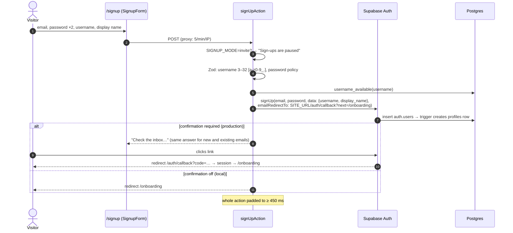

# Authentication and security

This guide explains how identity, sessions and authorization work end to end. The threat model,
the full control-by-control table and **how to report a vulnerability** are in the repository's
[SECURITY.md](../SECURITY.md); this page links to it rather than repeating it.

## Authentication flows

Diskarte uses Supabase Auth (email + password, optional GitHub / Google / Discord OAuth, TOTP
two-factor). All auth forms are Server Actions in
[`app/(auth)/actions.ts`](../diskarte/src/app/(auth)/actions.ts).

### Registration and email verification

**Password policy**: 10–72 bytes with lowercase, uppercase, digit and symbol
([`passwordSchema`](../diskarte/src/lib/schemas/profile.ts)); the live checklist on the form shows the
same rules, and Supabase Auth should be configured identically. Sign-in only checks the *shape* of
the input, never reveals the policy, and returns one message for unknown email and wrong password.

**Verified accounts** have a confirmed email or phone (`is_verified_user()`). Channels can require
verification to post; push and voice previews respect the same gate.

**Onboarding** (`/onboarding`): the profile builder sets avatar (salakot preset or upload), banner,
bio and status and flips `profiles.onboarded`. The `(app)` layout redirects un-onboarded accounts
there.

### Sign-in

- Password: `signInAction` → `supabase.auth.signInWithPassword` → redirect to `next` (validated by
  `safeRedirectPath`, same-site paths only).
- OAuth: `signInWithProviderAction` only accepts providers listed in `AUTH_OAUTH_PROVIDERS`, starts a
  **PKCE** flow (verifier in a cookie) and returns through `/auth/callback`, which exchanges the code.
- Accounts carrying `user_metadata.must_change_password` (created with a temporary password) are
  sent to `/reset-password?first=1` from the proxy, the login action and every protected render.

### Two-factor authentication (TOTP)

Settings → Account → Two-factor ([`TwoFactorSettings`](../diskarte/src/components/profile/TwoFactorSettings.tsx))
enrols an authenticator app with `supabase.auth.mfa.enroll`, verifies the first code and can unenrol
after re-verifying. Once an account has a **verified factor**, an `aal1` session is useless until the
second step:

| Layer | Enforcement |
| --- | --- |
| Pages | `requireProfile()` → `needsSecondFactor()` → `/mfa?next=…` ([`MfaChallenge`](../diskarte/src/components/auth/MfaChallenge.tsx)) |
| PostgREST (tables and RPCs) | `pgrst.db_pre_request = 'public.mfa_pre_request'` refuses every request from such sessions |
| Storage and Realtime | Restrictive policies `two-factor sessions only` using `mfa_ok()` |
| Push, voice preview, account deletion | Explicit `needsSecondFactor()` / `mfa_ok()` checks |

`mfa_ok()` is true when the JWT's `aal` is `aal2` **or** the account has no verified factor. The Auth
API itself (where the code is verified) is unaffected
([`20261013160000_mfa_enforcement.sql`](../supabase/migrations/20261013160000_mfa_enforcement.sql)).

### Password recovery

`/forgot-password` → `requestPasswordResetAction` (always answers "If an account exists…") →
Supabase emails a link to `/auth/callback?next=/reset-password` → recovery session →
[`/reset-password`](../diskarte/src/app/reset-password/page.tsx) → `changePasswordAction`.

### Sessions

| Aspect | Behaviour |
| --- | --- |
| Storage | `@supabase/ssr` cookies: host-only, `Path=/`, `SameSite=Lax`, `Secure` on HTTPS, **not HttpOnly** (the browser client needs the token for Realtime, Storage and direct queries; see SECURITY.md trade-offs) |
| Refresh | `proxy.ts` refreshes on every request; `getClaims()` verifies the JWT signature |
| Server checks | Pages and actions call `getUser()` (round-trip to Auth), which catches revoked sessions |
| Revoked / banned / deleted | Protected renders redirect to `/auth/revoked`, which clears the cookie and shows "Your session ended" |
| Sign out | This device (`scope: local`) or every device (`scope: global`, revokes all refresh tokens). Also removes this device's push registration and Control Center device record, and clears this browser's message outbox |
| Device heartbeat | `SessionGuard` sends `heartbeat_device()`; banned accounts are signed out within seconds via `db:account:<me>` |

## Authorization summary

| Resource | Rule (enforced in Postgres) |
| --- | --- |
| Tambayan content | Members only (`is_server_member`) |
| Private channels | Admins plus users/roles with a `channel_access` grant (`can_view_channel`); applies to messages, events in that channel, search, Realtime topics, push and workspace documents |
| Moderation | Rank hierarchy `member < moderator < admin`, owner above all; you can only act on members below you |
| DMs | Participants only. Starting a 1:1 DM requires an accepted friendship and no block in either direction; blocking ends the conversation for both |
| Friend requests | Recipient's `privacy_settings`: everyone, people who share a server (Diskarte HQ doesn't count), or nobody |
| Platform administration | `is_super_admin()` in the proxy, the page, the action and every `admin_*` RPC |
| Banned accounts | Restrictive RLS blocks posting messages and DMs even with a still-valid access token |

Details and the evaluation order: [database.md → Permission model](database.md#permission-model).

## Request security

| Control | Implementation |
| --- | --- |
| CSP | Per-request nonce + `strict-dynamic` scripts; `connect-src` limited to self, Supabase and LiveKit (both http(s) and ws(s)); `img-src` self, Supabase, OAuth avatar CDNs, GIPHY; `frame-src` only `youtube-nocookie.com`; `frame-ancestors 'none'`; `upgrade-insecure-requests` on HTTPS ([`buildCsp`](../diskarte/src/lib/security.ts)) |
| Static headers | HSTS (2 years, preload), `X-Frame-Options: DENY`, `nosniff`, strict referrer, COOP `same-origin`, Permissions-Policy (camera/mic/display-capture self only) ([`next.config.ts`](../diskarte/next.config.ts)) |
| CSRF | Same-origin `Origin`/`Referer` required for non-safe `/api/*`; Next.js Origin check for Server Actions; `SameSite=Lax` cookies |
| CORS | Only `SITE_URL` + `ALLOWED_ORIGINS` |
| Open redirects | `safeRedirectPath()` on every `next` parameter |
| Canonical host | Pages on any other host 308 to `SITE_URL` (cookies, OAuth and CSRF line up) |
| Rate limits | See [API reference → Conventions](reference/api.md#conventions) |
| XSS | Markdown without raw HTML (HTML becomes literal text), protocol allow-listed links, no remote images in messages, React escaping ([`MessageMarkdown.tsx`](../diskarte/src/components/chat/MessageMarkdown.tsx)) |
| SSRF | Link previews fetch only public addresses on default ports, verified at connect time and on every redirect, 512 KB / 5 s caps ([`lib/ssrf.ts`](../diskarte/src/lib/ssrf.ts)); preview images go through an HMAC-signed same-origin proxy with a sandbox CSP |

## Integration secrets

| Secret | Protects | Notes |
| --- | --- | --- |
| `LIVEKIT_API_SECRET` | Room tokens, webhook verification, preview-image HMAC (domain-separated key) | Server only (`server-only` import guard + a test that fails if client modules reference secrets) |
| `SUPABASE_SERVICE_ROLE_KEY` | LiveKit webhook broadcast, push dispatcher, admin grant script | Never used for user requests |
| Channel webhook tokens | `POST /api/webhooks/<id>/<token>` | 48 hex chars, shown once, stored as a hash; rotate in Server settings if leaked; anon-only RPC; 30/min per webhook |
| `PUSH_DISPATCH_SECRET` | `/api/push/dispatch` | ≥ 32 chars, constant-time compare, must match Vault `diskarte_push_secret` |
| VAPID private key | Push message signing | Keep stable; rotating forces every device to re-subscribe |

**Secret management rules:** keep secrets in the hosting provider's environment settings and
Supabase Vault; never in git, logs, screenshots, issue trackers or `NEXT_PUBLIC_*` variables.
Rotate LiveKit keys from LiveKit Cloud and Supabase keys from the dashboard if exposed, then update
the host and redeploy.

## File uploads

Attachments are validated in four places (browser magic bytes, Server Action Zod schema, the
message trigger and the Storage bucket + policy), stored privately, and served by short-lived signed
URLs from Supabase's origin so uploaded content never runs on Diskarte's origin. Limits and paths:
[database.md → Storage buckets](database.md#storage-buckets).

## Privacy features

| Feature | Where |
| --- | --- |
| Data export ("Request all of my data") | Settings → Data; `export_my_data()` returns one JSON file of everything the account wrote or set, including later additions (favourites, scheduled messages, moments, XP) |
| Account deletion | Settings → Danger zone; type your username; files removed first, then `delete_my_account()` (see [database.md](database.md#account-deletion-and-export)) |
| Friend request policy | Settings → Privacy |
| Push previews | Off by default (generic lock-screen text) |
| Diagnostics | Session-only, no content/ids/tokens; no third-party error reporting is configured |
| Analytics | Vercel Analytics page views; first-party visit count stores a random browser id, no IP or user id |

## Security testing

The security-relevant suites are listed in [SECURITY.md → Security testing](../SECURITY.md#security-testing)
and in [testing.md](testing.md). Run them all with `npm test` from the repository root. When adding a
table, policy or definer function, add a PGlite test that attacks it as a non-member, a member and a
lower-ranked moderator (see [contributing/database-migrations.md](contributing/database-migrations.md)).

## Public repository review (2026-11-07)

The GitHub repository is public, so everything committed — including Markdown that the Help Center
doesn't publish — is readable by anyone. A review of tracked files and history found:

| Finding | Severity | Status |
| --- | --- | --- |
| No credentials, keys, tokens, connection strings or `.env` files in tracked files or git history (pattern scan for JWTs, cloud keys, private keys and `*_KEY=` values) | — | `.env*` is ignored except `.env.example`; keep it that way |
| Operational runbooks (`docs/operations/*`, `diskarte/docs/web-push.md`, `docs/sql/*`) describe procedures, job names, Vault secret *names* and endpoint paths, but no secret values or private hosts | Low | Acceptable: every privileged path is authenticated by a secret or the service role. Never add values, project refs or customer data to these files |
| `20261005000000_super_server.sql` seeds the owner's production account UUID and handle as the Diskarte HQ creator | Low | A UUID isn't a credential and grants nothing by itself; future seeds should be applied by hand rather than committed |
| Commit metadata carries the author's personal email | Info | Consider GitHub's no-reply address for future commits |
| Unpublished docs are excluded from the Help Center and its search by an allow-list | — | Preserved (`docs/site.json`); this is about discoverability, not secrecy |

If material ever needs to be genuinely private (incident write-ups with user data, vendor contracts,
real infrastructure identifiers), keep it out of this repository — in a private repository or the
hosting providers' own access-controlled settings — rather than relying on the Help Center allow-list.

