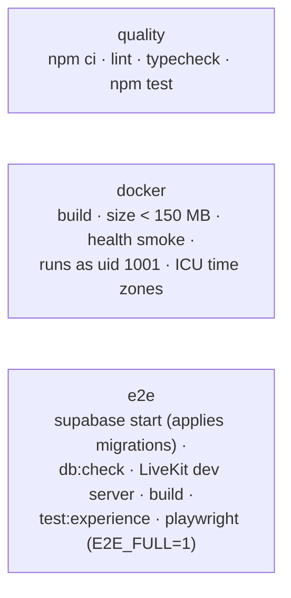

# Testing

## Philosophy

- **Test the rule where it lives.** Authorization is in Postgres, so it is tested against the real
  migrations (in PGlite), as different users — not by mocking Supabase.
- **Fast and hermetic by default.** `npm test` needs no Docker, network or credentials. Anything that
  needs live Supabase/LiveKit runs in CI's Playwright job.
- **Evidence, not certification.** Browser suites use Chromium emulation; physical phones, Safari and
  real camera/microphone hardware are not covered automatically (see [known limitations](known-limitations.md)).

## Test layers

| Layer | Tooling | Location | Runs |
| --- | --- | --- | --- |
| Unit (pure logic) | Vitest | `src/**/__tests__`, `tests/{security,deploy,community,…}` | `npm test` |
| Component / hook | Vitest + Testing Library + jsdom | `src/components/**/__tests__`, `tests/ui`, `tests/workspace`, `tests/components` | `npm test` |
| Route handlers | Vitest, handlers imported directly | `src/app/api/**/__tests__`, `tests/security/*-routes.test.ts` | `npm test` |
| **Database / RLS** | Vitest + PGlite (Postgres compiled to WASM) | `tests/db/*.test.ts` (one file per feature) | `npm test` |
| Accessibility (components) | axe-core in jsdom | `tests/a11y/axe.test.tsx` | `npm test` |
| Performance (virtualization) | Vitest | `tests/performance/virtualization.test.tsx` | `npm test` |
| Documentation | Vitest | `tests/docs/docs.test.ts`, `tests/docs/search.test.ts` | `npm test` |
| Responsive component browser | Playwright + Vite, real components with fixture data | `tests/browser/experience.spec.ts` | `npm run test:experience` |
| End to end | Playwright against the production standalone build | `e2e/*.spec.ts` | `npm run test:e2e` |

All commands run inside `diskarte/` (or from the root with `--prefix diskarte`).

## Commands

```bash
cd diskarte
npm test                          # everything Vitest: unit, component, route, PGlite RLS, docs (~160 files)
npx vitest run tests/db/messages  # one file or pattern
npm run test:watch                # watch mode
npm run lint                      # ESLint (Next.js + React Compiler rules)
npm run typecheck                 # next typegen + tsc --noEmit
npm run build                     # production build (also required before local E2E)
npm run test:experience           # responsive component browser suite (needs Chromium)
npm run test:e2e                  # Playwright; journeys skip unless E2E_FULL=1
npm run db:check                  # read-only check that a Supabase project has the expected objects
npm run docs:db                   # regenerate docs/reference/database.md
```

Install the browser once: `npx playwright install chromium`.

## Database / RLS tests

[`tests/db/harness.ts`](../diskarte/tests/db/harness.ts) boots a fresh PGlite instance, applies
[`supabase-shim.sql`](../diskarte/tests/db/supabase-shim.sql) (minimal `auth`, `storage`, `realtime`
schemas, the `anon`/`authenticated`/`service_role` roles, `auth.uid()`/`auth.jwt()` and Supabase's
default privileges) and then **every migration, unmodified, in order**.

```ts
// @vitest-environment node
import { beforeAll, describe, expect, it } from "vitest";
import { asUser, createDb, failure, one, signUp, type Db } from "./harness";

let db: Db;
let owner: string;
let outsider: string;
let general: string;

beforeAll(async () => {
  db = await createDb();
  owner = await signUp(db, "owner@diskarte.ph", { username: "kapitan" });
  outsider = await signUp(db, "out@diskarte.ph", { username: "outsider" });
  await asUser(db, owner);
  const serverId = (await one<{ id: string }>(db, "select public.create_server('Barkada', '') as id")).id;
  general = (await one<{ id: string }>(db, "select id from public.channels where server_id = $1 and type = 'text' order by position limit 1", [serverId])).id;
}, 60_000);

describe("scheduled messages", () => {
  it("refuses scheduling into a channel you can't see", async () => {
    await asUser(db, outsider);
    expect(await failure(db, "insert into public.scheduled_messages (channel_id, content, send_at) values ($1, 'hi', now() + interval '1 hour')", [general])).toBeTruthy();
  });
});
```

Helpers: `signUp()` inserts an `auth.users` row (firing the profile trigger), `asUser()` sets
`request.jwt.claim.sub` and `role authenticated`, `asAnon()`, `asService()`, `rows()`, `one()` and
`failure()` (returns the Postgres error message or `null`).

Things the shim does **not** emulate: PostgREST itself (pre-request hooks are called directly in
tests), Realtime delivery, Storage object bytes, `pg_cron`, `pg_net` and Vault. Push installer SQL is
exercised with stand-ins in `tests/db/push-deployment.test.ts`.

Gotchas:

- Auto-mod drops repeated identical messages — give each test message distinct content.
- Each test file creates its own database; keep fixtures inside the file.
- To check a function's *current* definition after many migrations, query the catalog
  (`pg_get_functiondef`) rather than grepping migration files.

## Component and hook tests

[`tests/setup.ts`](../diskarte/tests/setup.ts) registers global mocks so components render in jsdom:

| Mock | Replaces |
| --- | --- |
| [`mocks/livekit.ts`](../diskarte/tests/mocks/livekit.ts) | `livekit-client`'s `Room` and the LiveKit React hooks (tracks, speaking, participants driven by `livekitMock`) |
| [`mocks/navigation.ts`](../diskarte/tests/mocks/navigation.ts) | `next/navigation` (router, params, pathname) and `next/link` |
| [`mocks/audio.ts`](../diskarte/tests/mocks/audio.ts) | `AudioContext` for the 8-bit sound effects |
| [`mocks/actions.ts`](../diskarte/tests/mocks/actions.ts) | Server Actions |
| [`fixtures/fake-supabase.ts`](../diskarte/tests/fixtures/fake-supabase.ts) | A fake Supabase client with tables, RPCs and a Realtime emitter (`order()` is numeric-aware) |
| [`fixtures/server.tsx`](../diskarte/tests/fixtures/server.tsx), [`fixtures/layout.tsx`](../diskarte/tests/fixtures/layout.tsx) | Ready-made server/member/channel contexts and a full signed-in layout |
| [`stubs/server-only.ts`](../diskarte/tests/stubs/server-only.ts) | The `server-only` import guard (aliased in `vitest.config.mts`) |

jsdom has a `window`, so it **cannot catch SSR crashes** from code touching `window` during render.
[`tests/components/visit-beacon-ssr.test.tsx`](../diskarte/tests/components/visit-beacon-ssr.test.tsx)
renders with `renderToString` for that reason; do the same for anything added to the root layout.

## End-to-end tests

[`playwright.config.ts`](../diskarte/playwright.config.ts) starts `npm run start:standalone` (the last
`.next/standalone` build — **run `npm run build` first** or you test stale code), uses Chromium with
fake media devices, reduced motion, one worker locally (two in CI) and one retry in CI.

| Spec | Needs backend | Covers |
| --- | --- | --- |
| `smoke.spec.ts` | no | Landing, auth pages, CSP and security headers, 429 on auth brute force, API session gate, foreign-origin preflight |
| `public-auth.spec.ts`, `landing-experience.spec.ts`, `appearance.spec.ts`, `pwa.spec.ts` | no | Validation, navigation, reduced motion, themes, service worker caching and push dedupe |
| `auth-profile.spec.ts` | yes | Sign-up, onboarding, profile editing |
| `server-chat.spec.ts` | yes | Create a Tambayan, channels, two-user messaging |
| `community.spec.ts` | yes | Moderation, LFG, soundboard and community flows |
| `events.spec.ts` | yes | Event scheduling and RSVPs |
| `sync-workspace.spec.ts` | yes | Account sync and shared workspace conflicts |
| `notifications.spec.ts` | yes | Unreads, notification settings |
| `layout.spec.ts`, `mobile.spec.ts` | yes | Desktop columns/floating panels, phone navigation, 44 px tap targets, keyboard viewport |
| `voice.spec.ts` | yes | Two-person voice call with live preview |
| `admin.spec.ts` | yes | Control Center: non-admin refusal, sticky broadcast reaching another canvas, role change, ban |
| `a11y.spec.ts` | yes | axe-core audits of signed-in screens |
| `docs.spec.ts` | no | Help Center: home, navigation, search, copy buttons, diagrams, colour modes, 320–768 px layouts, internal pages not published, axe in dark and light |

Journeys are skipped unless `E2E_FULL=1`. Locally that requires Docker for `npx supabase start` and a
LiveKit dev server; without them, run the smoke specs:

```bash
npm run build
set -a; source .env.local; set +a; unset RATE_LIMIT_AUTH_PER_MINUTE
SITE_URL=http://localhost:3997 E2E_PORT=3997 npx playwright test e2e/smoke.spec.ts
```

`SITE_URL` must match the port or the CSRF check returns 403; leaving a low auth rate limit makes
the brute-force smoke test (which expects a 429) interact with other sign-in tests.

## Continuous integration

[`.github/workflows/ci.yml`](../.github/workflows/ci.yml) runs on pull requests, pushes to `main` and
manual dispatch (feature-branch pushes alone don't trigger it):



The three jobs run in parallel. The Supabase CLI is pinned (`supabase@2.122.1`) so a new CLI major
release can't break the E2E job; bump it deliberately and check `supabase/config.toml` still loads. On failure, the Playwright report and traces are uploaded as the
`playwright-report` artifact for 7 days. No repository secrets are needed: CI uses a throwaway local
Supabase stack and LiveKit's dev keys. Polling CI without the GitHub CLI:
`https://api.github.com/repos/xndrncp08/Diskarte/actions/runs`.

## Adding tests

| You changed… | Add |
| --- | --- |
| A migration (table, policy, trigger, RPC) | A `tests/db/<feature>.test.ts` case per role: outsider, member, the role just below the one allowed, the allowed role. Assert the error code, not just "fails" |
| A Server Action or route handler | A unit test with the Supabase client mocked at the module boundary, covering auth, validation and each error mapping |
| A hook with realtime behaviour | A test driving `fake-supabase`'s emitter: duplicates, out-of-order events, reconnect |
| A component | Testing Library by role/label; add it to `tests/a11y/axe.test.tsx` if it's a new surface |
| Something rendered in the root layout | An SSR `renderToString` test |
| A user journey | An `e2e/*.spec.ts` gated on `FULL` if it needs the backend |

## Known coverage gaps

- No automated tests on physical iOS/Android devices, Safari/WebKit or Firefox.
- No load or soak testing; performance evidence is limited to virtualization tests and one-off
  bundle/LCP measurements in [`diskarte/docs/platform-experience.md`](../diskarte/docs/platform-experience.md).
- Web Push is verified up to the browser's push event; delivery through Apple/Google/Mozilla push
  services is not.
- `pg_cron` jobs are tested by calling their functions, not by the scheduler.
- Production LiveKit webhooks and OAuth providers are not exercised in CI.
