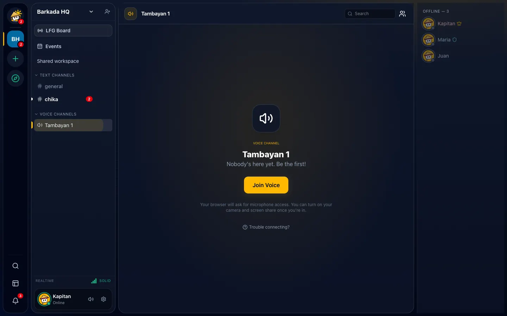

# Calls

## Join a voice channel

1. Click a channel with the speaker icon. You'll see who's inside.
2. Click **Join**. Allow microphone access the first time.
3. You stay in the call while you look at other channels, other Tambayans or your DMs.

*Sample data.*

Hover a Tambayan's icon (or long-press it and choose **Voice activity**) to see who's talking before
you join.

**Leave** with **Disconnect** in the "Voice Connected" panel (bottom left) or the call strip on phones.

## Call a friend

Open a DM or group DM and press the call button. Everyone else in the conversation sees a ringing
pop-up for 45 seconds and can accept or decline.

## During a call

| Button | What it does |
| --- | --- |
| Mic | Mute / unmute |
| Headphones | Deafen (you hear nothing and can't talk) |
| Camera | Turn your video on/off |
| Screen | Share your screen or a window/tab (with sound if your browser allows). Click a shared screen to watch it; use **focus mode** for full screen |
| Mixer | Change the volume of each person, mute someone just for you, or stop seeing their video |
| Soundboard | Play a short sound everyone hears |
| Activities | Watch YouTube together, play Tic-Tac-Toe or Pinoy Trivia |

The signal bars show your connection quality; tap them for details.

**Settings → Voice & Video** lets you choose your microphone and speakers, test your mic, pick a noise
setting (Isolation for noisy places, Studio for good mics) and turn on **push to talk** (hold a key
to speak).

## Tips for weak connections

- Turn on **Low-data mode** (Settings → Storage & Data): video uses less data.
- Turn your camera off; audio uses very little data.
- If the page reloads during a call, Diskarte reconnects you automatically.
- No sound after reconnecting? Click the **turn on sound** button.

## Moderators

Right-click someone in a voice channel to mute, deafen, disconnect or move them to another channel.
