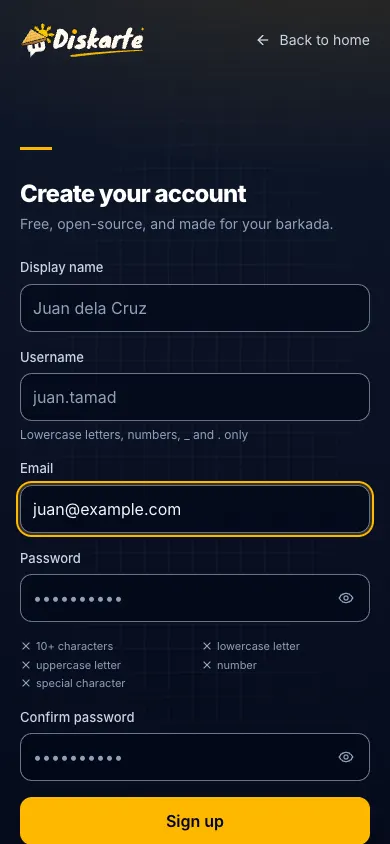
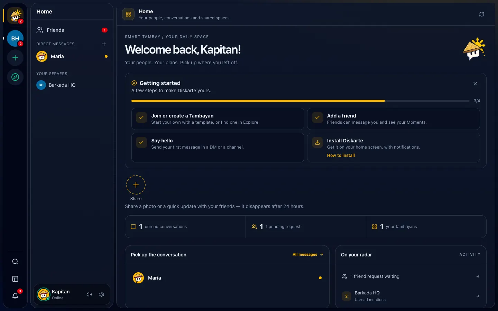

# Getting started

## Create your account

1. Go to the Diskarte website and choose **Sign up** (or continue with Google/GitHub if you see those
   buttons).
2. Enter your email, a **username** (3–32 lowercase letters, numbers, `_` or `.` — people add you
   with it, like `@juan.dc`), a display name, and a password.
3. Your password needs at least **10 characters** with an uppercase letter, a lowercase letter, a
   number and a symbol. The checklist under the box turns green as you go.
4. Check your email and tap the confirmation link (if you don't see it, look in Spam).
5. Set up your profile: pick a salakot avatar colour or upload a photo, add a banner and a short bio.

You're now in Diskarte and already a member of **Diskarte HQ**. Home shows a short **Getting
started** checklist — join or create a Tambayan, add a friend, say hello, install the app — that ticks
itself off as you go. Hide it anytime with the ✕.

*Sample data.*

> If sign-up says registrations are paused, the community running this Diskarte only accepts invited
> members for now.

**Forgot your password?** On the sign-in page choose **Forgot your password?**, enter your email, and follow
the link we send.

## Install Diskarte on your phone

Diskarte is a web app you can install — no app store needed. Installing gives you a home-screen icon,
a full-screen app and (on iPhone) notifications.

**iPhone or iPad (iOS 16.4 or newer)**

1. Open Diskarte in **Safari**.
2. Tap the **Share** button (square with an arrow).
3. Choose **Add to Home Screen**, then **Add**.
4. Open Diskarte from your home screen. To get notifications, go to Settings → Notifications and turn
   them on for this device.

**Android (Chrome)**

1. Open Diskarte in Chrome.
2. Tap the **⋮** menu → **Install app** (or **Add to Home screen**).
3. Open it from your home screen or app drawer.

**Computer (Chrome or Edge)** — click the install icon in the address bar, or Settings → **Storage &
Data** → **Install Diskarte**.

**Updating:** when a new version is ready, Settings → Storage & Data shows **Reload to update**.
Finish any call first.

## Customize your profile

Open **User settings** (gear next to your name, bottom left; on phones, the **Profile** tab):

- **My Profile** — avatar, banner, display name, bio.
- **Status** — click your avatar in the bottom-left panel to set Online, Idle, Do Not Disturb or
  Invisible, or pick a fun status like *Nagluto ng Canton* or *Nasa jeep, mahina signal*. Choose
  **Clear after** 30 minutes, 1 hour, 4 hours or 24 hours so you don't forget it.
- **Appearance** — themes (Solar, Bayan, Neon, Ube, Sampaguita, Kalikasan) and dark, light or system
  mode.
- **Language & Region** — English or Filipino menus, and your time zone.

## Find your way around

| On a computer | On a phone |
| --- | --- |
| Left edge: your Tambayans. Next column: channels or your DMs. Middle: the conversation. Right: members | Bottom tabs: **Home**, **Messages**, **Explore**, **Profile**. Swipe from the left edge to open channels |
| **Ctrl + K** (Windows) or **⌘ K** (Mac) jumps to any channel or conversation | Tap a conversation to open it full screen |

*Sample data.*

**What's new:** after an update, Home shows a short summary until you've seen it, and the full post
is in Diskarte HQ's `#announcements` channel (marked **Official**).

**Slow or expensive internet?** Settings → Storage & Data → **Low-data mode** loads smaller images,
stops GIFs from autoplaying and lowers video quality.
