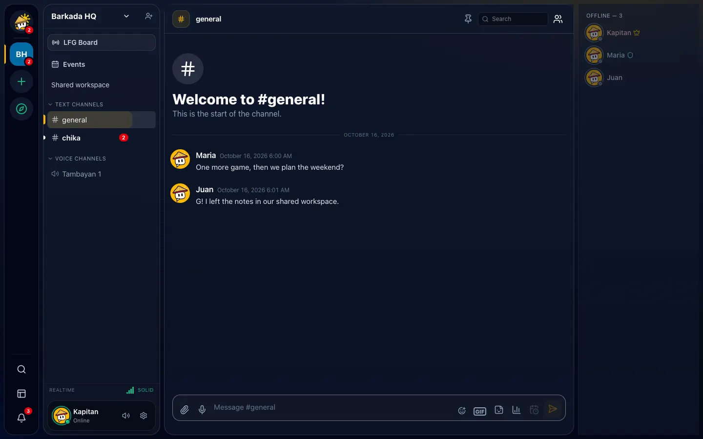
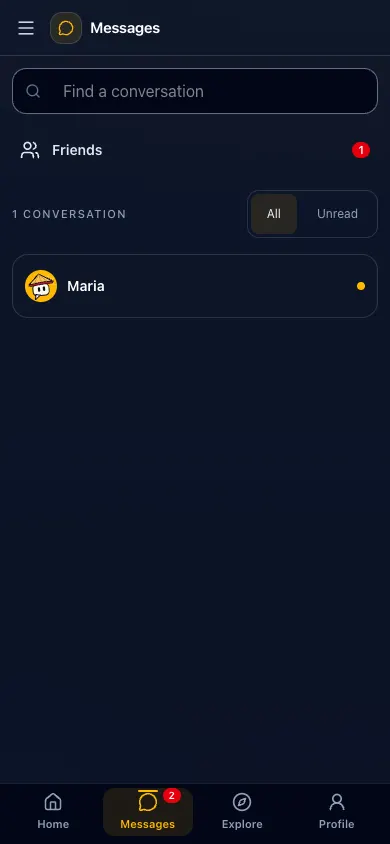

# Messages

## Send a message

Type in the box at the bottom and press **Enter**. **Shift + Enter** starts a new line.


*Sample data.*

- **Mention** someone with `@username`. Moderators can use `@everyone`, `@here` or a role.
- **Format** text with Markdown: `**bold**`, `*italic*`, `` `code` ``, ```` ``` ```` for code blocks,
  `||spoiler||` to hide something until clicked.
- **Attach** photos, videos, MP3s (up to 10 files, 10 MB each) with the paperclip.
- **Voice message**: tap **Record a voice message** (mic button) and record up to 5 minutes.
- **Stickers and GIFs**: open the sticker or GIF picker; picking one sends it right away.
- **Polls**: ask a question with 2–10 answers, open for an hour up to a week.
- **Shortcuts**: start a message with `/shrug`, `/tableflip`, `/unflip`, `/me` or `/spoiler`
  (press Tab to complete).

Links show a preview card. To hide a preview, wrap the link in `<` and `>`.

**No signal?** Keep typing and sending — messages wait in a queue (you'll see an 8-bit "offline" bar)
and send automatically when you're back online. If one fails, tap **Retry**.

**Why didn't my message send?**

| You see | Why |
| --- | --- |
| "Slow mode — you can send again in …" | The channel limits how often people post |
| "Accept this server's rules first" | Open the rules card above the message box and accept |
| "You're sending too fast" | Wait a few seconds |
| A lock instead of the message box | You're timed out, or only moderators can post here |
| The message vanished | Auto-moderation blocked it (spam, scam link or blocked word) |

## Reply, react and more

Hover a message (long-press on phones) for actions:

- **Reply** (or swipe right on a phone).
- **React** with Pinoy reactions like *petmalu*, *lodi*, *sana all*, or the Tambayan's custom emoji.
- **Start thread** to move a side discussion into its own panel.
- **Edit** or **Delete** your own messages. Edited messages show "(edited)"; you and moderators can
  see the earlier versions.
- **Pin** (moderators) — see all pins from the pin icon in the channel header.
- **Save Message** to bookmark it for yourself.
- **Forward** to another channel or a DM.
- **Mark Unread** to come back later.

## Forum channels

Each new post needs a title. Replies go inside the post. Pinned posts stay on top, then the most
active ones.

- **Tags:** pick up to 5 of the forum's tags when you post, or open your post to change them. Tap a
  tag above the list to show only those posts.
- **Solved:** open your question and tap **Mark solved** once it's answered.
- **Suggestion boards:** some forums collect ideas. Tap the arrow to upvote (tap again to take it
  back), use **Top** to see the most wanted ideas, and watch for the status a moderator sets:
  Under consideration, Planned, In progress, Completed or Declined.
- **Moderators:** the ⚙ button sets the forum's kind and its tags.

## Remind me

Right-click (long-press on phones) any message → **Remind me…** → pick a time. Diskarte saves the
message and pops up a reminder with an **Open** button when it's time. Reminders show while Diskarte
is open; if it's closed, you'll see it next time you open the app. Find pending reminders under
**Notifications → Saved**.

## Schedule a message

In a text channel, open **Schedule message** next to the send button, write the message and pick a
time up to 30 days ahead (you can have 25 waiting). Open **Scheduled messages** to see, cancel or
check failed ones. A scheduled message posts as you, following the channel's rules; if it can't
(for example you were timed out), it stays in the list with the reason. Scheduling isn't available in
DMs.

## Search

- **In a Tambayan**: use the search box in the channel header. Add `from:username` or `in:channel` to
  narrow it down.
- **Everywhere**: the **Search** page searches every Tambayan and DM you can read, with filters for
  sender, dates and media type.

Click a result to jump to that exact message.

## Direct messages

- Add friends first: **Friends** → **Add Friend** → their `@username`.
- Message a friend from their profile or the **Messages** tab. Start a **group DM** with up to 9
  friends.
- Under your latest message you'll see **Sent** or **Seen**.
- Right-click a DM to mark it read, see the person's options, or leave a group.

## Hangouts

A Hangout is a quick, temporary space for you and up to 9 friends — chat plus a call — that
cleans itself up afterwards.

1. On **Home**, tap **Start a Hangout** (or the ✦ next to a friend who's around).
2. Pick what it's for, who's coming and how long (1, 3 or 8 hours).
3. Leave **Jump into voice** on to join the call right away and ring everyone.

Anyone in it can add an hour. The host can **Keep** it (it becomes a normal group chat), **Make it
a Tambayan** (everyone gets an invite), or **End** it. When the time runs out, the hangout and its
messages are deleted. Files can't be shared in a hangout until it's kept.


*Sample data.*

## Unread messages

A white dot means new messages; a red number means someone mentioned you. Right-click a Tambayan →
**Mark As Read**, or use **Mark all as read** in your inbox.
